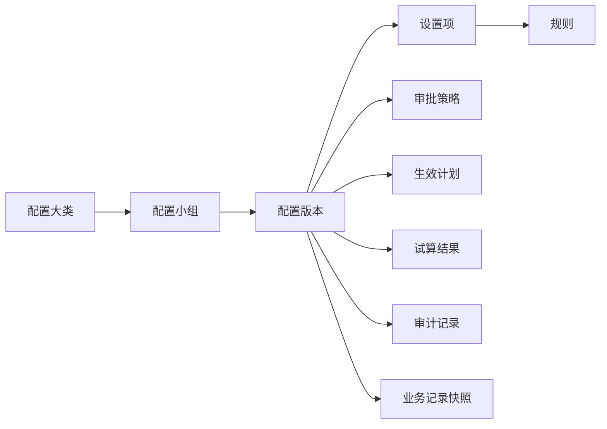

# 业务配置页面信息架构与字段控制规范

版本：v0.3  
日期：2026-11-08  
状态：开发规格底稿，待评审  
适用范围：管理端页面、Mock、前端页面、后端 API、配置数据模型和 QA 验收  
页面入口：`affiliate-mock-site/admin-dev.html#/admin-config/overview`

## 1. 文档摘要

| 项目 | 结论 |
| --- | --- |
| 这份文档解决什么问题 | 统一业务配置页面的菜单、版本、字段、权限、校验、审批、生效和审计规则 |
| 设计对象 | 业务配置中心，不是风险案件、佣金记录、结算单、提现订单或报表结果页面 |
| 业务配置 | 会改变资格、佣金、归属、风险、结算中、结算、保证金、税费、审批或数据授权结果的配置 |
| 系统配置 | 只改变平台运行、连接、展示、通知基础设施或技术频控的配置，单独进入系统配置页面 |
| 版本模型 | 每个业务配置小组独立维护版本；生效后自动锁定，只能复制或创建回退草稿 |
| 未确认参数 | 统一标记为“参考值”“待评审”“待技术核验”或“仅 Mock 演示”，不能写成生产默认值 |
| 风险与信用 | `R0-R3` 是即时风险档；`C0-C4` 是合作者信用等级，必须分开配置、计算、审计和快照 |
| 页面术语 | 页面统一使用“结算中”；技术字段可继续使用 `hold`，但不作为主要用户可见文案 |
| 外部事实源 | CRM、支付、IMC 等系统提供的事实只能引用，不能在 Affiliate 配置中心重复编辑 |

这份文档脱离当前 Mock 的实现限制，描述理想的页面和字段控制方案。v0.1 仍保留为当前 Mock 现状盘点，用于核对实现差异，不作为本版设计的唯一边界。

## 2. 设计边界与唯一事实源

### 2.1 配置中心不承载运行数据

以下对象不是配置，必须在对应业务页面或处理中心查看：

| 对象 | 正确承载位置 | 原因 |
| --- | --- | --- |
| 客户、合作者、KYC/KYB、欺诈结论 | CRM 或集成任务 | CRM 是事实源，Affiliate 只读引用 |
| 风险事件、风险案件、调查、隔离、申诉 | 风险识别与处理中心 | 这是规则执行后的运行对象 |
| 佣金记录、结算单、提现订单、保证金流水 | 资金与账务模块 | 这是账务事实和资金状态 |
| 集群成员、设备/IP/支付工具关系 | 集群识别中心 | 这是识别结果，不是识别规则 |
| 报表、指标和对账差异 | 报表与对账中心 | 这是统计结果或运行结果 |
| 通知发送记录和失败任务 | 通知中心、任务中心 | 模板是配置，发送记录是运行数据 |

### 2.2 业务配置与系统配置边界

| 判断问题 | 业务配置 | 系统配置 |
| --- | --- | --- |
| 是否改变佣金、结算、提现、保证金或税费结果 | 是 | 否 |
| 是否改变资格、归属、归因、风险门禁、审批结论或权益 | 是 | 否 |
| 是否需要试算、定时生效、回退或历史快照 | 是 | 否 |
| 是否只改变连接、队列、日志、展示、技术超时或运维开关 | 否 | 是 |
| 是否由外部系统提供事实 | 不编辑，只引用 | 不编辑，只引用 |

如果一个配置同时满足两类条件，必须拆成两个唯一配置项。例如：

- `postback_business_event`：业务事件和失败后的业务处置，进入业务版本。
- `postback_http_timeout_ms`：HTTP 技术超时，进入系统配置。

一个配置键只能有一个可编辑事实源。页面可以引用另一类配置，但不能复制出第二份可编辑值。

### 2.3 风险档与信用等级

| 体系 | 代码 | 对象 | 计算性质 | 主要作用 |
| --- | --- | --- | --- | --- |
| 即时风险档 | `R0-R3` | 客户、风险事件、佣金案件和关联对象 | 根据近期风险事件即时计算 | 结算中附加、人工复核、结算门禁、冻结、通知 |
| 合作者信用等级 | `C0-C4` | 合作者 | 根据长期信用积分、滚动窗口和已确认传导规则计算 | 结算资格、保证金、额度、权益和复核优先级 |

硬规则和 CRM 确权事实不依赖风险分，命中后直接按硬规则处置。风险事件可以通过明确的传导规则影响合作者信用，但不能把 `R3` 直接写入信用等级字段。

## 3. 配置对象模型

### 3.1 对象定义

| 对象 | 技术标识 | 定义 | 是否可直接编辑 |
| --- | --- | --- | --- |
| 配置大类 | `config_domain` | 奖励、结算、风控、资金、流程治理等页面分组 | 否，由产品维护 |
| 配置小组 | `config_subgroup` | 可以独立查看、编辑、校验、审批和生效的最小业务单元 | 否，由页面路由维护 |
| 配置版本 | `config_version` | 某个小组在某一时点的完整参数快照 | 草稿可编辑 |
| 设置项 | `config_setting` | 版本内的单个字段或字段组 | 草稿可编辑 |
| 规则 | `config_rule` | 带条件、证据、动作和优先级的设置项集合 | 草稿可编辑 |
| 版本快照 | `config_snapshot` | 业务记录命中版本时保存的不可变副本 | 否 |
| 审批策略 | `approval_policy` | 是否审批、审批人、复核人、SLA 和超时处理 | 通过版本配置 |
| 审计记录 | `audit_record` | 查看、修改、试算、审批、生效和失败的操作记录 | 追加，不更新 |

### 3.2 对象关系



### 3.3 业务记录快照规则

1. 佣金、结算、提现、保证金和税费案件生成时，保存命中的小组版本号和参数快照。
2. 后续配置版本生效，不回写已经生成的历史账务结果。
3. 重新计算只能通过明确的补算、冲正或人工修复流程执行，不能由页面静默回写。
4. 快照至少包含配置小组 ID、版本号、配置哈希、生效时间、命中时间和 TraceId。

## 4. 页面信息架构

### 4.1 总体布局

```text
固定深色管理端侧栏
  └─ 系统设置
       └─ 业务配置
            ├─ 配置总览
            ├─ 奖励
            ├─ 结算
            ├─ 风控
            └─ 流程与内容

右侧工作区
  ├─ 页面标题与说明
  ├─ 当前小组顶部 Tab
  ├─ 版本列表
  ├─ 选中版本的配置值区域
  └─ 固定底部操作区
```

### 4.2 左侧业务配置菜单

“配置总览”是首页入口，不计入五个业务大类。五个大类只负责收纳小组，不在一级菜单中展开 20 个小组。

| 大类 | 小组 | 路由 |
| --- | --- | --- |
| 配置总览 | 配置总览 | `#/admin-config/overview` |
| 奖励与资格 | 价格与佣金档 | `#/admin-config/price` |
| 奖励与资格 | 资格档与里程碑 | `#/admin-config/qualification` |
| 奖励与资格 | 质量服务规则 | `#/admin-config/quality-service` |
| 奖励与资格 | 归属与归因规则 | `#/admin-config/attribution` |
| 奖励与资格 | 信用等级与权益 | `#/admin-config/credit-benefit` |
| 奖励与资格 | 合作者等级与个人附加（P1） | `#/admin-config/partner-tier` |
| 奖励与资格 | 国家与主体 | `#/admin-config/country-entity` |
| 结算规则 | 动态结算中 | `#/admin-config/hold` |
| 结算规则 | D+N 与熔断护栏 | `#/admin-config/d-plus-n` |
| 结算与资金 | 保证金与税费 | `#/admin-config/guarantee-tax` |
| 结算与资金 | 结算与提现规则 | `#/admin-config/settlement-withdrawal` |
| 风控规则 | 集群识别与集群结算中 | `#/admin-config/cluster-rule` |
| 风控规则 | D1-D10 硬规则 | `#/admin-config/hard-rule` |
| 风控规则 | R0-R3 风险评分 | `#/admin-config/risk-score` |
| 风控规则 | 违规规则 | `#/admin-config/violation-rule` |
| 风控规则 | 合作者风险传导 | `#/admin-config/risk-propagation` |
| 流程与治理 | 审批流与自动审核 | `#/admin-config/approval` |
| 流程与治理 | 规则试算 | `#/admin-config/simulation` |
| 流程与治理 | 数据治理规则 | `#/admin-config/data-governance` |
| 流程与治理 | 官方路径与素材治理 | `#/admin-config/official-content` |

共 20 个配置小组，按 5 个大类收纳。系统配置独立于业务配置，不出现在业务版本列表和业务配置总览中。每个小组仍有自己的版本列表和配置详情页。

### 4.3 配置总览首页

总览的目标是先回答“每个业务配置项现在用哪个版本、是否有计划生效版本、最近谁改过”，不直接编辑参数。

页面区域：

1. 页面标题、说明和搜索。
2. 统计卡：当前生效配置、待处理版本、生效失败、本月有变更。
3. 筛选器：配置名称、业务分类、版本状态、责任角色、最近修改时间。
4. 配置项表格。
5. 查看详情抽屉和只读版本抽屉。

总览表格必须展示：

| 列 | 规则 |
| --- | --- |
| 配置项 | 人话名称、稳定编号 |
| 所属业务分类 | 奖励与资格、结算规则、结算与资金、风控规则、流程与治理 |
| 当前使用版本 | 唯一生效版本；无版本显示“未配置” |
| 当前参数摘要 | 只读摘要，不替代完整详情 |
| 定时生效版本 | 无则显示“无”；计划由编辑态草稿产生 |
| 计划生效时间 | 含时区；无则显示“—” |
| 当前状态 | 生效中、已失效、已作废、生效失败 |
| 最后修改人/时间 | 由版本事实源返回 |
| 操作 | 查看、查看版本列表、复制、创建回退草稿 |

总览不得直接提供“编辑当前值”“覆盖版本”“直接回退”按钮。

### 4.4 小组页面

每个小组页面统一使用以下顺序：

1. 面包屑、页面标题和业务说明。
2. 当前小组顶部 Tab。
3. 版本列表和版本筛选。
4. 版本详情或配置值区域。
5. 差异、影响范围、试算和审计折叠区。
6. 固定底部操作区。

配置小组内的顶部版本列表必须包含：

| 字段 | 规则 |
| --- | --- |
| 版本号 | 小组英文编号 + 服务器时间戳 + 两位自增长编号 |
| 版本状态 | 生效中、已失效、已作废、生效失败 |
| 生效时间 | 已失效、已作废和生效失败显示“—” |
| 定时生效时间 | 非定时版本显示“—” |
| 创建人/时间 | 系统生成 |
| 变更摘要 | 必填的人话说明 |
| 操作 | 统一为“操作”下拉按钮 |

小组页面底部固定操作：

- 编辑态：保存草稿、校验、试算、提交审批。
- 生效中：查看、复制、创建回退草稿。
- 已失效：查看、复制。
- 已作废：查看、复制。
- 生效失败：查看失败原因、复制重试。

编辑态草稿是独立的编辑对象，不作为版本列表状态展示。版本只有完成审批并生效后，才进入版本列表；生效失败的版本保留在列表中，便于追溯。

## 5. 通用字段控制矩阵

| 控件类型 | 数据类型 | 单位/精度 | 必填规则 | 校验 | 典型用途 |
| --- | --- | --- | --- | --- | --- |
| 文本输入 | `string` | 长度、字符集 | 由字段定义 | 空白、重复、敏感词 | 名称、原因、说明 |
| 多行文本 | `string` | 最大长度 | 条件必填 | 长度、换行、敏感信息 | 变更摘要、规则说明 |
| 金额输入 | `decimal` | USD，财务精度 | 通常必填 | 非负、精度、上下限 | 佣金、手续费、保证金 |
| 比例输入 | `decimal` | 0-100% | 通常必填 | 合计、精度、上下限 | 分成、税率、保留率 |
| 整数输入 | `integer` | 次数、天数、笔数 | 由设置项定义 | 非负、范围 | 观察期、门槛、次数 |
| 日期时间 | `datetime` | 含时区 | 定时生效必填 | 不得早于当前时间、冲突 | 生效、上下线、窗口 |
| 自然日 | `integer` | 自然日 | 结算中规则必填 | 正整数或零 | 结算中、观察期、SLA |
| 枚举下拉 | `enum` | 固定集合 | 必填 | 只接受字典值 | 状态、动作、风险档 |
| 多选下拉 | `array<enum>` | 不重复 | 条件必填 | 去重、互斥、最少数量 | 国家、渠道、角色 |
| 开关 | `boolean` | `true/false` | 必填 | 危险开关需确认 | 启用、审批、申诉 |
| 国家表 | `array<object>` | ISO 国家代码 | 至少一行 | 国家重复、主体有效 | 国家价格、主体 |
| 规则表 | `array<object>` | 规则编号唯一 | 至少一条 | 条件冲突、优先级冲突 | D1-D10、风险事件 |
| 角色选择 | `role` | 角色 ID | 审批开关开启时必填 | 角色存在、职责分离 | 审批人、复核人 |
| 条件表达式 | `expression` | 受限 DSL | 规则需要时必填 | 语法、字段白名单、可解释 | 风险条件、质量服务 |

每个字段都必须同时定义：显示名称、技术键、数据类型、单位、精度、必填条件、默认/参考值、依赖、校验、影响范围、生效时点、权限和审计字段。

## 6. 业务配置小组与字段下钻

以下字段是页面设计的最小可开发集合。参数数值未被正式确认时，只显示“参考值/待评审”，不能直接成为生产默认值。

### 6.1 价格与佣金档 `pricing.rules`

展示：基础价格表 + 国家覆盖表 + 规则说明。

| 字段 | 技术键 | 类型 | 控制规则 |
| --- | --- | --- | --- |
| 价格计划名称 | `plan_name` | 文本 | 必填、计划内唯一 |
| 适用国家/主体 | `country_codes`、`entity_id` | 国家多选、主体下拉 | 国家必须开放，主体必须有效 |
| 适用档位 | `tier_code` | 枚举 | `L1-L4`，引用资格档 |
| FTD 基础比例 | `ftd_ratio` | 比例 | 与有效FTD比例合计100% |
| 有效FTD基础比例 | `valid_ftd_ratio` | 比例 | 与FTD比例合计100% |
| 质量服务附加佣金 | `quality_bonus` | 金额/比例 | 不占基础 CPA 比例 |
| 三档基础金额 | `base_amount` | 金额/USD | 非负，精度由财务确认 |
| 国家系数 | `country_multiplier` | 小数 | 页面可显示国家，不要求用户端显示系数 |
| 自定义覆盖金额 | `override_amount` | 金额/USD | 可选；填写后覆盖公式值 |
| 覆盖优先级 | `override_priority` | 整数 | 同条件只能有一个最高优先级 |
| 生效窗口 | `valid_from`、`valid_to` | 日期时间 | 不允许重叠 |
| 是否启用 | `enabled` | 开关 | 关闭不影响历史快照 |

公式展示要求：

```text
采用金额 = 自定义覆盖金额（有值时）
       或 国家系数 × 三档基础金额
```

页面必须同时展示公式值、覆盖值、最终采用值和来源版本，避免出现“L4 达标但预计佣金对不上”的不可解释结果。

### 6.2 资格档与里程碑 `qualification.rules`

| 字段 | 技术键 | 类型 | 控制规则 |
| --- | --- | --- | --- |
| 档位编号/名称 | `tier_code`、`tier_name` | 枚举/文本 | `L1-L4`，稳定编号 |
| FTD门槛 | `ftd_threshold` | 整数/客户数 | 非负整数 |
| 有效FTD门槛 | `valid_ftd_threshold` | 整数/客户数 | 不低于FTD门槛 |
| 质量服务要求 | `quality_service_required` | 开关/条件 | 引用质量服务规则 |
| 升级条件 | `upgrade_conditions` | 条件数组 | 不得与降级条件冲突 |
| 降级条件 | `downgrade_conditions` | 条件数组 | 必须有观察窗口 |
| 锁定事件 | `lock_event` | 枚举 | 注册、FTD、有效FTD、质量服务等 |
| 关闭处理 | `disabled_action` | 枚举 | 保留旧快照或阻断新案件 |

### 6.3 质量服务规则 `quality_service.rules`

| 字段 | 技术键 | 类型 | 控制规则 |
| --- | --- | --- | --- |
| 观察期 | `observation_days` | 自然日 | 正整数，起算事件必填 |
| 最低活跃交易日 | `active_trading_days` | 天数 | 不超过观察期 |
| 最低交易次数 | `minimum_trade_count` | 次数 | 非负整数 |
| 净入金保留条件 | `net_deposit_retention` | 金额/比例 | 与支付事实源一致 |
| 客户状态条件 | `customer_status_required` | 状态数组 | 有效、活跃、低风险等 |
| 达标模式 | `pass_mode` | 枚举 | 全部满足、任一满足、条件表达式 |
| 未达标处理 | `fail_action` | 枚举 | 继续观察、标记未达标、人工复核 |
| 附加佣金 | `quality_bonus` | 金额/比例 | 独立于基础 CPA |

合作方端只显示质量服务是否达标及达标时间；管理端显示完整条件、命中证据和版本。

### 6.4 归属与归因规则 `attribution.rules`

| 字段 | 技术键 | 类型 | 控制规则 |
| --- | --- | --- | --- |
| 归因窗口 | `attribution_window_days` | 自然日 | 正整数，点击至注册等事件窗口 |
| 归因事件 | `attribution_events` | 枚举数组 | 事件顺序固定 |
| 优先级 | `priority_order` | 枚举数组 | 每个优先级只能出现一次 |
| 重复归因 | `duplicate_policy` | 枚举 | 首次、最后、人工复核 |
| IB/Affiliate隔离 | `ib_exclusion` | 开关/条件 | 引用 CRM 归属 |
| 跨设备 | `cross_device_policy` | 枚举 | 允许、拒绝、人工复核 |
| 无效事件处理 | `invalid_event_action` | 枚举 | 忽略、任务、阻断佣金 |
| Sub ID 统计 | `sub_id_policy` | 对象 | 仅引用，不编辑 CRM 原值 |

官方路径由系统生成，不能要求合作者填写路径。

### 6.5 信用等级与权益 `credit.benefits`

| 字段 | 技术键 | 类型 | 控制规则 |
| --- | --- | --- | --- |
| 信用等级 | `credit_tier` | 枚举 | `C0-C4` |
| 积分区间 | `score_min`、`score_max` | 整数 | 0-1000，区间不重叠不遗漏 |
| 结算资格 | `settlement_eligibility` | 枚举 | 允许、阻断；不阻断计佣 |
| 信用附加 | `credit_bonus` | 金额/比例 | 非负 |
| 结算中调整 | `hold_adjustment_days` | 自然日 | 可增可减，受护栏约束 |
| 保证金调整 | `guarantee_adjustment` | 金额/比例 | 引用保证金规则 |
| 提现/结算额度 | `payout_limit` | 金额/周期 | 非负 |
| 复核优先级 | `review_priority` | 枚举 | 普通、优先、最高 |
| 恢复条件 | `recovery_policy` | 条件对象 | 只影响未来 |

### 6.6 国家与主体 `country_entity.mapping`

| 字段 | 技术键 | 类型 | 控制规则 |
| --- | --- | --- | --- |
| 国家/地区 | `country_code` | ISO 枚举 | 唯一 |
| 开放状态 | `availability` | 枚举 | 开放、暂停、禁止 |
| 风险档 | `risk_band` | 枚举 | `R0-R3`，不能填 C0-C4 |
| 经营主体 | `entity_id` | 枚举 | 主体必须有效 |
| 适用币种 | `currency` | 枚举 | MVP 为 USD，扩展值待评审 |
| 时区 | `timezone` | IANA 时区 | 影响计划时间展示 |
| KYC/KYB 映射 | `verification_policy` | 对象 | CRM 状态只读引用 |
| 适用价格/资格计划 | `pricing_plan_id`、`qualification_plan_id` | 引用 | 必须存在有效版本 |
| 生效/失效时间 | `valid_from`、`valid_to` | 日期时间 | 不得重叠 |

### 6.7 合作者等级与个人附加（P1） `partner_tier.rules`

该小组属于扩展能力，字段必须先支持配置和展示，是否在 MVP 启用由产品发布范围决定。它不能替代 `C0-C4` 信用等级。

| 字段 | 技术键 | 填写控件 | 数据类型 | 页面展示 | 控制规则 |
| --- | --- | --- | --- | --- | --- |
| 等级编号 | `partner_tier_code` | 下拉框 | `enum` | 表格显示 P1、P2 等 | 编号稳定、不可重复 |
| 等级名称 | `partner_tier_name` | 单行输入 | `string` | 表格显示人话名称 | 必填、长度 1-40 |
| 合作时间门槛 | `cooperation_days` | 整数输入 | `integer` | 显示自然日 | 非负整数 |
| 客户数量门槛 | `customer_count_threshold` | 整数输入 | `integer` | 显示客户数 | 非负整数 |
| 个人附加比例 | `personal_bonus_rate` | 百分比输入 | `decimal` | 以百分比显示 | 0-100%，精度由财务确认 |
| 个人附加金额 | `personal_bonus_amount` | 金额输入 | `decimal` | USD 金额 | 与比例二选一 |
| 基础结算中减免 | `base_hold_discount_days` | 自然日输入 | `integer` | 显示“减少 X 自然日” | 不得抵消风险、支付方式和国家附加 |
| 升级条件 | `upgrade_conditions` | 条件规则编辑器 | `array<object>` | 摘要 + 展开详情 | 必须有观察窗口 |
| 降级条件 | `downgrade_conditions` | 条件规则编辑器 | `array<object>` | 摘要 + 展开详情 | 不回写历史佣金 |
| 生效范围 | `effective_scope` | 单选框 | `enum` | 新客户/新案件/全部未来案件 | 只能影响生效后的对象 |

### 6.8 动态结算中 `hold.rules`

| 字段 | 技术键 | 类型 | 控制规则 |
| --- | --- | --- | --- |
| 风险档基础结算中天数 | `base_hold_days_by_risk` | R0-R3→自然日 | R0-R3独立配置 |
| 起算事件 | `start_event` | 枚举 | 佣金生成、FTD、有效FTD等 |
| 国家附加天数 | `country_addon_days` | 国家表 | 按国家规则命中 |
| 支付方式附加天数 | `payment_addon_days` | 支付方式表 | 按支付风险档命中 |
| 信用等级调整 | `credit_adjustment_days` | C0-C4→自然日 | 信用与风险分开 |
| 集群附加 | `cluster_addon_days` | 规则表 | 引用集群规则 |
| 叠加方式 | `combination_mode` | 枚举 | 相加、取最大、按优先级 |
| 累计计时 | `cumulative_timing` | 枚举 | 同案件累计，不重置 |
| 结算中上限 | `max_hold_days` | 数值/空 | 当前允许暂不设置上限 |
| 释放检查 | `release_checks` | 条件数组 | 结算前再次检查风险和支付状态 |

页面必须展示计算明细：

```text
结算中总天数 = 基础天数 + 国家附加 + 支付方式附加
              + 风险/集群附加 + 信用调整
```

同一案件同一事实的计时累计，不因重新命中同一事实而重置；新增事实按配置叠加。

### 6.9 D+N 冻结与熔断护栏 `settlement.freeze`

| 字段 | 技术键 | 类型 | 控制规则 |
| --- | --- | --- | --- |
| 结算中冻结阈值 | `freeze_threshold_days` | 自然日 | 后台可配置，参考值不等于生产值 |
| 达到阈值动作 | `freeze_on_threshold` | 枚举 | 转冻结并生成风险信号 |
| 风险信号类型 | `overdue_signal_type` | 固定枚举 | `settlement_overdue` |
| 自动放行开关 | `auto_release_enabled` | 开关 | 可关闭/开启 |
| 金额护栏 | `amount_guardrail` | 金额/比例 | 只做自动放行保护 |
| 数量护栏 | `count_guardrail` | 整数 | 只做自动放行保护 |
| 冻结对象 | `freeze_scope` | 三元组 | `customer_id` + `commission_case_id` + `settlement_case_id` |
| 驳回后申诉开关 | `appeal_enabled_after_rejection` | 开关 | 风险信号被驳回后才开放 |
| 申诉窗口/次数 | `appeal_window_days`、`appeal_max_attempts` | 自然日/次数 | 后台可配置 |

冻结不得连带同客户其他案件、同合作方其他客户或整个结算批次。

### 6.10 D1-D10 硬规则 `risk.hard_rules`

每个 D 项独立配置、独立启停、独立审批和独立版本。通用字段：

| 字段 | 技术键 | 说明 |
| --- | --- | --- |
| 规则编号 | `rule_code` | `D1-1` 至 `D10-1`，稳定编号 |
| 中文名称 | `rule_name` | 面向员工的人话 |
| 启用状态 | `enabled` | 可关闭/开启；关闭需填写原因 |
| 触发场景 | `trigger_events` | 事件和来源 |
| 适用对象 | `scope` | 客户、佣金、结算、合作方等 |
| 证据要求 | `evidence_requirements` | 最小证据和来源 |
| 是否硬门禁 | `hard_gate` | 命中后是否阻断自动动作 |
| 处理方式 | `action` | 阻断、隔离、任务、延长结算中、通知 |
| 审批与复核 | `approval_policy` | 是否审批、审批人、复核人、SLA |
| 超时处理 | `timeout_action` | 升级、自动关闭、继续等待 |
| 申诉 | `appeal_policy` | 是否开放、窗口、次数 |
| 通知 | `notice_policy` | 通道、模板、强制确认 |

D2-1 只维护官方路径库；不提供合作者自填路径。D9-1 的 D+N 数值必须是后台可配置参数。D10-1 必须支持三角色签核和自动审核提示。

### 6.11 R0-R3 风险评分 `risk.scoring.rules`

| 字段 | 技术键 | 控制规则 |
| --- | --- | --- |
| 风险事件编号 | `event_code` | 唯一 |
| 事件名称/来源 | `event_name`、`source` | 事实源可追溯 |
| 权重/分值 | `weight`、`score` | 允许正负值需明确 |
| 有效期 | `valid_window` | 事件分值何时失效 |
| R档阈值 | `risk_band_thresholds` | R0-R3不重叠、不遗漏 |
| R档动作 | `band_actions` | 结算中、复核、冻结、通知 |
| 冲突优先级 | `conflict_priority` | 多事件命中时使用 |
| 证据最小集 | `evidence_minimum` | 不能只按分数自动处置硬风险 |

### 6.12 集群识别与集群结算中 `cluster.rules`

| 字段 | 技术键 | 控制规则 |
| --- | --- | --- |
| 特征类型 | `feature_type` | 设备、IP、支付工具、行为 |
| 观察窗口 | `window_days` | 自然日 |
| 命中阈值 | `threshold` | 数量、比例或金额 |
| 最小证据 | `minimum_evidence` | 至少两类证据时才可升级 |
| 命中动作 | `action` | 标记、任务、延长结算中、人工复核 |
| 集群附加天数 | `hold_addon_days` | 引用动态结算中 |
| 强制人工阈值 | `manual_review_threshold` | 仅阻断自动结算 |
| 处置恢复 | `recovery_policy` | 复核通过、到期或人工解除 |

实际集群成员、关系图和案件不在此页面编辑。

### 6.13 违规规则 `violation.rules`

| 字段 | 技术键 | 控制规则 |
| --- | --- | --- |
| 违规类型 | `violation_type` | 唯一字典 |
| 认定条件 | `conditions` | 条件表达式和证据 |
| 严重度 | `severity` | 与 R0-R3 关联但不混用 |
| 处置方式 | `action` | 警告、限制、追回、清退、转人工 |
| 申诉窗口 | `appeal_window_days` | 自然日 |
| 复核要求 | `review_policy` | 复核人和 SLA |
| 历史资金处理 | `funds_policy` | 不得静默改账，必须生成资金任务 |

### 6.14 保证金、税费与结算 `finance.rules`

| 字段 | 技术键 | 控制规则 |
| --- | --- | --- |
| 保证金计提比例 | `guarantee_rate` | 国家、主体或信用等级维度 |
| 保证金释放时间 | `guarantee_release_days` | 结算后自然日 |
| 终止合作保留期 | `termination_retention_days` | 后台可配置 |
| 保证金抵扣顺序 | `guarantee_offset_priority` | 追回、冲正、税费等顺序明确 |
| 税费基数 | `tax_base` | 毛额、扣除保证金后净额等 |
| 税率 | `tax_rate` | 国家/主体维度，来源可追溯 |
| 扣除顺序 | `deduction_order` | 先保证金、后税费或其他规则必须明确 |
| 提现手续费 | `withdrawal_fee` | 固定费/比例费/上下限 |
| 对账容差 | `reconciliation_tolerance` | 金额和笔数差异 |

税费、保证金和佣金显示必须同时提供计算说明，避免用户无法解释结算净额。

### 6.15 审批流与自动审核 `approval.workflow`

| 字段 | 技术键 | 控制规则 |
| --- | --- | --- |
| 业务类型 | `business_type` | 配置、风控、资金、内容等 |
| 是否审批 | `approval_required` | 可关闭/开启 |
| 审批人 | `approver_roles` | 角色或指定人 |
| 复核人 | `reviewer_roles` | 与申请人职责分离 |
| 审核周期 | `sla_hours` | 正整数 |
| 超时处理 | `timeout_action` | 升级、转交、自动拒绝等 |
| 自动审核 | `auto_approve_enabled` | 申请人有权限时可选择 |
| 自审审计 | `self_review_audit` | 必须同时记录 SUBMIT 和 APPROVE |

关闭审批后，如果配置属于硬风控门禁或资金高风险动作，系统必须阻止保存并提示改用人工审批。

### 6.16 规则试算 `simulation`

| 字段 | 技术键 | 说明 |
| --- | --- | --- |
| 基线版本 | `baseline_version_id` | 当前生效版本 |
| 候选草稿 | `candidate_draft_id` | 待试算的编辑态草稿 |
| 样本窗口 | `sample_window` | 起止日期合并为一个时间区间控件 |
| 影响对象 | `affected_scope` | 国家、主体、合作方、客户、案件 |
| 佣金影响 | `commission_delta` | 金额、笔数、分布 |
| 结算中影响 | `hold_delta` | 天数分布和冻结数量 |
| 护栏结果 | `guardrail_result` | 通过、警告、阻断 |
| 可解释原因 | `explanations` | 每个差异的计算路径 |

试算只产生结果，不直接修改生效版本。

### 6.17 数据治理与官方内容

数据治理字段：

- 数据分级：普通、敏感、高敏。
- 脱敏策略：邮箱、手机号、证件、银行卡、设备标识。
- 授权时长和查看原因。
- 保留期、删除、匿名化和争议例外。
- Breach 等级、通知窗口、升级角色和证据保留。

官方路径与素材字段：

- 路径/素材编号、类型、官方域名、国家、语言、平台、设备、分辨率。
- 状态：草稿、审批中、启用、停用、过期、已作废。
- 上下线时间、审核人、版本、来源和替代内容。
- 落地页路径必须引用官方路径库，不能让合作者自建路径。

这里的“草稿、审批中、启用”等是内容资源自身的上下线状态，不是业务配置版本列表状态；业务配置版本列表仍只使用生效中、已失效、已作废、生效失败四个最终状态。

## 7. 版本状态与编辑对象

### 7.1 版本列表只展示最终状态

版本列表只展示四个最终状态：

| 状态 | 含义 | 是否为当前有效规则 |
| --- | --- | --- |
| 生效中 | 当前小组正在使用的唯一版本 | 是 |
| 已失效 | 曾经生效，后来被新版本替代 | 否 |
| 已作废 | 版本被明确作废，不能作为当前规则使用 | 否 |
| 生效失败 | 发布或定时生效失败，原生效版本继续有效 | 否 |

编辑流程的中间结果只保存在 `config_draft` 中，不写入版本列表的状态字段。

### 7.2 编辑态草稿

编辑态草稿是独立的 `config_draft` 对象，不直接占用版本列表状态：

| 属性 | 规则 |
| --- | --- |
| 生成方式 | 新建、复制已生效版本或创建回退草稿 |
| 可编辑 | 只有草稿创建人和被授权角色可编辑 |
| 可见位置 | 配置小组页面顶部编辑区、审批详情和审计记录 |
| 保存 | 保存草稿后保留字段前后值和未通过的校验结果 |
| 提交 | 校验、试算和审批完成后进入生效事务 |
| 删除 | 不物理删除，取消后标记为已作废草稿并保留审计 |
| 生效 | 生效成功后生成版本列表中的“生效中”版本 |

### 7.3 版本号

版本号格式：

```text
{config_item_code}-{YYYYMMDDHHmmss}-{sequence}
```

示例：

```text
pricing-20261108153000-02
```

规则：

1. `config_item_code` 使用配置小组稳定英文编号。
2. 时间使用服务器时间，不使用浏览器本地时间。
3. 两位序号按配置小组独立递增，永不因日期变化重置。
4. `01` 至 `99` 使用两位显示；超过 `99` 后扩展为三位或更多位，不能复用旧编号。
5. 版本号由服务端生成，前端不允许输入或修改。
6. 唯一索引为配置小组 + 版本号，复制、回退和重试不得产生重复版本号。

### 7.4 生效与锁定

1. 每个配置小组只能有一个“生效中”版本。
2. 小组之间独立生效，不使用跨小组发布包。
3. 生效成功后版本自动锁定，不能原地编辑、覆盖、删除或解锁。
4. 修改已生效版本只能复制为新草稿或创建回退草稿。
5. 生效失败时，原“生效中”版本继续有效；失败版本显示生效失败和失败原因。
6. 新版本生效后，旧版本自动改为已失效，并保留完整快照。

## 8. 权限矩阵

| 角色 | 查看 | 敏感字段 | 新建草稿 | 编辑草稿 | 复制/回退 | 试算 | 提交审批 | 审批 | 复核 | 设置生效 | 作废 | 审计 |
| --- | --- | --- | --- | --- | --- | --- | --- | --- | --- | --- | --- | --- |
| 运营 | 授权范围 | 否 | 可选 | 可选 | 可选 | 可选 | 可选 | 否 | 否 | 否 | 否 | 授权范围 |
| 风控 | 风控相关 | 按授权 | 是 | 是 | 是 | 是 | 是 | 可选 | 是 | 可选 | 可选 | 相关 |
| 风控主管 | 全量风控 | 是 | 是 | 是 | 是 | 是 | 是 | 是 | 是 | 可选 | 是 | 全量相关 |
| 财务 | 资金相关 | 是 | 是 | 是 | 是 | 是 | 是 | 可选 | 是 | 可选 | 可选 | 资金相关 |
| 合规 | 合规相关 | 是 | 可选 | 可选 | 是 | 可选 | 可选 | 可选 | 是 | 可选 | 可选 | 合规相关 |
| 系统管理员 | 全量 | 按授权 | 是 | 是 | 是 | 是 | 是 | 不替代业务审批 | 不替代职责分离 | 可选 | 可选 | 全量 |
| 审计只读 | 全量只读 | 按授权 | 否 | 否 | 否 | 否 | 否 | 否 | 否 | 否 | 否 | 全量 |

无权限动作不渲染为可点击按钮。敏感字段无权限时显示掩码或“无权查看”，不能通过详情抽屉绕过。

## 9. API 与事件契约

### 9.1 API 资源

建议 API 资源：

```text
GET    /admin/api/v1/config/overview
GET    /admin/api/v1/config/subgroups/{subgroupId}/versions
GET    /admin/api/v1/config/versions/{versionId}
POST   /admin/api/v1/config/subgroups/{subgroupId}/drafts
POST   /admin/api/v1/config/versions/{versionId}/copy
POST   /admin/api/v1/config/versions/{versionId}/rollback-draft
PATCH  /admin/api/v1/config/versions/{versionId}/draft
POST   /admin/api/v1/config/versions/{versionId}/validate
POST   /admin/api/v1/config/versions/{versionId}/simulate
POST   /admin/api/v1/config/versions/{versionId}/submit-approval
POST   /admin/api/v1/config/versions/{versionId}/schedule
POST   /admin/api/v1/config/versions/{versionId}/activate
POST   /admin/api/v1/config/versions/{versionId}/void
POST   /admin/api/v1/config/versions/{versionId}/withdraw
GET    /admin/api/v1/config/versions/{versionId}/audit
```

所有写操作必须支持 `Idempotency-Key`、`TraceId`、并发版本号和权限校验。

### 9.2 版本对象示例

```json
{
  "object_type": "config_draft",
  "config_item_id": "pricing.rules",
  "subgroup_id": "price",
  "draft_id": "draft-pricing-20261108153000-02",
  "result_version": null,
  "base_version_id": "pricing-20261101090000-01",
  "settings": [
    {
      "setting_id": "pricing.ftd_ratio",
      "label": "FTD阶段基础比例",
      "data_type": "ratio",
      "value": null,
      "value_status": "待评审",
      "reference_range": { "min": 0, "max": 100, "unit": "%" }
    }
  ],
  "approval_policy": {
    "approval_required": true,
    "approver_roles": ["finance_manager"],
    "reviewer_roles": ["risk_manager"],
    "sla_hours": null
  },
  "effective_plan": {
    "mode": "scheduled",
    "scheduled_at": "2026-11-10T09:00:00+08:00",
    "timezone": "Asia/Shanghai"
  },
  "audit": {
    "created_by": "user-id",
    "change_reason": "调整国家价格覆盖",
    "trace_id": "trace-id"
  }
}
```

### 9.3 交互事件

| 事件 | 触发时机 | 必填审计字段 |
| --- | --- | --- |
| `CONFIG_OVERVIEW_VIEW` | 打开总览 | 操作人、角色、筛选条件、时间 |
| `CONFIG_SUBGROUP_OPEN` | 打开小组 | 小组 ID、版本筛选 |
| `CONFIG_VERSION_VIEW` | 查看版本 | 版本号、权限结果 |
| `CONFIG_DRAFT_CREATE` | 新建草稿 | 来源、原因、操作人 |
| `CONFIG_VERSION_COPY` | 复制版本 | 来源版本、新版本、原因 |
| `CONFIG_ROLLBACK_DRAFT_CREATE` | 创建回退草稿 | 目标历史版本、原因 |
| `CONFIG_DRAFT_VALIDATE` | 校验草稿 | 前后值摘要、结果、错误 |
| `CONFIG_SIMULATION_RUN` | 执行试算 | 基线、候选、样本、结果 |
| `CONFIG_SUBMIT_APPROVAL` | 提交审批 | 版本、审批策略、结果 |
| `CONFIG_VERSION_SCHEDULE` | 设置定时生效 | 时间、时区、冲突检查 |
| `CONFIG_VERSION_ACTIVATE` | 生效 | 版本、事务号、结果 |
| `CONFIG_VERSION_VOID` | 作废 | 原因、操作者 |
| `CONFIG_VERSION_WITHDRAW` | 撤回 | 原因、操作者 |

每个事件至少记录：`event_id`、`trace_id`、`operator_id`、`role`、`config_item_id`、`version_id`、前值摘要、后值摘要、原因、结果和时间。

## 10. 页面状态、错误和交互细节

| 状态 | 页面表现 | 用户动作 |
| --- | --- | --- |
| 加载中 | 版本表和参数区显示骨架，不显示空表提示 | 等待或取消 |
| 空配置 | 显示“尚未配置生效版本”和创建草稿入口 | 新建 |
| 无筛选结果 | 显示筛选条件摘要和清空筛选 | 重置 |
| 无权限 | 只显示可查看信息，不渲染编辑按钮 | 返回或申请权限 |
| 版本锁定 | 顶部明确显示“已锁定，只能复制或创建回退草稿” | 复制/回退 |
| 并发冲突 | 显示当前版本已变化、操作者和刷新入口 | 刷新后重新编辑 |
| 校验失败 | 字段级错误、依赖错误和全局错误分层展示 | 修正后重新校验 |
| 定时冲突 | 显示同一小组已有计划生效草稿和计划时间 | 取消旧计划或修改时间 |
| 生效失败 | 显示失败原因、TraceId，原版本保持有效 | 复制新草稿重试 |
| 网络失败 | 保留本地未提交草稿提示，不假装已保存 | 重试 |

交互要求：

1. 切换大类或小组前，如果存在未保存修改，必须提示保存或放弃。
2. 操作下拉菜单只展示当前状态和角色可执行的动作。
3. 危险动作“作废”“撤回”“关闭硬规则”必须二次确认并填写原因。
4. 版本列表和配置参数支持刷新，但刷新不得清除未保存草稿。
5. 时间区间使用一个范围控件，同时选择开始和结束时间，统一显示时区。
6. 金额、比例、天数和版本号使用等宽数字，便于核对。
7. 复杂规则默认折叠，展开后显示条件、证据、动作和影响，不在表格中塞入长文本。

## 11. 数据安全与脱敏

1. 邮箱和手机号默认脱敏，详情查看敏感字段必须具备权限并记录查看原因。
2. 证件、银行卡、设备指纹、IP 和支付工具按数据分级展示。
3. 导出结果沿用字段授权和脱敏规则，不能因为导出绕过页面权限。
4. 审计记录保存前值和后值摘要；高敏原值只能在受限审计存储中查看。
5. Mock 数据只能使用合成数据，文档中不得写入真实客户、合作者或支付信息。

## 12. 验收标准

### 12.1 信息架构

- [ ] 业务配置总览是业务配置首页，系统配置不出现在总览。
- [ ] 左侧菜单按大类分组，小组页面顶部显示当前大类的小组 Tab。
- [ ] 不把风险案件、佣金记录、结算单、提现订单或报表结果放入配置中心。

### 12.2 版本控制

- [ ] 每个小组都有独立版本列表。
- [ ] 版本号由服务器时间和小组编号生成，不能人工重复。
- [ ] 生效版本自动锁定，不能原地编辑。
- [ ] 复制和回退都生成新草稿，不覆盖源版本。
- [ ] 同一小组只允许一个计划生效草稿，冲突时阻止发布。
- [ ] 失败版本不影响原生效版本。

### 12.3 字段控制

- [ ] 所有字段具备类型、单位、精度、必填、范围、依赖、权限和审计定义。
- [ ] 比例合计、国家重复、规则编号重复、时间重叠和条件冲突能被校验。
- [ ] 未确认数值显示参考值或待评审，不冒充生产默认值。
- [ ] R0-R3 与 C0-C4 不混用。
- [ ] D1-D10 每项可以独立启停、审批、复核和回退。
- [ ] D2 不允许合作者自填路径；D9 的阈值后台可配置。

### 12.4 资金与风险

- [ ] 结算中计算可以展示基础天数、国家附加、支付方式附加、信用调整和集群附加。
- [ ] 同一案件同一事实累计计时，不重置。
- [ ] 冻结对象严格为当前客户、当前佣金案件和当前结算案件三元组。
- [ ] 保证金、税费、手续费和结算净额有可解释的计算说明。
- [ ] 试算显示影响对象数量、金额、结算中变化和护栏结果。

### 12.5 权限、审计和异常

- [ ] 无权限动作不渲染。
- [ ] 敏感字段默认脱敏。
- [ ] 修改、复制、回退、试算、审批、生效、作废和失败都有审计记录。
- [ ] 自审同时记录 `SUBMIT` 和 `APPROVE`。
- [ ] 页面具备加载、空、无权限、冲突、校验失败、计划冲突和生效失败状态。

## 13. 对 Mock 和开发的交接要求

这份文档确认后，Mock 实现应按以下顺序落地：

1. 先实现左侧菜单、总览、版本列表和编辑态草稿。
2. 再按小组逐项替换通用字段表，先覆盖价格、资格、动态结算中、D+N、保证金税费和 D1-D10。
3. 接着补齐规则试算、审批/复核、审计和错误状态。
4. 最后补齐官方内容、数据治理、权限和系统配置的交叉入口。

Mock 中的示例数据必须带 `value_status`，并在页面上区分“参考值”“待评审”“仅 Mock 演示”。只有业务资料和评审决议确认后的参数，才可以进入生产配置字段字典。

本版不修改 Mock 代码、不冻结生产参数、不替代业务规则正文。完成评审后，另行建立字段控制变更清单，再进入实现会话。

## 14. 字段填写方式与展示方式

本章是开发实现时的通用字段契约。每个配置小组的字段必须从下表选择控件和数据类型，不允许同一字段在不同页面使用不同语义。

| 字段类别 | 填写控件 | API 数据类型 | 保存格式 | 列表展示 | 详情展示 | 空值展示 |
| --- | --- | --- | --- | --- | --- | --- |
| 人话名称 | 单行输入框 | `string` | UTF-8 文本 | 原文，超过 24 字截断 | 完整文本 | `—` |
| 稳定编号 | 系统生成，只读 | `string` | 小写英文、数字、下划线 | 原文 | 原文 + 复制按钮 | 不允许为空 |
| 规则说明 | 多行文本框 | `string` | 最大长度由字典控制 | 摘要 | 完整文本 | “未填写说明” |
| 金额 | 金额输入框，右侧显示币种 | `decimal` | 不使用千分位存储 | 带币种、两位小数 | 原值 + 计算来源 | `—` |
| 百分比 | 百分比输入框 | `decimal` | 存储 0-100 的数值 | 带 `%` | 原值 + 精度说明 | `—` |
| 自然日 | 整数输入框，单位固定显示“自然日” | `integer` | 非负整数 | `N 天` | 原值 + 起算事件 | `—` |
| 次数/数量 | 整数输入框 | `integer` | 非负整数 | 带单位 | 原值 + 统计窗口 | `—` |
| 小数系数 | 小数输入框 | `decimal` | 不存百分号 | 保留配置精度 | 原值 + 公式 | `—` |
| 开关 | 开关控件 | `boolean` | `true/false` | 启用/关闭 | 启用/关闭 + 影响说明 | 不允许为空 |
| 单选枚举 | 下拉框或单选组 | `enum` | 存储稳定值 | 显示中文标签 | 中文标签 + 技术值 | “未设置” |
| 多选枚举 | 可搜索多选下拉 | `array<enum>` | 去重数组 | 显示前 3 项 + `+N` | 完整列表 | “全部”或“未设置” |
| 国家/主体 | 可搜索表格选择器 | `array<object>` | 国家代码 + 主体 ID | 国家名称 | 国家、代码、主体和生效窗口 | 不允许为空 |
| 角色 | 可搜索角色下拉 | `array<role_id>` | 角色 ID | 角色名称 | 角色、职责和范围 | 审批开启时不允许为空 |
| 日期时间 | 日期时间选择器 | `datetime` | ISO 8601，含时区 | `YYYY-MM-DD HH:mm UTC±N` | 原值 + IANA 时区 | `—` |
| 时间区间 | 单个范围选择器 | `object{from,to}` | 两端均为 ISO 8601 | `开始至结束` | 两端时间和时区 | “不限” |
| 规则条件 | 条件编辑器 | `array<object>` | 受限规则 DSL | 条件摘要 | 条件、证据、动作、优先级 | “无附加条件” |
| 规则表 | 可编辑数据表 | `array<object>` | 行级稳定 ID | 关键列 | 全部列和行级审计 | “暂无规则” |

### 14.1 通用字段属性

每个字段定义必须具备以下属性，前端、后端和测试共用同一份字段字典：

| 属性 | 说明 | 示例 |
| --- | --- | --- |
| `field_id` | 配置小组内稳定字段编号 | `hold.base_days.r0` |
| `label` | 页面人话名称 | `R0基础结算中天数` |
| `control` | 页面控件类型 | `number-input` |
| `data_type` | API 数据类型 | `integer` |
| `unit` | 页面和校验单位 | `自然日` |
| `precision` | 小数位或金额精度 | `0` |
| `required` | 是否必填或条件必填 | `true` |
| `reference_value` | 参考值，不代表生产默认值 | `30` |
| `reference_range` | 评审参考范围 | `{min: 0, max: 180}` |
| `dependencies` | 前置字段或联动字段 | `approval_required` |
| `validation` | 前端和后端共同校验 | `integer>=0` |
| `display_mode` | 表格、详情、tooltip 或隐藏 | `table+detail` |
| `permission` | 查看、编辑、审批角色 | `risk_manager` |
| `effective_rule` | 何时影响业务 | `new_cases_only` |
| `audit_required` | 是否记录前后值和原因 | `true` |
| `source_system` | 字段事实来源 | `Affiliate`、`CRM`、`Payment` |

### 14.2 字段填写通用行为

1. 输入框失焦时做格式校验，点击保存时做依赖校验，提交试算时做全量校验。
2. 错误显示在字段下方；全局依赖错误显示在页面顶部摘要区域。
3. 关闭一个开关导致关联字段失效时，关联值保留但显示为只读，不静默清空。
4. 重新打开开关时恢复原值，并要求用户确认是否继续使用。
5. 参考值和生产值必须使用不同视觉标签，不能仅靠颜色区分。
6. 所有数值输入显示单位，API 不把单位拼进数值字符串。
7. 复制或回退时复制字段值，但清空审批结果、计划时间、锁定信息和上一操作人的确认结果。

## 15. 20 个配置小组字段控制索引

下表是开发拆页和建模的总索引。每个小组的详细字段必须继续遵守第 14 章的填写和展示规则。

| 编号 | 配置小组 | 主组件 | 关键字段 | 主要输入方式 | 主要展示方式 |
| --- | --- | --- | --- | --- | --- |
| B01 | 价格与佣金档 | 国家价格数据表 | 价格计划、档位、基础金额、比例、覆盖值 | 金额/比例输入 + 国家表 | 公式值、覆盖值、采用值并列 |
| B02 | 资格档与里程碑 | 资格档表 | L1-L4、FTD门槛、有效FTD门槛、锁定事件 | 整数输入 + 条件编辑器 | 档位矩阵 + 达标条件摘要 |
| B03 | 质量服务规则 | 规则表 | 观察期、活跃交易日、净入金、达标模式 | 整数/金额/条件编辑器 | 达标条件、失败处理、证据要求 |
| B04 | 归属与归因规则 | 归因优先级面板 | 窗口、事件顺序、重复归因、跨设备 | 整数输入 + 排序列表 + 单选 | 归因路径图 + 冲突策略 |
| B05 | 信用等级与权益 | C0-C4矩阵 | 分数区间、结算资格、保证金和结算中调整 | 区间输入 + 金额/天数输入 | 等级矩阵 + 权益摘要 |
| B06 | 合作者等级与个人附加 | P1等级表 | 合作时间、客户数量、个人附加、基础结算中减免 | 整数/比例/金额输入 | 等级规则表，标注 P1 |
| B07 | 国家与主体 | 国家主体矩阵 | 国家、开放状态、R档、主体、币种、时区 | 可搜索国家表 + 下拉 | 国家名称、代码、主体、适用规则 |
| S01 | 动态结算中 | 结算中规则表 | R档基础、国家、支付方式、信用、集群、叠加方式 | 规则表 + 天数输入 | 计算公式 + 命中顺序 |
| S02 | D+N与熔断护栏 | 护栏配置面板 | 阈值、自动放行、金额/数量护栏、冻结范围 | 开关 + 天数/金额/数量输入 | 护栏说明 + 三元组范围 |
| F01 | 保证金与税费 | 资金规则表 | 计提、释放、抵扣顺序、税基、税率、手续费 | 比例/金额/排序表 | 净额计算链路 + 公式 |
| F02 | 结算与提现规则 | 结算规则面板 | 批次、门槛、币种、提现条件、方式 | 金额/枚举/条件编辑器 | 结算条件和提现方式矩阵 |
| R01 | 集群识别与集群结算中 | 特征规则表 | 特征、窗口、阈值、证据、动作、附加天数 | 规则表 + 条件编辑器 | 命中条件和处置链路 |
| R02 | D1-D10硬规则 | 硬规则表 | 编号、事件、证据、门禁、审批、复核、申诉 | 规则表 + 开关 + 角色选择 | 规则状态、证据和动作 |
| R03 | R0-R3风险评分 | 风险评分矩阵 | 事件、分值、权重、R档阈值、动作 | 数值输入 + 事件表 | 分数区间和动作映射 |
| R04 | 违规规则 | 违规规则表 | 类型、认定、证据、处置、申诉、资金处理 | 条件编辑器 + 枚举 | 违规类型和处置摘要 |
| R05 | 合作者风险传导 | 风险传导规则表 | 聚合维度、窗口、阈值、信用动作、资金动作 | 条件编辑器 + 目标等级下拉 | 传导链路、阈值和护栏 |
| G01 | 审批流与自动审核 | 流程节点表 | 是否审批、审批人、复核人、SLA、超时、自审 | 开关 + 角色选择 + 整数 | 流程图 + 节点表 |
| G02 | 规则试算 | 试算配置和结果表 | 基线、候选、样本、影响对象、护栏 | 版本选择 + 时间范围 | 差异表、影响金额和数量 |
| G03 | 数据治理规则 | 数据治理矩阵 | 分级、脱敏、授权、保留、删除、Breach | 枚举/整数/角色选择 | 字段分级和策略矩阵 |
| G04 | 官方路径与素材治理 | 内容资源表 | 路径、素材、国家、渠道、设备、上下线 | URL只读 + 表格编辑 | 预览、状态、适用范围 |

说明：

- 编号以配置小组为单位，业务代码和页面路由可以不同。
- `B/S/F/R/G` 只是文档索引，不是风险档或信用等级。
- 国家系数只在管理端配置和计算；用户端只显示国家和最终采用金额。
- 所有外部事实字段必须标记为只读和事实来源。

### 15.1 可直接建模的字段注册表

下表把页面中需要员工填写或选择的字段进一步落成控件、数据类型和展示方式。未列出的审计字段由系统自动生成，不由员工填写。

| 组 | 字段键 | 页面名称 | 填写方式 | 数据类型 | 展示方式 | 必填与校验 |
| --- | --- | --- | --- | --- | --- | --- |
| B01 | `plan_name` | 价格计划名称 | 单行输入框 | `string` | 表头和详情标题 | 必填，1-80字，组内唯一 |
| B01 | `country_codes` | 适用国家 | 可搜索多选下拉 | `array<country_code>` | 国家名称，详情显示代码 | 至少1个，去重，国家必须开放 |
| B01 | `tier_code` | 适用佣金档 | 单选下拉 | `enum` | L1-L4标签 | 必填，必须存在资格档 |
| B01 | `base_amount` | 基础佣金金额 | 金额输入框 | `decimal` | USD金额 | 非负，财务精度 |
| B01 | `ftd_ratio` | FTD基础比例 | 百分比输入框 | `decimal` | 百分比 | 0-100%，与有效FTD合计100% |
| B01 | `valid_ftd_ratio` | 有效FTD基础比例 | 百分比输入框 | `decimal` | 百分比 | 0-100%，与FTD合计100% |
| B01 | `quality_bonus` | 质量服务附加佣金 | 金额/比例切换输入 | `decimal` | 金额或百分比 | 金额和比例二选一 |
| B01 | `country_multiplier` | 国家系数 | 小数输入框 | `decimal` | 仅管理端显示 | 非负，保留配置精度 |
| B01 | `override_amount` | 自定义覆盖金额 | 金额输入框 | `decimal|null` | 公式值旁显示覆盖值 | 为空表示使用公式值 |
| B02 | `tier_code` | 档位编号 | 系统生成下拉 | `enum` | L1-L4 | 唯一，不允许改编号 |
| B02 | `tier_name` | 档位名称 | 单行输入框 | `string` | 档位标题 | 必填，1-40字 |
| B02 | `ftd_threshold` | FTD门槛 | 整数输入框 | `integer` | 客户数 | 非负整数 |
| B02 | `valid_ftd_threshold` | 有效FTD门槛 | 整数输入框 | `integer` | 客户数 | 不低于FTD门槛 |
| B02 | `quality_service_required` | 是否要求质量服务 | 开关 | `boolean` | 是/否标签 | 开启时必须引用B03 |
| B02 | `upgrade_conditions` | 升级条件 | 条件编辑器 | `array<object>` | 条件摘要/展开详情 | 至少一条，不能与降级冲突 |
| B02 | `lock_event` | 档位锁定事件 | 单选下拉 | `enum` | 事件名称 | 必填，必须是事件字典值 |
| B03 | `observation_days` | 质量服务观察期 | 自然日输入 | `integer` | `N自然日` | 正整数，起算事件必填 |
| B03 | `active_trading_days` | 最低活跃交易日 | 整数输入框 | `integer` | 天数 | 不超过观察期 |
| B03 | `minimum_trade_count` | 最低交易次数 | 整数输入框 | `integer` | 次数 | 非负整数 |
| B03 | `net_deposit_retention` | 净入金保留条件 | 金额/比例输入 | `decimal` | 金额或比例 | 非负，与支付事实源一致 |
| B03 | `customer_status_required` | 客户状态条件 | 可搜索多选下拉 | `array<enum>` | 状态标签 | 至少一个有效状态 |
| B03 | `pass_mode` | 达标方式 | 单选下拉 | `enum` | 全部满足/任一满足 | 必填，条件表达式时需校验 |
| B03 | `fail_action` | 未达标处理 | 单选下拉 | `enum` | 处理方式标签 | 必填，不得自动冲正历史 |
| B04 | `attribution_window_days` | 归因窗口 | 自然日输入 | `integer` | `N自然日` | 正整数 |
| B04 | `attribution_events` | 归因事件 | 可排序多选 | `array<enum>` | 顺序列表 | 事件不可重复，顺序完整 |
| B04 | `priority_order` | 归属优先级 | 拖拽排序列表 | `array<enum>` | 优先级序号 | 每个来源最多一次 |
| B04 | `duplicate_policy` | 重复归因处理 | 单选下拉 | `enum` | 处理方式 | 必填 |
| B04 | `ib_exclusion` | IB隔离 | 开关/条件编辑器 | `boolean|object` | 开启/关闭 | 开启时必须有CRM字段映射 |
| B04 | `cross_device_policy` | 跨设备归因 | 单选下拉 | `enum` | 允许/拒绝/复核 | 必填 |
| B05 | `credit_tier` | 信用等级 | 系统生成下拉 | `enum` | C0-C4标签 | 稳定编号，不允许输入R档 |
| B05 | `score_min` | 积分下限 | 整数输入框 | `integer` | 分数 | 0-1000 |
| B05 | `score_max` | 积分上限 | 整数输入框 | `integer` | 分数 | 大于下限，区间不重叠 |
| B05 | `settlement_eligibility` | 结算资格 | 单选下拉 | `enum` | 允许/阻断 | 阻断不影响计佣 |
| B05 | `credit_bonus` | 信用附加奖励 | 金额/比例输入 | `decimal` | 金额或百分比 | 非负 |
| B05 | `hold_adjustment_days` | 结算中调整天数 | 整数输入框 | `integer` | 增加/减少自然日 | 受动态结算中护栏约束 |
| B05 | `guarantee_adjustment` | 保证金调整 | 比例/金额输入 | `decimal` | 金额或百分比 | 引用F01 |
| B06 | `partner_tier_code` | 合作者等级编号 | 系统生成下拉 | `enum` | P1等标签 | 不得与C0-C4混用 |
| B06 | `partner_tier_name` | 合作者等级名称 | 单行输入框 | `string` | 等级标题 | 必填，1-40字 |
| B06 | `cooperation_days` | 合作时间门槛 | 自然日输入 | `integer` | `N自然日` | 非负整数 |
| B06 | `customer_count_threshold` | 客户数量门槛 | 整数输入框 | `integer` | 客户数 | 非负整数 |
| B06 | `personal_bonus_rate` | 个人附加比例 | 百分比输入框 | `decimal|null` | 百分比 | 与金额二选一 |
| B06 | `base_hold_discount_days` | 基础结算中减免 | 自然日输入 | `integer` | 减少天数 | 不得抵消风险附加 |
| B07 | `country_code` | 国家/地区 | 可搜索国家下拉 | `country_code` | 国家名称和代码 | 唯一，ISO代码 |
| B07 | `availability` | 开放状态 | 单选下拉 | `enum` | 开放/暂停/禁止 | 禁止时必须填写原因 |
| B07 | `risk_band` | 国家风险档 | 单选下拉 | `enum` | R0-R3标签 | 不能选择C0-C4 |
| B07 | `entity_id` | 经营主体 | 可搜索下拉 | `entity_id` | 主体名称 | 主体必须有效 |
| B07 | `currency` | 适用币种 | 单选下拉 | `enum` | 币种代码 | MVP仅USD |
| B07 | `timezone` | 国家时区 | 可搜索下拉 | `iana_timezone` | UTC偏移和城市 | 必须是IANA时区 |
| B07 | `pricing_plan_id` | 价格计划 | 版本选择器 | `version_id` | 计划名称/版本 | 必须是生效中版本 |
| B07 | `qualification_plan_id` | 资格计划 | 版本选择器 | `version_id` | 计划名称/版本 | 必须是生效中版本 |
| S01 | `base_hold_days_by_risk` | R0-R3基础结算中天数 | 风险档规则表 | `object<risk_band,integer>` | 四档并列 | 非负整数 |
| S01 | `start_event` | 起算事件 | 单选下拉 | `enum` | 事件名称 | 必须存在事件字典 |
| S01 | `country_addon_days` | 国家附加天数 | 国家表+整数输入 | `array<object>` | 国家和天数 | 国家不可重复 |
| S01 | `payment_addon_days` | 支付方式附加天数 | 支付方式表+整数输入 | `array<object>` | 支付方式和天数 | 支付方式必须有效 |
| S01 | `credit_adjustment_days` | 信用等级调整 | C0-C4规则表 | `object<credit_tier,integer>` | 增加/减少天数 | 不得修改R档 |
| S01 | `cluster_addon_days` | 集群附加天数 | 规则表 | `array<object>` | 命中条件和天数 | 引用R01 |
| S01 | `combination_mode` | 叠加方式 | 单选下拉 | `enum` | 相加/取最大/优先级 | 必填 |
| S01 | `cumulative_timing` | 是否累计计时 | 固定开关/单选 | `enum` | 累计/不重置 | 本项目固定累计 |
| S01 | `max_hold_days` | 结算中上限 | 整数或空输入 | `integer|null` | 显示“未设置”或天数 | 当前允许为空 |
| S02 | `freeze_threshold_days` | 冻结阈值 | 自然日输入 | `integer` | `N自然日` | 后台可配置 |
| S02 | `freeze_on_threshold` | 达到阈值动作 | 固定单选 | `enum` | 转冻结并生成信号 | 不允许空 |
| S02 | `auto_release_enabled` | 自动放行 | 开关 | `boolean` | 开启/关闭 | 关闭需填写原因 |
| S02 | `amount_guardrail` | 金额护栏 | 金额/比例输入 | `decimal` | 金额或百分比 | 非负 |
| S02 | `count_guardrail` | 数量护栏 | 整数输入框 | `integer` | 笔数 | 非负整数 |
| S02 | `freeze_scope` | 冻结范围 | 固定只读说明 | `enum` | 三元组说明 | 固定为客户+佣金案件+结算案件 |
| S02 | `appeal_enabled_after_rejection` | 驳回后开放申诉 | 开关 | `boolean` | 开启/关闭 | 开启时窗口和次数必填 |
| S02 | `appeal_window_days` | 申诉窗口 | 自然日输入 | `integer` | `N自然日` | 正整数 |
| R01 | `feature_type` | 集群特征类型 | 多选下拉 | `array<enum>` | 设备/IP/支付/行为标签 | 至少一类 |
| R01 | `window_days` | 观察窗口 | 自然日输入 | `integer` | `N自然日` | 正整数 |
| R01 | `threshold` | 命中阈值 | 数量/比例输入 | `decimal` | 带单位 | 需与特征类型匹配 |
| R01 | `minimum_evidence` | 最小证据 | 多选下拉 | `array<enum>` | 证据标签 | 至少两类证据 |
| R01 | `action` | 命中动作 | 多选下拉 | `array<enum>` | 动作标签 | 必须配置优先级 |
| R01 | `hold_addon_days` | 集群附加天数 | 自然日输入 | `integer` | 增加天数 | 引用S01 |
| R02 | `rule_code` | 硬规则编号 | 只读文本 | `string` | D1-1至D10-1 | 唯一，禁止修改 |
| R02 | `enabled` | 是否启用 | 开关 | `boolean` | 启用/关闭 | 关闭必须填原因 |
| R02 | `trigger_events` | 触发事件 | 可搜索多选 | `array<enum>` | 事件标签 | 至少一项 |
| R02 | `scope` | 适用对象 | 多选下拉 | `array<enum>` | 对象标签 | 必填 |
| R02 | `evidence_requirements` | 证据要求 | 条件编辑器 | `array<object>` | 证据摘要 | 不得为空 |
| R02 | `hard_gate` | 是否硬门禁 | 开关 | `boolean` | 是/否 | 开启时必须有处置 |
| R02 | `action` | 处理方式 | 多选下拉 | `array<enum>` | 阻断/隔离/任务等 | 至少一项 |
| R02 | `approval_policy` | 审批策略 | 策略选择器 | `approval_policy` | 审批/复核摘要 | 高风险规则可覆盖默认策略 |
| R02 | `appeal_policy` | 申诉策略 | 条件编辑器 | `object` | 窗口和次数 | 与处置方式联动 |
| R03 | `event_code` | 风险事件编号 | 只读/新增输入 | `string` | 事件编号 | 唯一 |
| R03 | `source` | 风险事实来源 | 单选下拉 | `enum` | CRM/支付/行为等 | 必填 |
| R03 | `weight` | 风险权重 | 小数输入框 | `decimal` | 小数 | 允许正负需说明 |
| R03 | `score` | 事件分值 | 整数输入框 | `integer` | 分数 | 必填 |
| R03 | `valid_window` | 分值有效期 | 时间区间控件 | `object{from,to}` | 开始至结束 | 不得重叠 |
| R03 | `risk_band_thresholds` | R0-R3区间 | 区间表 | `object` | 四档区间 | 不重叠、不遗漏 |
| R03 | `band_actions` | 风险档动作 | 规则表 | `array<object>` | 动作映射 | 每档至少一条 |
| R04 | `violation_type` | 违规类型 | 单选/可新增下拉 | `enum|string` | 类型标签 | 稳定字典 |
| R04 | `conditions` | 认定条件 | 条件编辑器 | `array<object>` | 条件摘要 | 至少一条 |
| R04 | `severity` | 严重度 | 单选下拉 | `enum` | 严重度标签 | 与风险档独立 |
| R04 | `action` | 处置方式 | 多选下拉 | `array<enum>` | 处置标签 | 必填 |
| R04 | `appeal_window_days` | 申诉窗口 | 自然日输入 | `integer` | `N自然日` | 非负整数 |
| R04 | `funds_policy` | 历史资金处理 | 单选下拉 | `enum` | 生成任务/人工处理 | 禁止静默改账 |
| R05 | `aggregation_dimensions` | 聚合维度 | 多选下拉 | `array<enum>` | 合作方/国家/渠道等 | 至少一维 |
| R05 | `window_days` | 聚合窗口 | 自然日输入 | `integer` | `N自然日` | 正整数 |
| R05 | `trigger_conditions` | 触发条件 | 条件编辑器 | `array<object>` | 条件摘要 | 至少一条 |
| R05 | `credit_action` | 信用处置 | 单选下拉 | `enum` | 扣分/降至等级 | 目标等级必须明确 |
| R05 | `target_credit_tier` | 目标信用等级 | 单选下拉 | `enum` | C0-C4标签 | 只能选明确目标等级 |
| R05 | `hold_action` | 结算中联动 | 单选下拉 | `enum` | 不联动/增加天数/人工 | 需引用S01 |
| R05 | `manual_review_required` | 是否人工复核 | 开关 | `boolean` | 是/否 | 高风险默认开启 |
| G01 | `business_type` | 业务类型 | 单选下拉 | `enum` | 业务类型标签 | 必填 |
| G01 | `approval_required` | 是否需要审批 | 开关 | `boolean` | 是/否 | 关闭需检查硬门禁 |
| G01 | `approver_roles` | 审批人 | 可搜索多选角色 | `array<role_id>` | 角色名称 | 审批开启时必填 |
| G01 | `reviewer_roles` | 复核人 | 可搜索多选角色 | `array<role_id>` | 角色名称 | 与申请人职责分离 |
| G01 | `sla_hours` | 审核周期 | 整数输入框 | `integer` | 小时 | 正整数 |
| G01 | `timeout_action` | 超时处理 | 单选下拉 | `enum` | 升级/转交等 | 必填 |
| G01 | `auto_approve_enabled` | 自动审核 | 开关 | `boolean` | 开启/关闭 | 仅有权限的申请人可见 |
| G01 | `self_review_audit` | 自审双审计 | 固定只读开关 | `boolean` | 已启用 | 固定记录SUBMIT和APPROVE |
| G02 | `baseline_version_id` | 基线版本 | 版本搜索下拉 | `version_id` | 版本号和状态 | 必须为生效中 |
| G02 | `candidate_draft_id` | 候选草稿 | 草稿搜索下拉 | `draft_id` | 草稿名称和修改人 | 必须属于同一小组 |
| G02 | `sample_window` | 样本时间区间 | 日期范围控件 | `object{from,to}` | 开始至结束 | 开始不晚于结束 |
| G02 | `affected_scope` | 影响对象 | 多选下拉 | `array<enum>` | 国家/客户/案件等 | 至少一项 |
| G02 | `commission_delta` | 佣金变化 | 结果只读 | `object` | 金额、笔数、分布 | 系统计算 |
| G02 | `hold_delta` | 结算中变化 | 结果只读 | `object` | 天数和冻结量 | 系统计算 |
| G02 | `guardrail_result` | 护栏结果 | 结果只读 | `enum` | 通过/警告/阻断 | 系统计算 |
| G03 | `data_classification` | 数据分级 | 单选下拉 | `enum` | 普通/敏感/高敏 | 必填 |
| G03 | `masking_policy` | 脱敏策略 | 规则表 | `array<object>` | 字段和掩码 | 邮箱、手机号等必须覆盖 |
| G03 | `authorization_duration` | 授权时长 | 整数+单位输入 | `integer` | 小时/自然日 | 正整数 |
| G03 | `retention_days` | 保留期限 | 自然日输入 | `integer` | `N自然日` | 合规范围内 |
| G03 | `deletion_action` | 到期处理 | 单选下拉 | `enum` | 删除/匿名化/保留 | 必填 |
| G03 | `breach_level` | Breach等级 | 单选下拉 | `enum` | 等级标签 | 必填 |
| G04 | `content_type` | 内容类型 | 单选下拉 | `enum` | 路径/落地页/横幅/视频/GIF | 必填 |
| G04 | `official_domain` | 官方域名 | 只读白名单字段 | `string` | 域名 | 不能由合作者填写 |
| G04 | `official_path` | 官方路径 | 路径输入或系统生成 | `string` | 链接预览 | 必须匹配域名白名单 |
| G04 | `country_codes` | 适用国家 | 可搜索多选 | `array<country_code>` | 国家名称 | 至少一国 |
| G04 | `channels` | 适用渠道 | 可搜索多选 | `array<enum>` | 渠道标签 | 需匹配平台规格 |
| G04 | `device_type` | 设备类型 | 多选下拉 | `array<enum>` | 网站/Android/iOS | 必填 |
| G04 | `resolution` | 分辨率/尺寸 | 文本或结构化输入 | `object|string` | 尺寸标签 | 需符合平台规格 |
| G04 | `valid_from`、`valid_to` | 上下线时间 | 日期时间范围 | `object{from,to}` | 时间区间 | 不得重叠 |
| G04 | `replacement_content_id` | 替代内容 | 搜索下拉 | `content_id|null` | 内容名称 | 过期内容建议填写 |

## 16. API 数据模型和错误码

### 16.1 配置小组响应

```json
{
  "subgroup_id": "hold",
  "display_name": "动态结算中",
  "domain": "settlement_rules",
  "version": {
    "version_id": "hold-20261108153000-02",
    "status": "生效中",
    "effective_at": "2026-11-08T15:30:00+08:00",
    "scheduled_at": null,
    "locked": true
  },
  "fields": [
    {
      "field_id": "hold.base_days.r0",
      "label": "R0基础结算中天数",
      "control": "number-input",
      "data_type": "integer",
      "unit": "自然日",
      "value": 7,
      "value_status": "参考值",
      "reference_range": { "min": 0, "max": 180 },
      "read_only": false,
      "source_system": "Affiliate"
    }
  ],
  "approval_policy": {
    "approval_required": true,
    "override_allowed": true,
    "approver_roles": ["risk_manager"],
    "reviewer_roles": ["finance_manager"],
    "sla_hours": 24,
    "timeout_action": "escalate"
  }
}
```

### 16.2 字段保存请求

```json
{
  "draft_id": "draft-hold-20261108153000-02",
  "base_version_id": "hold-20261101090000-01",
  "change_reason": "调整支付方式附加结算中天数",
  "changes": [
    {
      "field_id": "hold.payment_addon.card",
      "old_value": 3,
      "new_value": 5,
      "value_status": "参考值"
    }
  ],
  "expected_revision": 4,
  "effective_plan": {
    "mode": "immediate",
    "timezone": "Asia/Shanghai"
  }
}
```

### 16.3 错误码

| 错误码 | 场景 | 页面处理 |
| --- | --- | --- |
| `CONFIG_FIELD_REQUIRED` | 必填字段为空 | 定位字段并显示原因 |
| `CONFIG_FIELD_TYPE_INVALID` | 数据类型错误 | 保留输入值，禁止提交 |
| `CONFIG_RANGE_INVALID` | 超出参考或硬限制 | 显示允许范围和来源 |
| `CONFIG_DEPENDENCY_INVALID` | 依赖字段不满足 | 显示关联字段和修正建议 |
| `CONFIG_DUPLICATE_COUNTRY` | 国家重复 | 定位重复行 |
| `CONFIG_OVERLAP_WINDOW` | 生效窗口重叠 | 显示冲突版本 |
| `CONFIG_APPROVAL_REQUIRED` | 高风险配置必须审批 | 引导到审批设置 |
| `CONFIG_ROLE_CONFLICT` | 申请人和复核人职责冲突 | 禁止保存 |
| `CONFIG_CONCURRENT_UPDATE` | 草稿被其他人修改 | 显示最新修订人和刷新入口 |
| `CONFIG_SCHEDULE_CONFLICT` | 同小组已有计划生效草稿 | 引导取消或改期 |
| `CONFIG_VERSION_LOCKED` | 修改已生效版本 | 引导复制或回退草稿 |
| `CONFIG_ACTIVATION_FAILED` | 生效事务失败 | 原版本继续有效，显示 TraceId |
| `CONFIG_PERMISSION_DENIED` | 无权查看或修改 | 不显示敏感值和操作按钮 |

## 17. 验收测试矩阵

| 场景 | 前置条件 | 操作 | 预期 |
| --- | --- | --- | --- |
| 打开总览 | 有多个配置小组版本 | 进入配置总览 | 显示 20 个小组汇总，系统配置不出现 |
| 打开小组 | 小组有历史版本 | 点击小组 | 顶部显示该小组版本列表和字段区 |
| 查看版本 | 存在生效中版本 | 点击查看 | 只读展示完整字段、来源、审计和影响范围 |
| 复制版本 | 版本为生效中/已失效/已作废 | 点击复制 | 创建编辑态草稿，不改变源版本 |
| 创建回退 | 存在已失效版本 | 点击回退 | 创建基于历史版本的编辑态草稿 |
| 保存字段 | 草稿可编辑 | 修改金额或天数并保存 | 保存前后值、字段状态和修改原因 |
| 依赖校验 | 关闭审批或复核 | 保存关联字段 | 显示依赖错误，不允许产生非法草稿 |
| 比例校验 | FTD和有效FTD比例 | 输入合计不为100% | 定位两字段并阻止提交 |
| 国家重复 | 国家价格表 | 添加重复国家 | 行级错误，不允许保存 |
| 时间冲突 | 同小组已有计划草稿 | 设置第二个计划时间 | 阻止保存并显示冲突版本 |
| 审批覆盖 | D1-D10规则 | 修改审批开关 | 使用小组默认策略或规则覆盖策略 |
| 自动审核 | 申请人具备审批权限 | 选择自动审核 | 记录 SUBMIT 和 APPROVE 两条审计 |
| 生效成功 | 审批和试算完成 | 设置立即或定时生效 | 新版本生效中，旧版本已失效，新版本锁定 |
| 生效失败 | 模拟底层事务失败 | 执行生效 | 失败版本生效失败，原版本继续有效 |
| 风险档分离 | 输入风险档和信用等级 | 设置 R3、C3 | 字段分别保存，页面不允许互换 |
| 动态结算中 | 多项附加规则命中 | 打开计算详情 | 显示基础、国家、支付方式、信用和集群分项 |
| 冻结范围 | 当前客户有多笔案件 | 触发结算超时 | 只冻结当前客户当前佣金/结算案件三元组 |
| 脱敏 | 无敏感权限角色 | 查看邮箱/手机号 | 显示掩码，查看行为写入审计 |
| 并发编辑 | 两人打开同一草稿 | 一人先保存，另一人再保存 | 后保存者收到并发冲突，不覆盖前值 |

