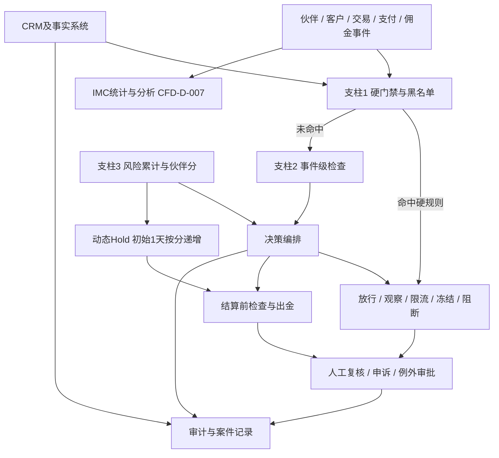

# Affiliate CPA 风控方案

## 方案评审稿

**适用项目：** Affiliate CPA 合作计划（与成熟 IB 体系并行）  
**版本：** v0.3 讨论稿  
**日期：** 2026 年 10 月 23 日  
**前版：** v0.2（Affiliate CPA风控方案.md，2026-10-20，保留不动）  
**文档状态：** 方案主稿升级版；评分权重、Hold 递增数值、黑名单期限、验收阈值仍待评审  
**编写依据：** ①本项目 v0.2 及已确认规则（CFD-BR/CFD-D 编号）②《Affiliate风控方案_讨论稿.md》（飞书 v0.1，2026-10-17/18，下称"讨论稿"）③Q-007 2026-10-23 用户确认的结算与 Hold 变更

### 来源与继承说明（本版最重要的约定）

| 来源                                            | 继承内容                                                                                   | 处理方式                                                                                |
| --------------------------------------------- | -------------------------------------------------------------------------------------- | ----------------------------------------------------------------------------------- |
| 本项目已确认规则                                      | CFD-BR-001~005、CFD-D-014 首触判定、Q-007 方向（2026-10-23 版）、Q-014 自荐亲属禁止、评分 P1 口径（2026-10-21） | 直接作为已确认基线引用编号                                                                       |
| 讨论稿 §1.3 五层机制                                 | 硬门禁、事件级检查、特征风险、周期评分、黑名单治理                                                              | 已按用户 2026-10-21 决定收敛为**三条支柱**，特征与评分合并为第三支柱                                          |
| 讨论稿 D1~D4（操作权限、数据共享、案件SLA、试点验收，2026-10-18 确认） | 双人审批、数据分层授权、SLA 时限、200 样本/误伤≤2%/分档放量等验收结构                                              | **机制吸收，确认状态标"待复核"**——该确认发生在项目迁移前，需在本项目重新过会                                          |
| 讨论稿 QFTD 术语与定义                                | 合格客户六条件                                                                                | **沿用 QFTD 术语**（Qualified First-Time Depositor）——评审原型 v0.15 已按讨论稿口径采用，风控方案、原型、规范三线统一 |
| 讨论稿 §5.3 评分模型（六向量 20/20/20/15/15/10、R0-R4）    | 风险分模型与风险带                                                                              | **采用为当前口径**（原型 v0.15 已按此反转展示）：风险分 0-100 越高越险、事件加分累计、R0-R4 风险带；六向量权重与指标阈值仍属参考值待评审    |
| 讨论稿 H1=30天、首次Hold=7天                          | 名单与 Hold 期限                                                                            | **口径已被 Q-007 变更部分替代**（动态 Hold）；名单期限作为参考值待评审                                         |

> 本版一条主线：**日结之后钱走得快，风控必须前移。** 结算节奏从月结改为日结、取消最低提现后，靠"月度复盘拦住损失"不再成立，风险承接主体变为动态 Hold 与事件级检查（用户 2026-10-23 确认时的原始口径）。

---

## 1. 执行摘要

### 1.1 方案定位

覆盖合作方准入、渠道与素材、点击与归因、客户资格、佣金与出金、申诉与审计的完整风控闭环。CPA 与 IB 按已确认规则双向隔离（CFD-BR-002~005、CFD-D-014），风控不通过重新归因既有客户制造业绩。

### 1.2 方案结论

1. 可以按有限范围建立风控闭环，但不按全面放量方式上线。
2. 硬门禁、归属排除、事件级检查、结算前检查和人工复核先行（P0）。
3. 风险评分列为 **P1 开发**（2026-10-21 确认）：为各风险事件设计权重，按事件**加分累计**计算账户风险分（PartnerRiskScore，0-100 越高越险），依据 R0-R4 风险带施加限制；权重与阈值数值待评审。评审原型 v0.15 已按此口径展示。
4. 评分落地的第一出口是 **动态 Hold**（Q-007，2026-10-23 确认方向）：初始 1 天，按账户风险分递增，累计超 30 天转冻结并进入人工审核。数值待评审。
5. 讨论稿 D1~D4 机制吸收、确认状态待复核（见头部继承说明）。

### 1.3 三支柱决策机制（已确认，2026-10-21）

| 支柱            | 介入时点                                     | 具体方案                                                               | 触发结果                            | 参考验收                                     |
| ------------- | ---------------------------------------- | ------------------------------------------------------------------ | ------------------------------- | ---------------------------------------- |
| ① 硬门禁 + 黑名单治理 | 伙伴申请、素材上线、客户注册、首次入金、结算前、确认风险、到期复评        | 校验国家主体、身份互斥、既有IB归属、确认黑名单、盗卡制裁、确认恶意流量；分层维护对象、范围、证据、期限、审批、申诉         | 拒绝申请、阻断注册、不归因、禁用链接、冻结佣金、进入调查、追索 | 禁推漏放0；硬规则覆盖率100%；名单记录完整率100%；到期复评覆盖率100% |
| ② 事件级检查       | 注册、KYC、首次入金、交易、提现、退款拒付、资格确认、结算前（日结后高频执行） | 关键事件读取客户、伙伴、归因、资金、交易与调查状态，输出放行/观察/冻结/不归因/拒付，均带原因码                  | 进入下一状态，或人工复核、Hold、重算、冲正         | 关键事件覆盖率100%；结算前漏检0；结果均有原因码               |
| ③ 风险信号 + 周期评分 | 事件实时累计；每日增量、每周运营、每月评级                    | 为各风险事件设计权重，按事件加分累计计算账户风险分（PartnerRiskScore）；输出风险趋势、审核队列、风险带与合作档位建议 | 正常维持、观察、动态Hold递增、限流、延迟结算、降级、调查  | 评分按时更新；加分原因可解释；申诉改判率监控                   |

**决策优先级：** 确认的硬门禁 > 已确认的归属与身份隔离规则（CFD-BR）> 结算前资格与账务检查 > 人工复核结论 > 周期评分与风险排序 > 单个弱信号。评分不能抵消确认的制裁、盗卡、既有IB归属或身份冲突。

### 1.4 方案目标

> 谁带来了客户，客户是否真实新增，风险在哪个节点发生，哪个规则产生了决定，佣金为什么支付、暂缓或没有支付。

## 2. 风控目标与边界

### 2.1 风控目标

1. 阻止违法、禁推地区和明显欺诈流量进入获客链路。
2. 识别以套取 CPA 为目的的客户、交易和支付行为。
3. 避免与 IB 重复归属、重复计佣和客户错误迁移。
4. 降低盗卡、拒付、退款、冲正和追索损失——**日结后损失窗口变短，此目标优先级上升**。
5. 每次阻断、冻结、拒付、冲正和放行都有原因码和证据。
6. 不因单一弱信号误伤正常合作方。

### 2.2 业务边界

**属于本方案：** 合作方身份与渠道、注册与归因、IB客户排除、CPA资格与佣金状态、交易支付相关风险、素材内容合规、数据回传/权限/申诉/审计。

**属于其他团队但需提供结果：** 完整KYC/AML决策、交易系统市场风险、支付机构授权与拒付、客户适当性、CRM客户主档、IMC统计分析（CFD-D-007）、投诉与监管报告。

### 2.3 已确认业务规则（本方案基线）

| 编号                | 规则                                           | 对风控的影响                                   |
| ----------------- | -------------------------------------------- | ---------------------------------------- |
| CFD-BR-001        | 分国统计                                         | 国家、主体、计划、费率必须绑定校验                        |
| CFD-BR-002        | 推广身份互斥                                       | 伙伴身份唯一识别，不得双持                            |
| CFD-BR-003        | Affiliate注册客户不可再挂IB                          | 归属转换请求一律阻断                               |
| CFD-BR-004        | 已有IB客户排除在Affiliate统计与计佣外                     | 归因前必查既有IB归属                              |
| CFD-BR-005        | 双向隔离（CFD-D-009）                              | 同上两条的双向执行                                |
| CFD-D-014         | 同一用户主体只能有一种推荐身份，以首触为准                        | 注册时首触判定；风控按互斥口径检查多身份注册                   |
| CFD-D-015         | "交易"=真实交易，模拟盘不计                              | 合格客户交易条件的判定口径                            |
| Q-007（2026-10-23） | 日结、无最低提现；Hold 动态机制（初始1天/按风险分递增/超30天转冻结+人工审核） | 结算前检查高频化；动态 Hold 是评分第一出口                 |
| Q-014（2026-10-21） | 自荐及亲属推广不允许                                   | 自荐识别进入硬门禁与事件检查；关联公司/子Affiliate待会议（议程2.8） |

### 2.4 未确认、不得默认的事项

CPA 单价与国家差异（Q-007 数值）、归因窗口细节（Q-008）、国家判定字段（Q-009）、客户识别粒度（Q-010）、报表分母（Q-011）、多级分佣结构（议程2.8）、评分权重与等级阈值、黑名单各层期限、讨论稿 D1~D4 的复核确认。

## 3. CPA 与 IB 的业务隔离

隔离原则、身份/归属/资格/佣金四层区分、归属判断顺序沿用 v0.2 §3（内容与已确认规则一致，此处不重复全文），要点：

```text
识别推广方身份（互斥校验）
  → 识别客户主档 → 查询既有IB归属
  → 判断是否已批准Affiliate来源（首触为准，CFD-D-014）
  → 记录首次归因 → 判断合格客户资格 → 进入佣金状态
```

已有IB归属的客户：原始事件留存、不改归属、不进统计、不计佣、保留排除原因与归属快照。任何双向转换请求一律阻断并留痕。

## 4. 竞品风控模式（结论沿用，不复制阈值）

行业通行控制方向：新客户与唯一身份、入金与交易双门槛、净入金经济保护、Churning 识别、设备/IP/关联集群、机器人与归因操纵、品牌与素材治理、佣金冻结-拒付-冲正-追回、伙伴持续管理、计划隔离。十类模式与 v0.2 §4、讨论稿 §3 一致，此处不重复表格；**所有阈值须经历史数据、目标国家、主体和试点校准，不照搬竞品数值**。Exness SC 协议 5.8 的 21 项不付款情形可作为我方拒付/冲正事件清单的输入（见《Exness企业资料-合作伙伴协议SC实体分析》）。

## 5. 总体风控架构

### 5.1 决策结构



### 5.2 生命周期介入点（七阶段）

| 阶段          | 风控重点                            | 正常结果             | 风险结果          |
| ----------- | ------------------------------- | ---------------- | ------------- |
| 1 伙伴申请      | 身份、主体、受益所有人、国家、收款、历史关系、互斥校验素材使用 | 进入审核（对应08-合作者审核） | 拒绝、补件、人工复核    |
| 2 投放前       | 域名、素材、品牌词、地区、准则门禁               | 素材与来源获批          | 下线、整改、禁用      |
| 3 点击与注册     | Bot、设备集群、点击节奏、首触判定、既有IB归属       | 正常归因             | 不归因、限流、观察     |
| 4 KYC与首次入金  | 重复身份、支付工具、盗卡、拒付、资金来源            | 有效FTD，进入资格观察     | 待审、排除、冻结      |
| 5 交易观察      | 真实交易（CFD-D-015）、短持仓、对冲、达标即停     | 合格客户确认，产生计佣事件    | 冻结、降级、调查      |
| 6 结算前（日结高频） | 风险快照、动态Hold、黑名单、调查状态、重复计佣       | 批准出金并留证          | Hold、重算、拒付、申诉 |
| 7 结算后       | 拒付、客诉、新证据、关联集群                  | 维持合作、更新伙伴分       | 冲正、追索、封禁      |

**核心原则：越早发现，动作越轻；越晚发现，动作越重。** 日结使第 6 阶段从月度动作变为每日动作。

### 5.3 风险对象分开处置

Partner / Customer / Trade-Cohort / Payment / Creative-Traffic 五类对象分别建模、分别评分、分别处置（结构沿用讨论稿 §4.3）。伙伴分不能替代客户级风险判断；客户资格与佣金状态分离（§10）。

## 6. 硬门禁设计

| 控制项目           | 触发条件                                     | 控制动作       | 必留证据       | 验收指标        |
| -------------- | ---------------------------------------- | ---------- | ---------- | ----------- |
| 国家与主体          | 国家/主体/产品/计划组合不在允许范围                      | 阻断申请、注册或归因 | 名单版本、字段快照  | 禁推漏放0       |
| 伙伴身份互斥         | 证件、主体、收款或受益所有人命中IB（CFD-BR-002、CFD-D-014） | 拒绝、冻结或人工复核 | 匹配证据       | 冲突识别覆盖率100% |
| 既有IB客户         | 客户主档已有IB归属（CFD-BR-004/005）               | 不归因、不计佣    | IB归属快照、排除码 | IB客户CPA支付为0 |
| Affiliate客户转IB | 转换请求（CFD-BR-003）                         | 阻断转换       | 请求与拒绝原因    | 非批准转移为0     |
| 自荐与亲属          | 客户身份、支付工具或设备与伙伴关联（Q-014）                 | 排除、拒付、调查   | 关联证据       | 自荐识别率       |
| 确认黑名单          | 命中H0（制裁、盗卡、确认点击欺诈等）                      | 阻断、冻结、调查   | 命中记录与审批    | 确认重大风险支付为0  |
| 收款账户           | 收款人不匹配、变更未审批                             | 暂停出金，二次核验  | 账户快照与审批链   | 未审批变更付款为0   |
| 数据完整性          | 事件重复、签名错误、字段缺失、时间异常                      | 隔离批次、停止计算  | 接口日志       | 重复计佣为0      |

单次共享IP、单次支付失败或单个低质量客户不直接造成永久封禁，除非命中确认硬规则或经人工调查。

## 7. 事件级检查设计

日结后，事件级检查从"关键节点兜底"变为"每日资金闸门"，以下事件全部要求准实时（分钟级）执行：

| 事件      | 必查内容                       | 输出结果          |
| ------- | -------------------------- | ------------- |
| 伙伴申请    | 身份、主体、国家、渠道、收款、历史关系、互斥     | 通过、补件、拒绝、复核   |
| 素材上线    | 品牌、收益承诺、地区、落地页、批准状态        | 上线、整改、下线      |
| 点击      | Campaign、Sub ID、设备、IP、点击节奏 | 记录、过滤、观察      |
| 注册      | 客户主档、IB归属、首触判定、国家、关联       | 归因、不归因、观察     |
| KYC     | 身份、地区、重复、关联、制裁结果           | 通过、失败、补件、冻结   |
| 首次入金    | 支付工具、金额、退款拒付、净入金           | 记录、待审、排除      |
| 交易      | 真实交易口径、持仓、对冲、批次聚集          | 观察、冻结、候选资格    |
| 资格确认    | 资格条件、时间窗、风险状态、规则版本         | 候选、确认、拒绝、待审   |
| 提现申请    | 伙伴分档位、Hold状态、收款账户、调查状态     | 放行、动态Hold、拒绝  |
| 结算前（每日） | 黑名单、调查、资格、重复计佣、规则版本        | 批准、Hold、拒付、重算 |
| 付款后     | 退款、拒付、回滚、投诉、伙伴违规           | 保持、冲正、追索、终止   |

每个 Hold/Reject 结果必须能追溯到事件、规则版本和原因码。**日结＋无最低提现意味着"提现申请"成为高频事件，伙伴分档位检查在此处执行（§8.4）。**

## 8. 风险评分方案（事件加分累计 + R0-R4，评审原型 v0.15 已对齐）

### 8.1 主模型：账户风险分（PartnerRiskScore）

**口径（2026-10-21 确认累计机制 + 2026-10-23 原型 v0.15 按讨论稿反转方向）：**

- 风险分 0–100，风险事件按权重**加分**累计，分数越高风险越高；
- 每次加分记录：事件类型、证据引用、分值、时间、规则版本；
- 六向量加权结构（身份合规 20% / 流量归因 20% / 客户质量 20% / 交易行为 15% / 支付资金 15% / 伙伴行为 10%）与 R0–R4 风险带沿用讨论稿 §5.3，**指标阈值与向量内权重全部为参考值待评审**；
- 硬门禁命中时决策由硬规则覆盖，不进入加权评分；样本不足标记 insufficient_data，不按低风险处理；
- 数据窗口与冷启动（实时/24h/7天/30天/90天、新伙伴受控试用）沿用讨论稿 §5.3.4。

### 8.2 风险带与动作映射（R0-R4，结构确认，数值待评审）

| 风险带    | 分数            | 动作方向                | 佣金/出金处理                             |
| ------ | ------------- | ------------------- | ----------------------------------- |
| R0 正常  | 0–19          | 正常放行，保留实时硬规则        | 动态Hold按初始1天，日结正常出金                  |
| R1 观察  | 20–39         | 有限流量，不扩预算           | Hold 适度递增（参考值待评审）                   |
| R2 限制  | 40–59         | 限制新客户/国家/来源         | 新增CPA人工复核，Hold 进一步递增                |
| R3 高风险 | 60–79         | 暂停放量与新归因            | 未付佣金冻结，暂扣+人工复核                      |
| R4 阻断  | 80–100 或命中硬门禁 | 按获批范围处置；确认硬风险直接按硬门禁 | 冻结/拒付/追回须有已批准规则、证据和合同依据，分数不单独构成扣佣依据 |

评审原型已按此口径展示：07-合作者列表（分数·R带、≥60 即 R3+ 计高风险卡）、16-参数配置组4（风险带参数）、11-风控事件处置（对象带分）、22-出金审批。

### 8.3 加分事件目录（初始结构，权重待共同设计）

| 向量分组  | 加分事件示例                      | 说明                 |
| ----- | --------------------------- | ------------------ |
| 身份与合规 | KYC复检失败 / 资料造假 / 禁推地区命中     | 命中即显著加分，部分直接触发硬门禁  |
| 流量与归因 | 无效流量（脚本特征）/ 归因低于基准 / 点击异常   | 参考原型 11 页事件类型（10类） |
| 客户质量  | 客户投诉 / 批量冲门槛                |                    |
| 交易行为  | 对冲 / 短持仓聚集 / 达标即停           | 真实交易口径（CFD-D-015）  |
| 支付与资金 | 拒付冲正 / 盗卡关联 / 快速出入金         | 参考值：拒付冲正 +15       |
| 伙伴行为  | 素材违规 / 品牌词冒用 / 整改逾期 / 长期未活跃 | —                  |

权重、衰减恢复机制、向量内指标映射：**共同设计中**（用户已明确"接下来一起完成"）。

### 8.4 动态 Hold：评分的第一出口（Q-007，2026-10-23 确认方向）

| 要素      | 规则                                                      |
| ------- | ------------------------------------------------------- |
| 初始 Hold | 1 天（所有合格客户佣金结算前默认）                                      |
| 递增规则    | 按账户风险分递增 Hold 天数：风险带越高 Hold 越长；递增映射表待评审                 |
| 累计上限    | 累计超 30 天转**冻结**并进入人工审核（不再是无期限暂缓）                        |
| 计时原则    | 同一案件同一事实累计计时，换原因码不重置；到期无获批延期则该条 Hold 失效                 |
| 与出金关系   | 日结+无最低提现下，Hold 是唯一事前资金闸门——事件级检查（§7 提现申请行）在放行前校验 Hold 状态 |

与讨论稿 D3 SLA 的衔接：D3 的"首次 Hold 7 天/普通累计 30 天"结构中，**首次天数已被动态机制替代**（初始1天起步）；"同案累计不超限、到期失效、延期需审批"的计时纪律全部保留。页面规范 16-组5 的 Hold 参数在待同步清单中（Q-007 变更同步项）。

### 8.5 评分上线顺序（shadow → pilot → active，待复核）

| 模式          | 评分权限                        | 说明           |
| ----------- | --------------------------- | ------------ |
| shadow 影子运行 | 只计算、排序、解释，不自动处置             | 硬门禁与事件检查正常生效 |
| pilot 小流量联动 | 在获批伙伴/国家/动作范围内参与 Hold 递增与限流 | 对照误伤率与申诉改判率  |
| active 正式应用 | 按版本参与全部映射动作                 | 联合评审通过后      |

评分权重未定稿前，动态 Hold 的"初始1天"先按固定值上线（Q-007 已确认），递增映射在 shadow 期间用历史事件数据校准后启用。用户已确认上线运行模式（shadow/pilot/active）不进评审原型展示，仅存在于方案文档与实施计划。

## 9. 黑名单治理

层级、对象、状态机、字段、治理规则沿用 v0.2 §11 与讨论稿 §7 的合并结构：

- **层级：** H0 确认阻断（制裁、盗卡、伪造身份、确认点击欺诈）/ H1 高风险观察（疑似团伙、异常提现、疑似刷量；参考期限 30 天、每周复核、延期需审批、到期失效）/ H2 规则提醒（单次违规整改）/ A0 允许名单（范围绑定，不豁免硬门禁）。
- **对象：** 伙伴、主体与受益所有人、域名、广告账户、Campaign、Sub ID、客户主档、设备、支付工具、IP、收款账户、素材、品牌词、确认的欺诈关系集群。
- **记录字段：** 对象类型/标识、层级、范围、原因码、证据引用、来源、责任人、审批人、生效/到期时间、申诉状态、关联对象、版本（v0.2 §11.4 全表有效）。
- **治理规则：** H0 必须证据+审批；H1 必须到期时间与复核安排，到期不自动续期；A0 定期复核；关联扩大阻断前评估误伤；申诉不自动解除硬门禁；名单变更保留前后版本与操作人。
- 待复核项：H1=30 天期限、每周复核节奏、双人审批要求（来自讨论稿 D1）——机制吸收，数值与审批层级过会确认。

## 10. 资格与佣金状态分离

术语：沿用 **QFTD（Qualified First-Time Depositor，合格首次入金客户）**，与评审原型 v0.15 及讨论稿一致。QFTD 六条件（有效归因、新客户、合规通过、有效FTD、真实交易达标、风险观察通过）；"交易达标"采用真实交易口径（CFD-D-015，模拟盘不计）。QFTD_confirmed 是资格结果，不是付款授权。

### 10.1 客户资格状态

Registered → KYC_Passed → FTD_Candidate → Trading_Candidate → FTQ_Candidate → FTQ_Confirmed / FTQ_Rejected / On_Hold / Reversed（全表沿用 v0.2 §12.2）。

### 10.2 佣金状态

Not_Eligible → Calculated → Pending_Review → Held → Approved → Payable → Paid / Rejected / Clawed_Back / Disputed / Released（全表沿用 v0.2 §12.3）。

### 10.3 状态分离原则

注册≠有效客户；入金≠收入；交易≠有效交易；资格确认≠立即付款；计算≠批准付款；已付款≠不可冲正。佣金状态不能覆盖客户归属与身份状态。日结不改变状态机，只改变状态流转的频率与结算前检查的执行密度。

## 11. 结算前检查、拒付、冲正与追索


### 11.1 结算前检查（日结后每日执行）

每笔/每批 CPA 出金前检查：客户主档与归属、资格状态、黑名单与调查状态、退款拒付、动态Hold 状态、交易真实性、国家/主体/费率版本、收款账户验证、重复计佣幂等、数据完整性。任何一项失败即进入 Hold 并记录原因码。

### 11.2 拒付与冲正（Q-007 已确认结构）

- 拒付/退款**全额冲正**，从后续佣金或余额扣回，不足挂负（2026-10-21 确认）；
- 冲正评估触发：付款后确认身份/资金/交易重大问题、退款拒付回滚、归因确认错误、伙伴违规、人工误付、申诉复核推翻原付款；
- 冲正必留：原付款记录、触发事件、规则版本、调查审批、金额计算、通知记录、追索结果；
- 参考事件清单：Exness SC 协议 5.8 的 21 项不付款情形（已归档竞品分析）。

### 11.3 追索

追索与冲正分离管理：已付不改写原付款为未付，以关联调整记录跟踪待追回/部分收回/已收回。重大追索需审批（层级待复核，参考讨论稿 D1：合规确认依据、财务批准账务）。

## 12. 多场景风控矩阵

v0.2 §14 的 25 个场景矩阵全部保留有效（伙伴冒名、身份冲突、禁推地区、未审批素材、自荐、亲属关联、重复客户、IB客户点击CPA、多链接抢归因、Cookie stuffing、Bot点击农场、激励注册、虚假KYC、盗卡入金、快速出入金、刷交易量、达标即停、重复计算、费率错误、收款账户变更、子Affiliate隐瞒、Postback重复、数据延迟、越权查询、伙伴申诉、规则变更），此处不重复全表。新增两个日结场景：

| 场景         | 控制目标     | 触发条件            | 控制动作              |
| ---------- | -------- | --------------- | ----------------- |
| 日结高频出金     | 防止损失快速流出 | 伙伴分中/高风险档位下申请提现 | 动态Hold递增、提现转人工复核  |
| Hold累计超30天 | 防止无期限暂缓  | 同一案件Hold累计超30天  | 转冻结+人工审核，按结论解除或冲正 |

## 13. 人工复核、申诉、例外与权限

### 13.1 P0 人工复核闭环（随 MVP 交付）

案件编号、对象、触发规则、状态、证据、处理人/审批人、时间线、通知、结论、佣金影响、是否冲正/进黑名单——全部必填。MVP 可复用现有工单；自助申诉界面与自动化属 P1（讨论稿 §1.5.2 口径，待复核）。

### 13.2 申诉流程

提交 → 受理校验 → 关联原决定与证据 → 复核 → 维持/补发/解除/冲正/升级调查 → 通知 → 归档。提交申诉不自动解除硬门禁或 Hold；解除后重新执行结算前检查。时效参考（讨论稿 D3，待复核）：1 个工作日通知与受理、15 个自然日申诉窗口、5 个工作日复核结论、复杂案件每 5 个工作日反馈。

### 13.3 例外放行

仅限证据可解释的误报、可纠正数据问题、合规批准的特殊场景；不得绕过制裁、既有IB排除、身份互斥、未验证收款账户、账务对账。例外有范围、有效期、审批、复评时间，不形成永久白名单。审批要求（双人、申请人回避）沿用讨论稿 D1，待复核。

### 13.4 权限矩阵

沿用 v0.2 §15.4 的 RACI 表（运营发起、风控结论、合规会签、财务执行账务）。与评审原型 18-账户配置的角色枚举（超管/运营/风控/财务/客服）对齐；若采纳讨论稿 D1 的双人审批结构，需在 18 页角色权限中补充体现（同步项见 §18）。

## 14. 数据责任与访问边界

- 责任分工沿用 v0.2 §16.1（Affiliate 定规则、CRM 出事实、IMC 出统计；CFD-D-007 边界不变：统计结果无归属/审批/付款权限）。
- 事件字段最低要求沿用 v0.2 §16.2 十一类事件表。
- 访问原则：最小必要、客户信息默认脱敏（原型 07 邮箱脱敏已是示范）、伙伴只见自己合作范围内的资格状态/佣金状态/可披露原因分类，不暴露检测规则与其他伙伴信息。
- 讨论稿 D2 的数据分层（敏感原始/特征结果/经营汇总）、代标识、分类保留结构吸收为设计参考，**确认状态待复核**；具体法人组合、字段映射和保留年限实施前核验。

## 15. 试点与放量

### 15.1 结构（沿用讨论稿 D4，确认状态待复核）

- 试点范围：3~5 个获批伙伴、单一主体、少量国家，锁定预算、规则版本、观察窗口与回滚责任人；
- 必过控制项：关键场景 100% 通过（禁推、重复计佣、IB冲突、越权、自批）；状态机可复现；时限可验证；可停止评分联动而基础控制仍有效；
- 成熟样本：每放量单元 ≥200 名完成 30 日观察的首入金客户（含后来被拒付/冻结者）；
- 误伤：点估计 ≤2% 且 95% 置信区间上限 ≤5%；
- 结算验证：≥2 个完整结算批次逐笔对账（日结下即 ≥2 个自然日批次+对账）；
- 分档放量：获批目标日量的 10% → 25% → 50% → 100%，每档至少一个完整结算批次+联合评审，不自动升档；
- 回滚触发：重大控制失效、误伤超标、时限不达标、账务不一致、数据异常。

### 15.2 与日结的适配

月结时代"观察窗口"以月为单位；日结后资金流出快，试点期应同时监控**日度出金总额与 Hold 覆盖率**（被 Hold 拦住的出金占申请出金比例），作为经济约束的先行指标。

## 16. 风控成效指标

沿用 v0.2 §19 三组指标（安全结果 / 风控质量 / 数据运营），补充日结适配项：

| 补充指标      | 说明                            |
| --------- | ----------------------------- |
| Hold 覆盖率  | 动态Hold拦住的高风险出金占全部申请出金比例       |
| Hold 平均天数 | 按伙伴分档位分层统计，验证递增映射有效性          |
| 冻结转人工数    | Hold 累计超 30 天转冻结的案件量（监控阈值合理性） |
| 日度出金对账差异率 | 日结批次与资金流水的差异                  |

具体阈值待历史数据与试点校准。

## 17. P0 / P1 建设范围

**P0（MVP 必须）：** 伙伴/身份/主体/收款准入；国家主体白名单；双向归属隔离与首触判定；统一客户识别与重复排除；点击注册入金交易资格状态分离；既有IB排除；结算前检查（日结节奏）；动态Hold基础版（初始1天固定值）；Hold/拒付/冲正/追索/申诉状态；规则版本、原因码、审计留痕；基础黑名单 H0/H1/H2/A0；CRM/Affiliate/IMC 事件接口；人工复核与例外审批；基础监控与对账。

**P1：** 评分权重落地与动态Hold递增映射（已确认 P1，2026-10-21）；关系图与设备集群；素材自动巡检；实时限流；伙伴分衰减恢复机制；自助申诉；风险趋势与伙伴档位；模型增强。P1 不替代 P0 硬门禁缺口。

## 18. 待确认参数与决策项

### 18.1 已确认方向、数值待评审（Q-007 联动）

| 参数     | 已确认方向               | 待评审数值             |
| ------ | ------------------- | ----------------- |
| 合格客户   | 入金+交易组合、达标期限、真实交易口径 | 入金门槛、手数、期限天数      |
| 结算     | 日结、无最低提现            | —                 |
| 动态Hold | 初始1天/按分递增/超30天转冻结   | 递增映射表、各档天数        |
| 冲正     | 全额冲正、扣回、不足挂负        | —                 |
| CPA定价  | 分国家档                | 各档单价（23-CPA档位表承载） |

### 18.2 待确认决策（建议按序过会）

1. **评分权重共同设计**：加分事件目录（§8.3）与六向量权重逐项定值与衰减恢复规则——用户此前明确"接下来一起完成"；
2. **讨论稿 D1~D4 复核**：双人审批、数据分层、案件SLA（1天通知/5天复核）、试点验收四组机制是否在本项目重新确认；
3. **多级分佣结构**（议程2.8，已定暂不讨论，结论回填时）的风控连带规则（上级冲正连带）；
4. **黑名单期限**：H1=30天参考值确认；
5. **Hold 递增映射表**：各风险带对应的 Hold 天数（Q-007 遗留数值）。

## 附录 A：原因码（合并两版，去掉与已确认术语冲突项）

GEO_NOT_ALLOWED / ENTITY_NOT_ALLOWED / PARTNER_ID_CONFLICT / IB_ALREADY_ASSIGNED / AFFILIATE_TO_IB_BLOCKED / DUPLICATE_CUSTOMER / RELATED_PARTY / UNAPPROVED_SOURCE / MATERIAL_VIOLATION / BOT_OR_CLICK_FRAUD / ATTRIBUTION_CONFLICT / FIRST_TOUCH_CONFLICT（首触判定冲突，CFD-D-014）/ KYC_FAILED / PAYMENT_RISK / TRADING_RISK（含模拟盘不计口径）/ DATA_INCOMPLETE / COMMISSION_DUPLICATE / RULE_VERSION_ERROR / ACCOUNT_CHANGE_UNVERIFIED / APPEAL_PENDING / INVESTIGATION_PENDING

## 附录 B：版本记录

| 版本   | 日期         | 说明                                                                        |
| ---- | ---------- | ------------------------------------------------------------------------- |
| v0.1 | 2026-10-17 | 讨论稿（飞书），D1~D4 于 10-18 确认；项目迁移前文档                                          |
| v0.2 | 2026-10-20 | 本项目主稿首版；五层收敛为三支柱；中性术语替代 QFTD                                              |
| v0.3 | 2026-10-23 | 本版：吸收讨论稿机制（标注待复核）；落实 Q-007 日结+动态 Hold 变更；评分锚定事件累计制；新增日结场景与指标；与原型/页面规范口径对齐 |
