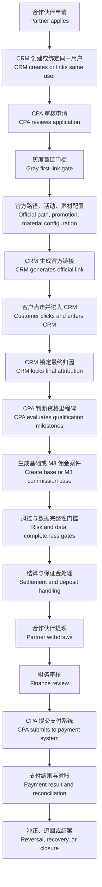
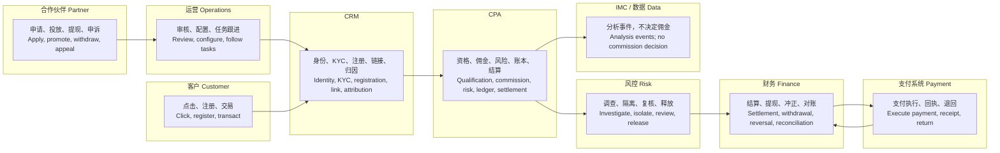

# 01 业务全景与角色 / Business Overview And Roles

Version: v1.0; Date: 2026-11-16
Source: [Core PRD](../../PRD_EN/01-CORE-PRD.md), [Architecture Boundary](../../PRD_EN/status/architecture-boundary-change-2026-11-16.md)

## 1. 全业务主链路 / End-To-End Business Chain

## 2. 角色泳道 / Role Swimlane

