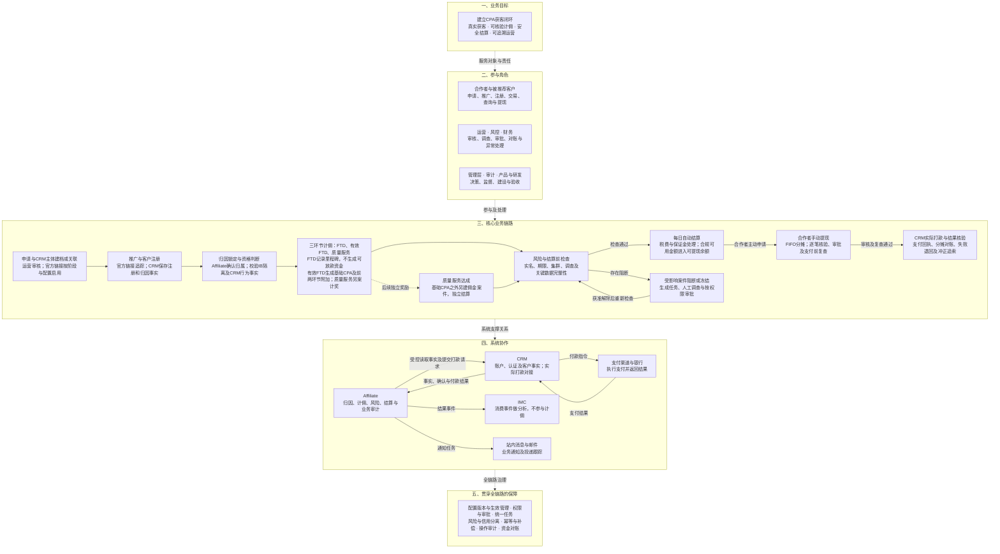

# Affiliate项目全景图

版本：v0.1预览稿  
状态：目标方案内容预览，待用户审阅；不表示生产功能已实现。

实线表示业务步骤或实际调用，虚线表示层级关联和支撑关系。整体自上而下排列，业务层内按箭头阅读。

## 阅读时保留的边界

- 灰度期审核通过后启用链接；全量期可按配置提前启用。推广可用不代表身份、结算或提现门禁通过。
- CRM负责账户、认证及客户事实；Affiliate负责最终归因、资格、佣金和自身风险处置结论。数据库直连仍须受控。
- FTD、有效FTD、质量服务三个环节分别支持信用及个人附加比例和固定金额。FTD达成只记录里程碑，不生成可放款资金；有效FTD达成时生成基础CPA及FTD、有效FTD两环节附加；质量服务达成时另建额外奖励案件，不阻塞基础CPA。FTD段与有效FTD段基础比例合计100%，质量服务在100%之外。
- 集群、调查、隔离和结算关键缺数阻断自动结算，已能计算的佣金继续计算。
- 超时冻结只绑定当前客户、当前佣金案件和当前结算案件；不连带其他案件。信号驳回不自动解冻。
- 保证金逐佣金案件独立到期，只释放无风险部分；每日自动结算不生成提现订单或结算单。
- 打款结果未知时先查询；已确认失败或银行已确认退回的金额才按分摊回余额，不重复付款或退回。

## 来源与后续细化

- [项目全景图绘制说明](01-项目全景图.md)：目标、节点及跨图关联。
- [最新用户与业务流程](../../需求文档/02-用户与业务流程-v0.1.md)及[决策记录](../../需求文档/09-决策与待确认事项-v0.1.md)：申请、CRM建档、分阶段开链与资金门禁。
- [接口v0.14第8A节](../../接口文档/Affiliate接口文档-v0.14-设计稿.md)与[状态字典v0.4第14节](../../评审资料包/基础资料/05-状态与原因码字典-v0.4.md)：自动结算、提现、结算单和CRM打款。

本图不展开全部审批策略、风险申诉时点和支付重试状态；这些内容由对应专项图说明。上下级分润仍按讨论稿边界另行评审。图中引用的生产阈值及真实外部能力仍待专业核验。
