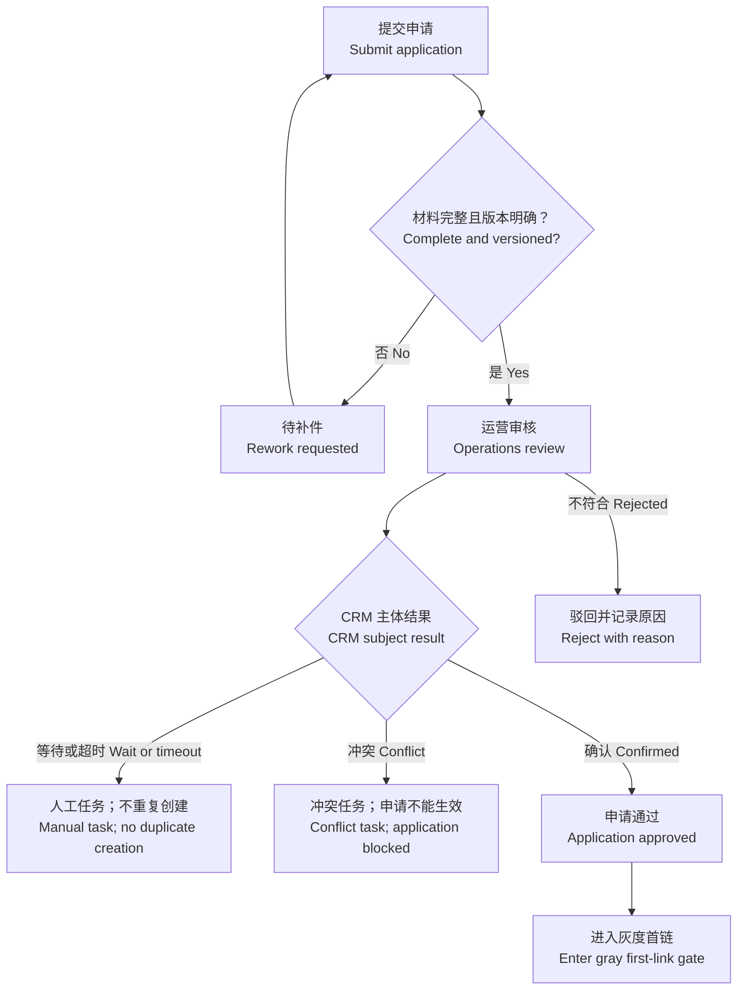
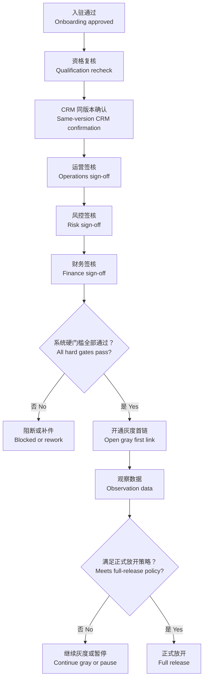
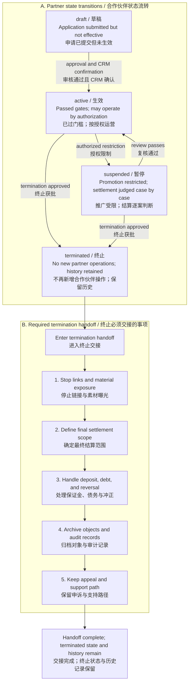
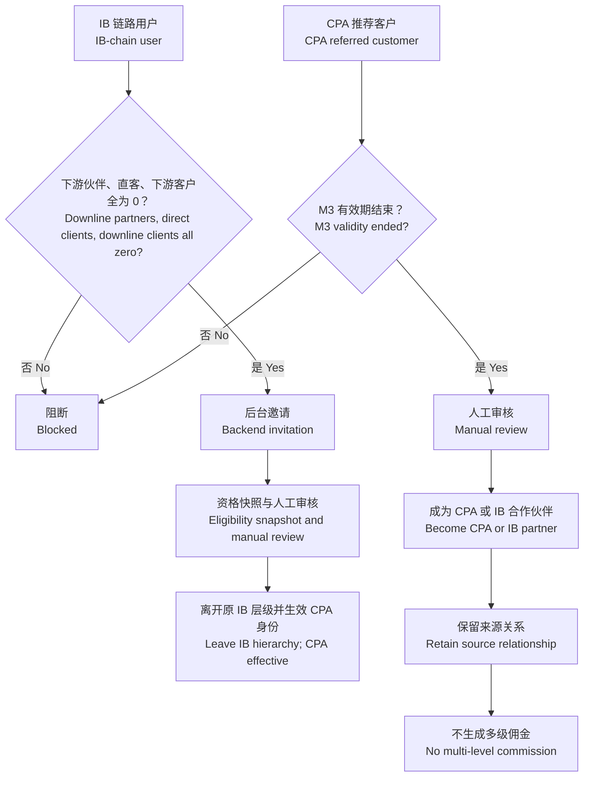

# 02 合作伙伴与身份 / Partners And Identity

Version: v1.0; Date: 2026-11-16
Source: [Partner Onboarding](../../PRD_EN/slices/partner-onboarding-v0.1.md)

## 3. 合作伙伴入驻 / Partner Onboarding

## 4. 灰度首链与正式放开 / Gray First Link And Full Release

## 5. 合作伙伴状态与终止交接 / Partner States And Termination

## 6. IB 与 CPA 身份转换 / IB And CPA Identity Transition

