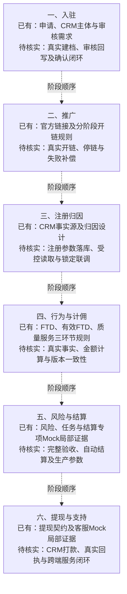
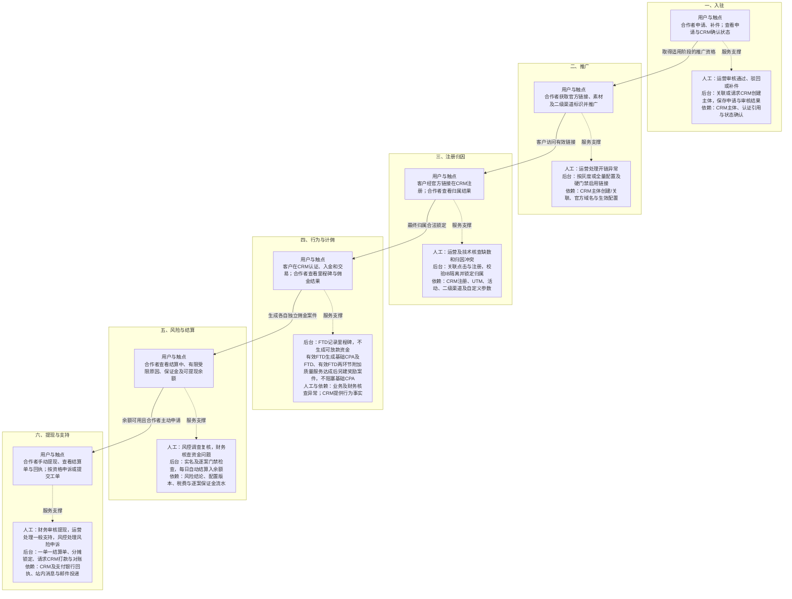

# Affiliate当前态与目标态服务蓝图

版本：v0.2预览稿  
状态：供内容与交接关系审阅；目标设计不代表生产系统已实现。

## 1. 如何阅读

两张图采用相同六阶段：入驻、推广、注册归因、行为与计佣、风险与结算、提现与支持。

当前态以已回收资料和验证证据为边界。真实线上操作、实际耗时及人工交接尚无完整证据，不能用目标设计补成已运行流程。当前态虚线只表示业务阶段顺序。

目标态从上到下按阶段阅读。每阶段前一框表示用户动作与可见触点，后一框表示人工岗位、后台及外部数据支撑。阶段间实线表示主服务推进；阶段内虚线表示支撑关系，不表示每名用户都必须经过人工处理。

本图作为02至20项的服务总览继续使用。跨角色交接见[03端到端泳道](03-端到端业务泳道图-Mermaid预览.md)，注册归因见[04](04-注册归因泳道图-Mermaid预览.md)，三环节计佣见[05](05-佣金计算流程图-Mermaid预览.md)，资金及时序见[06](06-结算与资金时序图-Mermaid预览.md)和[07提现](07-提现流程图-Mermaid预览.md)。详细授权和执行条件以对应预览的来源及待确认项为准。

## 2. 当前态：已有证据与待核实缺口

## 3. 目标态：用户触点与服务支撑

## 4. 服务泳道对照

此表展开图中的支撑框，便于后续在绘图软件中转为完整泳道。横向是业务阶段，纵向是不同服务责任。

| 泳道 | 入驻 | 推广 | 注册归因 | 行为与计佣 | 风险与结算 | 提现与支持 |
| --- | --- | --- | --- | --- | --- | --- |
| 合作者动作 | 申请、补件、查结果 | 取链接与素材、使用二级渠道 | 查看本人客户归属 | 查看里程碑及佣金结果 | 查看受限原因和余额，按提示完成实名 | 手动提现、查单、符合条件时申诉、提工单 |
| 被推荐客户动作 | 尚未进入此获客流程 | 访问官方链接 | 在CRM注册 | 在CRM认证、入金、交易 | 相关事实按授权供核验 | 无权代合作者申请提现或查询其完整账务 |
| 可见前台触点 | 申请、补件、状态页 | 链接与素材页 | CRM注册及合作者客户页 | 客户里程碑、佣金记录；质量服务只展示结果 | 钱包、结算明细、有限原因及下一步 | 提现、结算单、通知、申诉及支持工单 |
| 人工服务 | 运营审核，技术处理同步异常 | 运营处理例外或止血 | 运营受理争议，技术补数 | 业务与财务核查计算异常 | 风控调查、财务复核；按权限审批处置 | 财务审核、运营服务、风控申诉复核 |
| Affiliate后台 | 主体关联、申请与CRM同步 | 硬门禁、阶段策略、链接状态 | 有效点击、IB隔离、最终归属与证据 | 三环节判断、独立案件、价格与权益快照 | 动态结算中、逐案阻断、超时冻结、每日自动结算 | 订单、结算单、资金分摊、CRM请求及回执对账 |
| 外部系统与数据 | CRM账户、资料及认证引用 | CRM主体、官方域名和配置 | CRM注册与归因原始事实 | CRM资金、交易及认证事实 | CRM实名及其他事实；获批风险、财务参数 | CRM调用支付渠道或银行；消息与邮件服务 |
| 交接证据 | 申请ID、CRM主体ID、审核及同步版本 | 链接ID、开停原因、生效配置与阶段 | 点击、客户、归因ID及规则版本 | 事实引用、佣金案件、金额与权益版本 | 案件三元组、运行ID、审批及账务流水 | 提现/结算单/分摊ID、CRM打款编号、回执与审计 |

IMC在各阶段消费获准事件做分析，不参与资格或计佣判断。消息、IMC和合作者回传失败各自重试，不重新生成原佣金或付款。

## 5. 失败、人工交接与恢复

| 失败或异常 | 用户看到什么 | 谁接手及如何恢复 |
| --- | --- | --- |
| 审核通过但CRM确认失败 | 审核结果保留、身份确认处理中 | 同步任务自动重试，超限转人工；灰度不开链，全量已开链仍不得结算或提现 |
| 开链门禁失败或入驻被驳回 | 有限原因及下一步；驳回后链接停用 | 运营受理、按门禁恢复；历史归因和佣金保留 |
| 归因缺数、冲突或IB排除 | 待核验或排除结果，不承诺佣金 | 运营及技术核实CRM原始事实；无合法来源不猜测归属 |
| 计算所需事实缺失 | 待核验，不编造金额 | 创建补数任务，事实完整后重新判断资格及金额 |
| 集群、调查、隔离或结算关键缺数 | 佣金仍记录，结算受限 | 风控或对应任务处理人接手；解除阻断后重新执行全部结算前检查 |
| 合作者未实名 | 提示去CRM完成实名 | CRM认证后同步，未实名不得自动或人工结算 |
| 当前案件结算超时冻结 | 当前案件受限，信号驳回前无申诉入口 | 后台处理信号；驳回后按开关、窗口及次数开放申诉，不自动解冻 |
| 提现审核未通过 | 原因、补件或其他可执行下一步 | 财务审核，资金占用按批准状态处理；工单不能直接代替资金操作 |
| CRM付款未知或超时 | 处理中或待核实结果 | 查询原CRM请求，不先退款、不盲目重付 |
| 确认失败、部分成功或银行确认退回 | 分别显示原付款与未成功/退回金额 | 财务逐分摊核验；仅确认失败或银行确认退回金额回余额并追加反向流水 |
| 支持问题转风险或财务事项 | 工单保留公开回复和处理状态 | 关联专业任务，内部证据及备注不直接外发 |

申诉和一般支持可在符合条件的阶段发生，不必等到首次提现；为便于总览，图中集中放在第六阶段。申诉、调查、审批、执行、结算与提现状态分别维护。VIS-RISK-Q01所涉超时解除时点继续待决。

## 6. 三环节计佣与资金边界

FTD、有效FTD、质量服务三个环节均须显式保留。各环节分别支持按基础CPA价格配置信用附加、个人附加比例和固定额；FTD本身不产生可放款资金，有效FTD触发基础CPA及前两环节附加，质量服务另案触发额外奖励。

基础FTD段与有效FTD段合计100%，质量服务在100%之外，基础CPA不等待质量服务。保证金逐佣金案件独立到期，到期只释放无风险部分。每日自动结算只形成可提现余额，不生成提现订单、结算单或CRM打款请求。

当前态真实服务耗时、岗位交接实践、CRM实际表/视图及支付联调证据仍待核实；生产SLA、风险阈值、申诉次数和保证金期限不在本图确定。

核验统一进入[服务蓝图核验台账](核验/服务蓝图核验台账.md)，已拆分24项并完成首轮资料盘点。首批从入驻与CRM主体关联开始；真实联调未执行，图中待核实状态继续保留。

## 7. 来源

- [服务蓝图绘制说明](02-当前态与目标态服务蓝图.md)：六阶段及泳道定义。
- [当前工作台](../当前工作台.md)与[原型及Mock证据总表](../核验/Affiliate原型与Mock评审证据总表-v0.1.md)：当前已有材料及未核销边界。
- [最新用户与业务流程](../../需求文档/02-用户与业务流程-v0.1.md)：入驻、CRM建档、分阶段开链及异常服务。
- [CPA设计方案](../业务规则/Affiliate%20CPA设计方案-v1.6.md)：FTD、有效FTD、质量服务及附加金额。
- [接口v0.14第8A节](../../接口文档/Affiliate接口文档-v0.14-设计稿.md)与[状态字典v0.4第14节](../../评审资料包/基础资料/05-状态与原因码字典-v0.4.md)：当前资金规则。
- [待决事项](../待决事项.md)：申诉、解除冻结及专业待决项。
