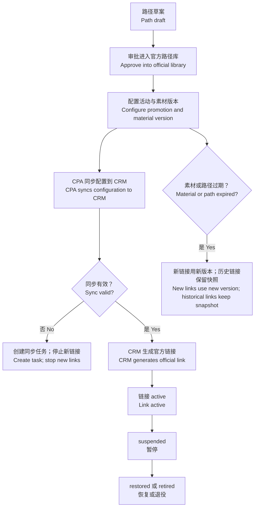
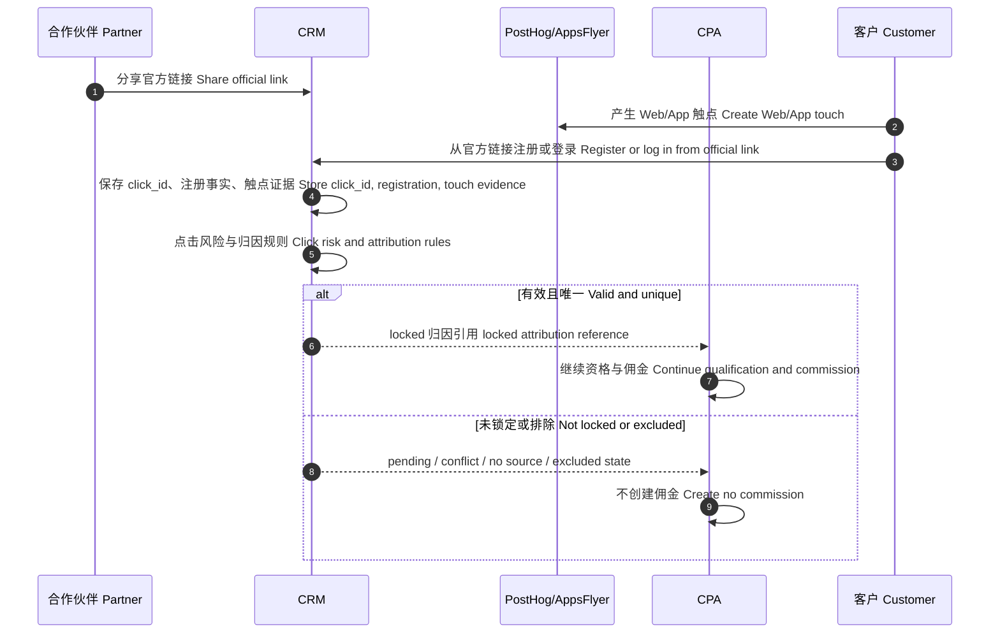
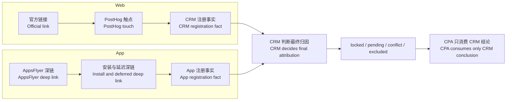
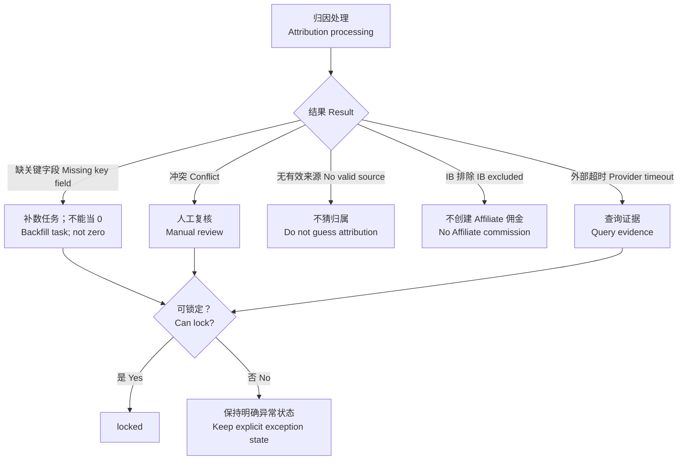

# 03 推广点击与归因 / Promotion, Clicks, And Attribution

Version: v1.0; Date: 2026-11-16
Source: [Promotion And Official Links](../../PRD_EN/slices/promotion-official-links-v0.1.md), [Registration Attribution](../../PRD_EN/slices/registration-attribution-v0.1.md)

## 7. 官方路径、素材与链接生命周期 / Official Path, Material, And Link Lifecycle

## 8. 点击、注册与锁定归因 / Click, Registration, And Locked Attribution

## 9. Web 与 App 归因差异 / Web And App Attribution Differences

## 10. 归因异常与人工复核 / Attribution Exceptions And Manual Review

