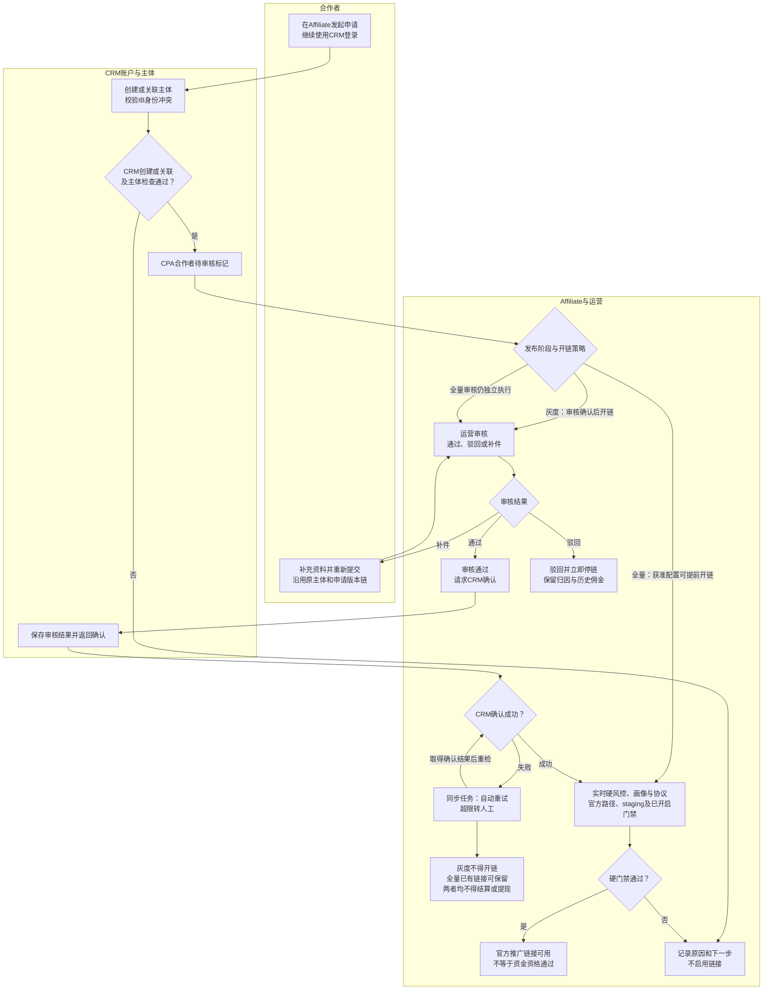
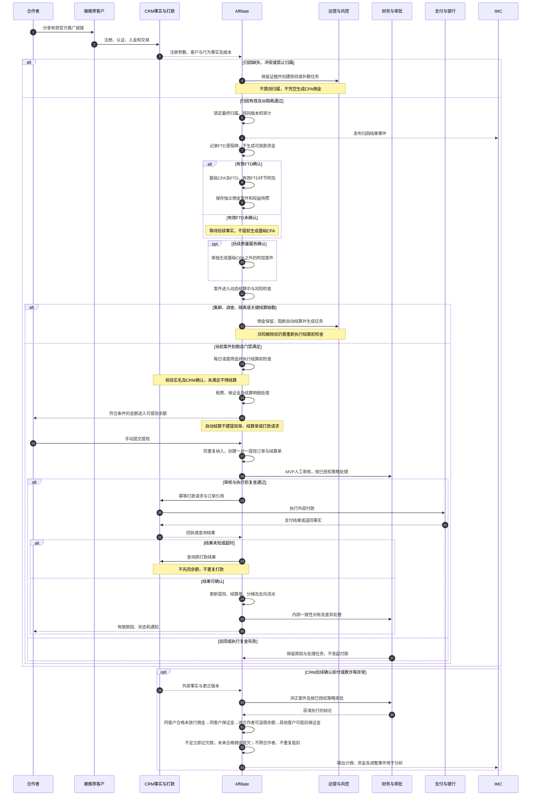

# 03 端到端业务泳道图 Mermaid 预览

版本：v0.1。状态：业务设计预览，待评审；不表示已实现或真实联调通过。  
对应[文字绘制说明](03-端到端业务泳道图.md)。本预览优先采用最新需求中的入驻及审批决定，原说明中的旧双角色限制不作为新增授权依据。

## 1. 入驻到官方链接

阶段化开链单独展开，避免把“审核、CRM确认、推广和资金资格”压成一个状态。图中发布阶段分支由已批准配置决定。

全量提前开链必须满足CRM创建/关联、主体冲突、实时硬风控和官方入口等门禁；不表示可以绕过CRM建档。全量开链的具体触发、失败撤销与在途点击细节仍按SBV-06/07核验。

## 2. 获客到结算、提现及追索

超时冻结和申诉细节见[资金时序预览](06-结算与资金时序图-Mermaid预览.md)，不在本图把信号驳回画成直接恢复放款。保证金按案件独立释放，质量服务不阻塞基础CPA。

## 3. 关键节点与来源

| 节点/连接 | 精确来源 |
| --- | --- |
| E01至E13，阶段化开链与确认失败 | [用户与业务流程§2.1及§3](../../需求文档/02-用户与业务流程-v0.1.md)；[DEC-015至029](../../需求文档/09-决策与待确认事项-v0.1.md) |
| E14至E18，开链和驳回停链 | 用户与业务流程§2.1、§3；DEC-016、025、026 |
| 归因与计佣交接 | 用户与业务流程§2.2；[业务规则§3](../../需求文档/03-业务规则与状态-v0.1.md)；[CPA方案§2](../业务规则/Affiliate%20CPA设计方案-v1.6.md) |
| 每日结算、月度结算单、手动提现及CRM打款 | [接口v0.14§8A.2至8A.6](../../接口文档/Affiliate接口文档-v0.14-设计稿.md)；[资金专题§2A、3A、4](../../评审资料包/基础资料/13-Affiliate佣金结算与资金时序图-v0.2.md) |
| 审批不沿用旧敏感双角色限制 | 决策记录DEC-032及OPEN-REQ-017；[核验台账SBV-22](核验/服务蓝图核验台账.md) |
| 结算实名门槛、状态分离 | [待决事项§1A.15“合作者实名门槛”](../待决事项.md)；[状态字典§14](../../评审资料包/基础资料/05-状态与原因码字典-v0.4.md) |

## 4. 待确认与核验

| 原编号 | 为什么影响图示 | 类型及停止边界 |
| --- | --- | --- |
| SBV-06/07、OPEN-REQ-009/012 | 提前开链、撤销和在途流量处理 | 技术/业务细化；不据图认定所有全量开链条件已实现 |
| SBV-12、OPEN-REQ-001 | 资格原始事实与最终判定分工未完全一致 | 专业职责核验；不把全资格计算移给CRM |
| SBV-22、OPEN-REQ-017 | 最新自动审核方向已有确认，动作策略未落表 | 权限契约细化；图不自行增授任何动作 |
| VIS-RISK-Q01、SBV-17 | 超时冻结何时可申请/执行解除 | 业务时点决策；转06待决分支，不直接恢复 |
| SBV-19/20 | CRM实际付款通道、部分支付和重试关系 | 技术/财务核验；未知先查询，不能据图重付 |
