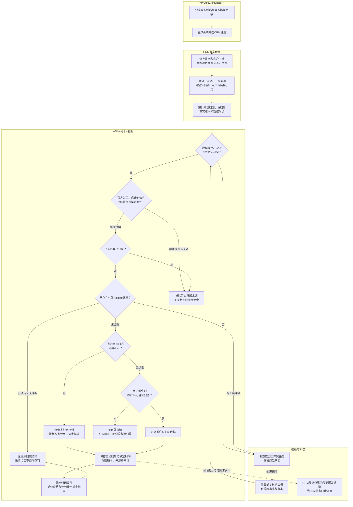
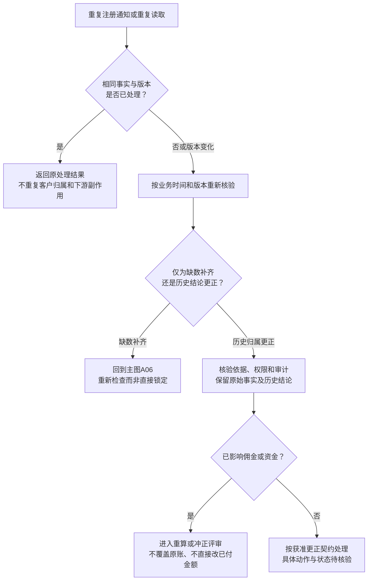

# 04 注册归因泳道图 Mermaid 预览

版本：v0.1。状态：业务设计预览，待CRM及技术评审；不表示接口、表/视图或链路已交付。  
对应[文字绘制说明](04-注册归因泳道图.md)。图内代码仅为绘图节点，不新增业务编号。

## 1. 官方点击到最终归属

实线是已记载的设计链路；虚线只表示待评审回传依赖，不表示可以直接写CRM原表。非法或高风险点击被排除，不把它自动替换成推广码；推广码兜底只针对符合既有规则的点击缺失。

一般集群疑似属于后续风险控制，不等同于没有合法来源。对合法归属且事实充分的案件，继续计佣、阻断自动结算的规则不变。

## 2. 异常恢复与更正边界

X10不是新增“随意改归属”入口。资料未明确的更正动作、批准者和时间窗口不在图中补造。

## 3. 节点及来源对应

| 节点/关系 | 来源及章节 |
| --- | --- |
| A01至A05：CRM保存参数与注册事实 | [用户与业务流程§2.2、§4](../../需求文档/02-用户与业务流程-v0.1.md)；[原注册归因专题§3、4](../../评审资料包/基础资料/12-Affiliate注册归因泳道与时序图-v0.1.md) |
| A06至A17：有效性、首次有效点击、推广码兜底及IB排除 | 原注册归因专题§5、6；[核验台账SBV-08/09](核验/服务蓝图核验台账.md) |
| A14/A15：锁定、不因后续点击改判 | 原注册归因专题§6.4、6.7、6.11及6.12 |
| A19/A20、X01至X10：补偿与更正边界 | [文字说明§5](04-注册归因泳道图.md)；核验台账SBV-09/10及14 |
| A21：最终结果是否回传CRM | [CRM评审§11.1至11.2](../CRM事件与数据/05-CRM系统评审文档-v0.1.md)；[待决事项“CRM业务回传”议题](../待决事项.md) |

## 4. 待核验

| 原编号 | 为什么影响图示 | 类型及关闭要求 |
| --- | --- | --- |
| SBV-08/09 | 点击、注册和客户能否同对象追溯；首触时间、窗口和兜底输入是否一致 | CRM/技术核验；提供真实字段与样本、拒绝和补偿结果 |
| SBV-10 | 数据库直连不自动授权任意读写，缺数与更正需要增量依据 | 数据库/安全/后端核验；受控表/视图、权限、游标及版本契约 |
| OPEN-51“CRM业务回传” | 是否回传最终归属及用途决定A21是否有执行出口 | 业务/CRM/合规决策；保留待评审节点，不代替同号“实名门槛”议题 |

当前首次有效点击、IB隔离、无来源不猜测及锁定后不自动改判已有资料依据，不重复要求用户确认业务方向。
