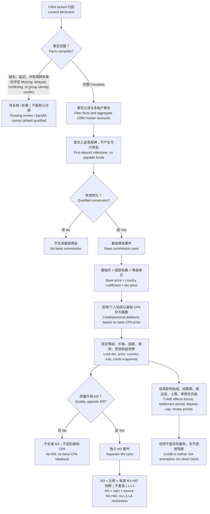
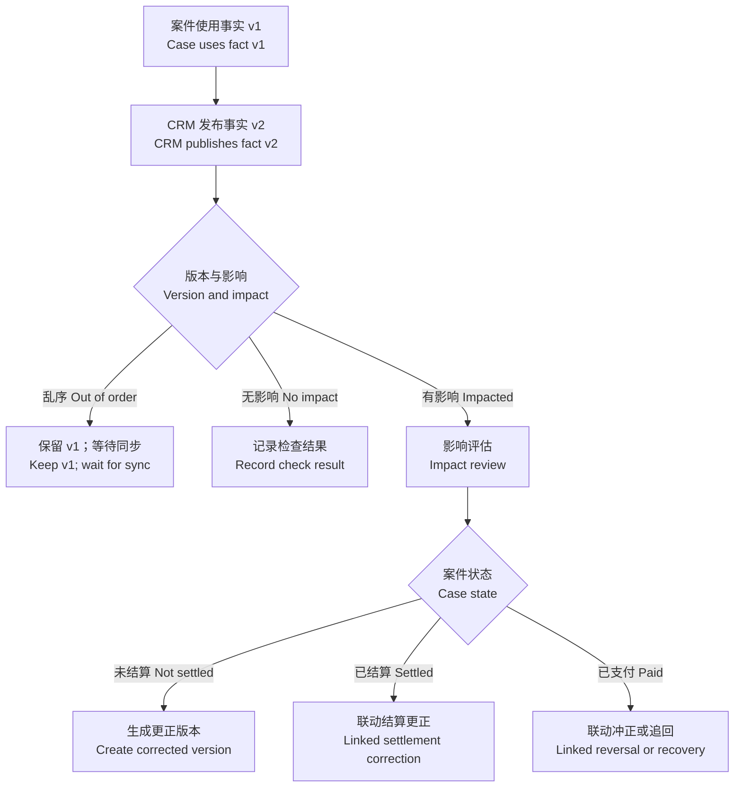
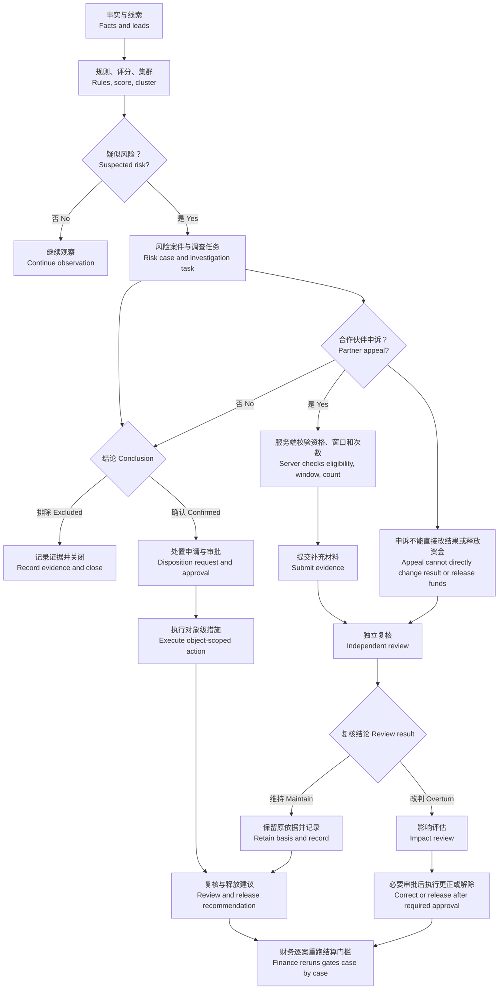
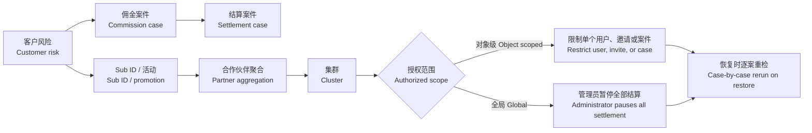

# 04 资格、佣金与风险 / Qualification, Commission, And Risk

Version: v1.0; Date: 2026-11-16
Source: [Qualification And Commission](../../PRD_EN/slices/qualification-commission-v0.1.md), [Risk And Settlement Gates](../../PRD_EN/slices/risk-settlement-gates-v0.1.md)

## 11. 资格里程碑与佣金生成 / Qualification Milestones And Commission

## 12. 佣金更正与重算 / Commission Correction And Recalculation

## 13. 风险发现与处置 / Risk Detection And Disposition

## 14. 风险传播与影响范围 / Risk Propagation And Scope

