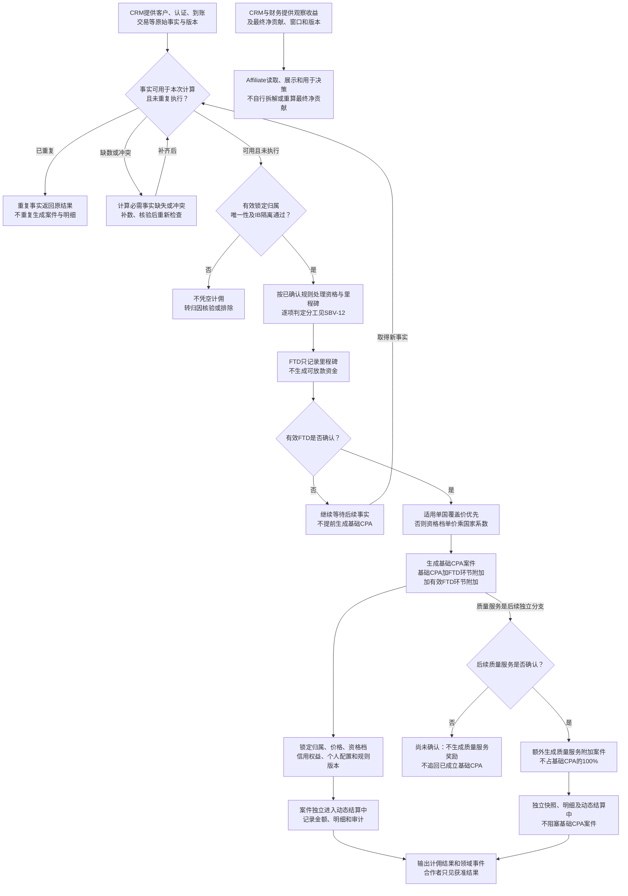
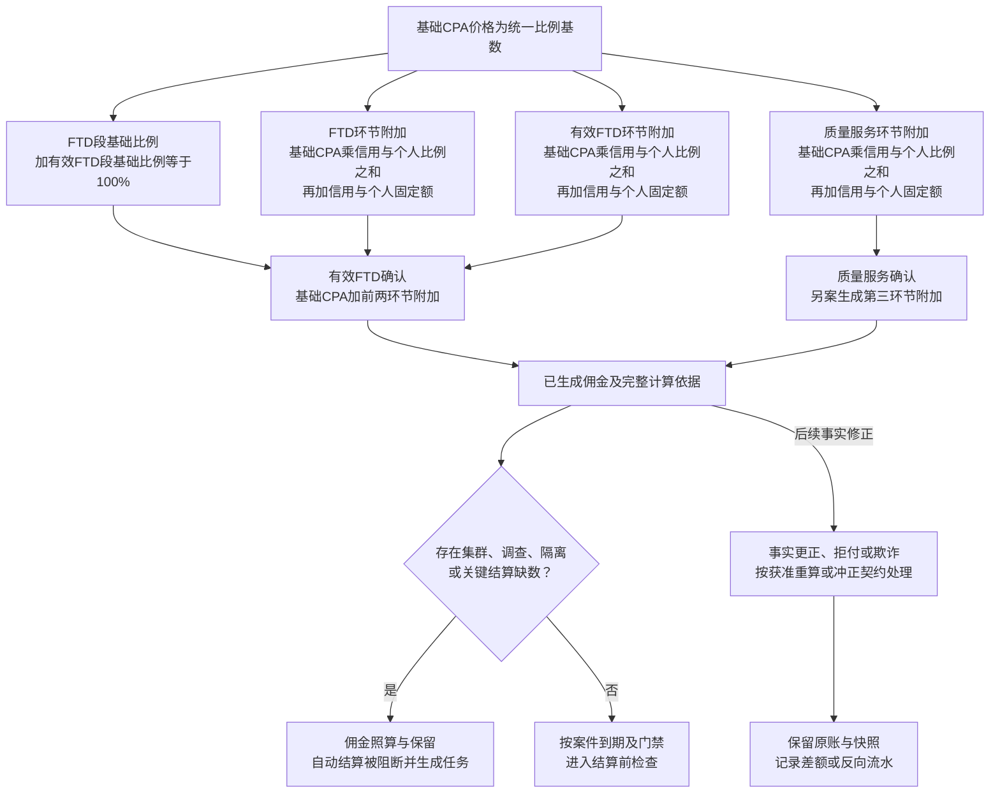

# 05 佣金计算流程图 Mermaid 预览

版本：v0.1。状态：业务设计预览，待业务、财务及技术评审；不表示已实现。  
对应[文字绘制说明](05-佣金计算流程图.md)。仅表达已确认计算关系，资格原始事实与判定的具体分工仍按SBV-12细化。

## 1. 事实、资格与三环节计佣

观察收益支线与资格计佣主链分开。CRM最终净贡献来源已确认，不代表全部资格判定已转移给CRM；本图不补造客户净贡献低于某值就必然拒绝计佣的规则。

## 2. 金额构成与风险边界

各等级和每位合作者分别配置三环节比例与固定金额；图中不填生产数值。R0-R3风险档与C0-C4信用等级分开。质量服务只展示获准结果，不展示内部进度、差项、权重或完整规则。

## 3. 节点与来源

| 节点/连接 | 来源与章节 |
| --- | --- |
| C01至C10：事实、归因和里程碑 | [用户与业务流程§2.2、2.3](../../需求文档/02-用户与业务流程-v0.1.md)；[业务规则§2、3](../../需求文档/03-业务规则与状态-v0.1.md) |
| C11至C19、M01至M07：基础CPA与三环节附加 | [CPA方案§2.1至2.4、§3](../业务规则/Affiliate%20CPA设计方案-v1.6.md)；业务规则§3.1、3.2 |
| C20/C21：观察收益及最终净贡献 | 业务规则§6；[DEC-012](../../需求文档/09-决策与待确认事项-v0.1.md) |
| M08至M13：计佣与结算分离、更正保留原账 | 业务规则§4.1；[状态字典§14.3](../../评审资料包/基础资料/05-状态与原因码字典-v0.4.md)；[资金专题§4](../../评审资料包/基础资料/13-Affiliate佣金结算与资金时序图-v0.2.md) |

## 4. 待确认及核验

| 原编号 | 为什么影响图示 | 类型及停止边界 |
| --- | --- | --- |
| SBV-12、OPEN-REQ-001 | 资格输入、CRM观察结果和Affiliate判定结论在旧资料中不完全一致 | 专业职责核验；逐项分工签核前不据图新增生产资格计算职责 |
| SBV-11/14 | 到账、交易、更正版本和快照时点影响金额一致性 | CRM/后端/财务技术核验，补同客户事实、规则版本和重放结果 |
| SBV-13 | 三环节明细需证明计算完整且幂等 | 开发后验证，不重问已确认计算方向 |
| OPEN-53/54及SHARE-Q01至06 | 首版分润方向已确认，制度仍为讨论稿 | 专业参数与制度评审；本图不把讨论稿接入已冻结开发主链 |

金额精度、舍入和生产比例由原契约及专业参数评审承接，图稿不自行给默认值。
