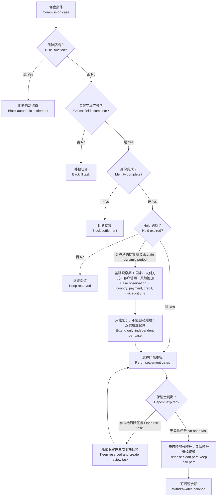
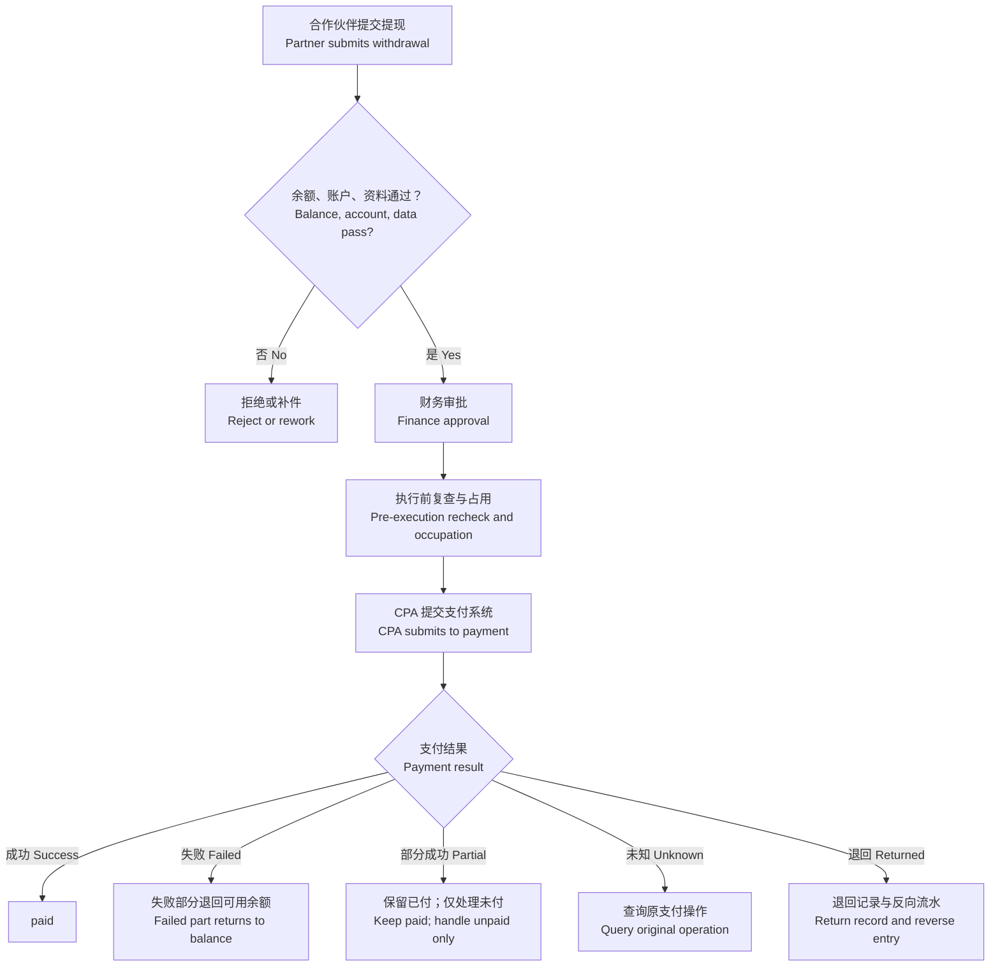
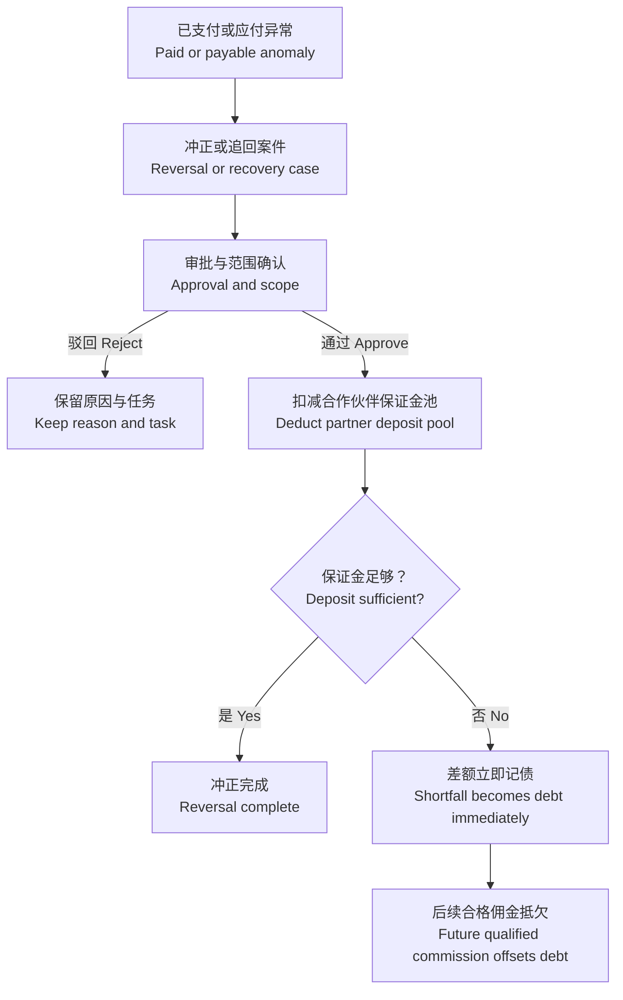
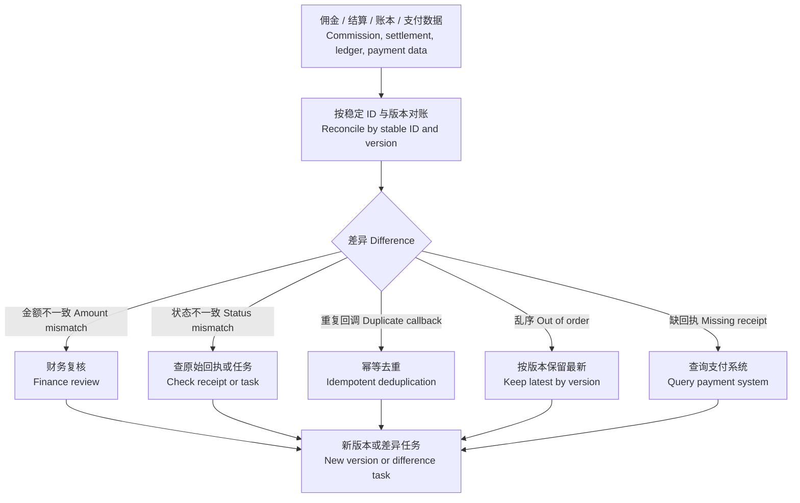

# 05 资金、结算与支付 / Funds, Settlement, And Payment

Version: v1.0; Date: 2026-11-16
Source: [Settlement, Withdrawal, And Payment](../../PRD_EN/slices/settlement-withdrawal-payment-v0.1.md)

## 15. 结算门槛与保证金 / Settlement Gates And Deposit Reserve

## 16. 提现与支付结果 / Withdrawal And Payment Results

## 17. 冲正、追回与债务 / Reversal, Recovery, And Debt

## 18. 对账与差异处理 / Reconciliation And Differences

