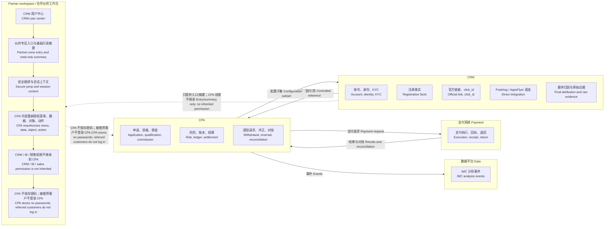
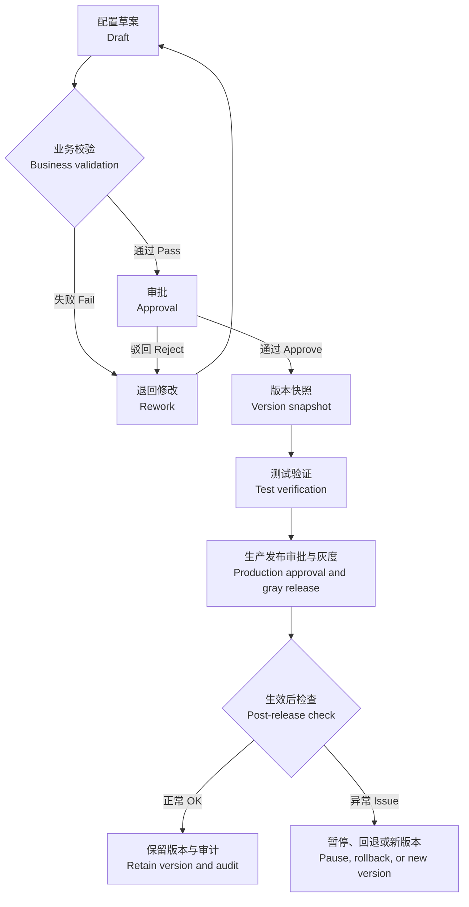

# 06 系统边界与配置 / System Boundaries And Configuration

Version: v1.0; Date: 2026-11-16
Source: [Architecture Boundary](../../PRD_EN/status/architecture-boundary-change-2026-11-16.md), [Requirement Workflow](../../PRD_EN/03-REQUIREMENT-ORIGIN-AND-WORKFLOW.md)

## 19. 跨系统权威边界与数据流 / System Boundaries And Data Flow

## 20. 配置审批与发布回退 / Configuration Approval And Rollback

