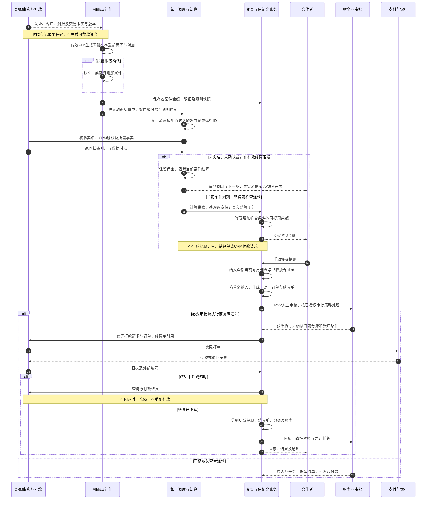
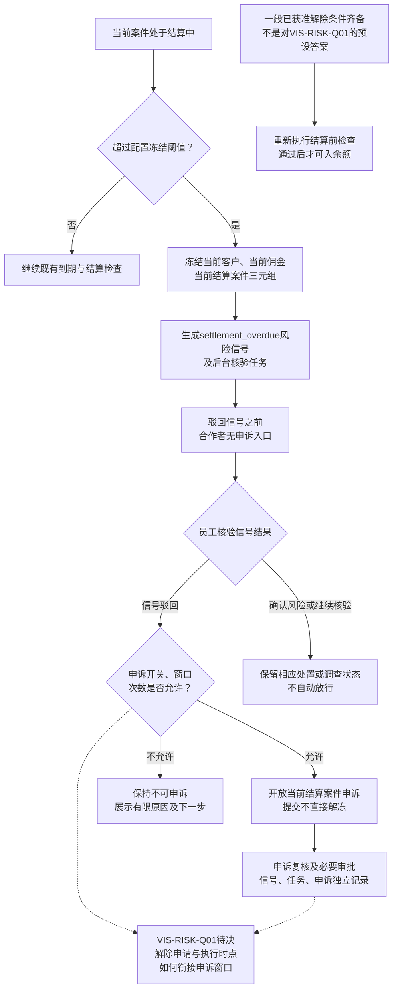
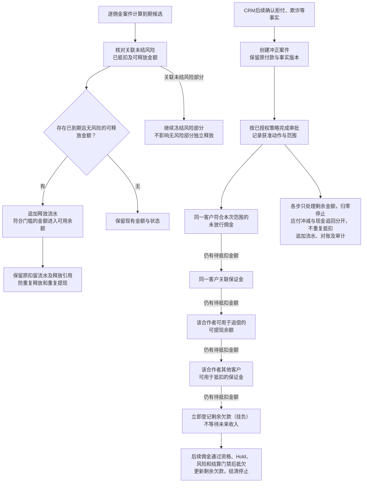

# 06 结算与资金时序图 Mermaid 预览

版本：v0.1。状态：业务设计预览，待财务、风控、CRM与技术评审；不表示真实资金链已通过。  
对应[文字绘制说明](06-结算与资金时序图.md)。采用现行覆盖章节，旧“周期结算单先审再入余额”和旧双角色限制不用于确定本预览的执行规则。

## 1. 每日自动结算与手动提现

`settled`仅表示入钱包，付款由提现状态表达。结算时已确认的税费不得在提现时重复扣除。保证金逐案件到期并独立处理，不必等待提现或结算单生成。

## 2. 超时冻结、信号与申诉

R13没有到R14的执行连线。该业务时点尚未决定，不能用“驳回信号”“申诉受理”或“任务关闭”越过待决项。三元组之外的客户、佣金、同批次案件不连带冻结。

## 3. 保证金释放与付款后冲正

2026-11-12用户确认：允许同一合作者内跨客户使用保证金，不跨合作者，不扩大其他客户风险冻结；已释放并入余额的保证金不能再作为保证金重复抵扣。欠款立即登记，未来合格佣金抵欠，记欠款不等于现金追回或案件关闭。保证金起算点、保留期和部分风险金额分配仍需专业签核。

## 4. 来源对应

| 图中关系 | 来源及章节 |
| --- | --- |
| 有效FTD、质量服务分别建案 | [业务规则§3](../../需求文档/03-业务规则与状态-v0.1.md)；[资金专题§4.1至4.3](../../评审资料包/基础资料/13-Affiliate佣金结算与资金时序图-v0.2.md) |
| 每日入余额、月度结算单、手动提现、CRM打款 | [接口§8A.2至8A.6](../../接口文档/Affiliate接口文档-v0.14-设计稿.md)；资金专题§2A、3A |
| 状态、税费与保证金分离 | [状态字典§14.1、14.3至14.6](../../评审资料包/基础资料/05-状态与原因码字典-v0.4.md) |
| 结算实名及CRM确认门槛 | [待决事项§1A.15“合作者实名门槛”](../待决事项.md)；[用户流程§2.1](../../需求文档/02-用户与业务流程-v0.1.md) |
| R01至R15：超时冻结、申诉及重检 | [业务规则§5](../../需求文档/03-业务规则与状态-v0.1.md)；资金专题§4.5至4.7及§5 |
| G01至G07、V01至V10 | 资金专题§4.8至4.14；[FUND-01及2026-11-12补充](../待决事项.md#1a18-佣金结算与资金时序决策2026-11-09)；[资金统一契约第七节](../01-佣金结算与资金流转统一事件契约与数据指标-V1.0.md#七计算与资金守恒)；[核验台账SBV-18/20](核验/服务蓝图核验台账.md) |
| 审批按已授权策略 | [DEC-032、OPEN-REQ-017](../../需求文档/09-决策与待确认事项-v0.1.md)；核验台账SBV-22 |

## 5. 待确认与核验

| 原编号 | 为什么影响图示 | 类型与停止边界 |
| --- | --- | --- |
| VIS-RISK-Q01、SBV-17 | 冻结解除申请/执行与申诉窗口时点未决定 | 需要业务决策；R13停止，不默认开放即可解冻 |
| SBV-18 | 保证金起算、风险金额分配影响释放与抵扣 | 财务/风控规则签核及技术核验，不填固定天数 |
| SBV-19/20 | CRM回执、部分成功、退款及新尝试关联影响资金守恒 | CRM/后端/财务核验；未知先查，保留原单和版本 |
| SBV-22、OPEN-REQ-017 | 自动审核方向已定，具体动作配置待统一 | 权限契约细化；不凭旧双角色条款或本图扩大授权 |
