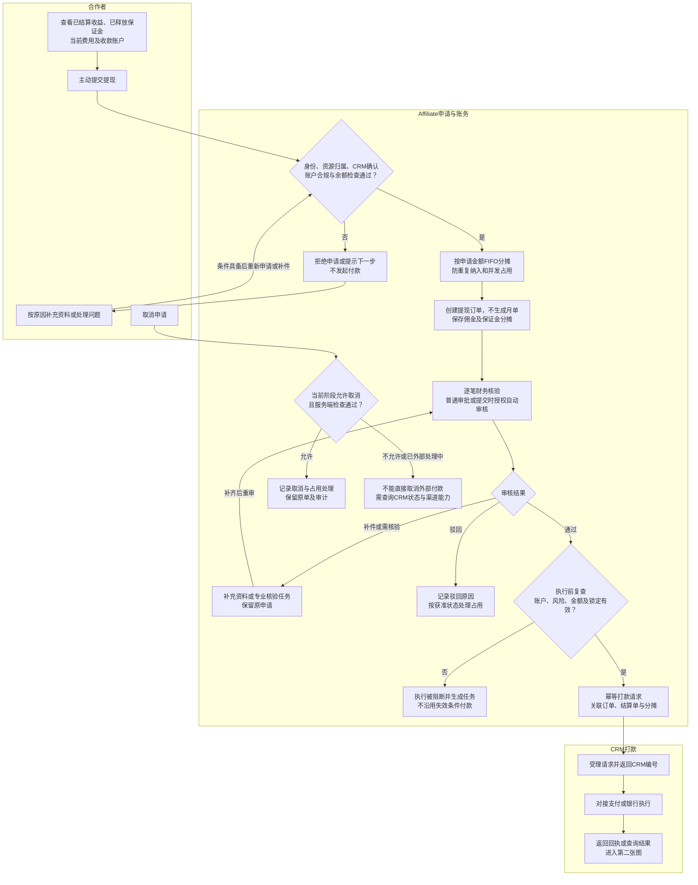
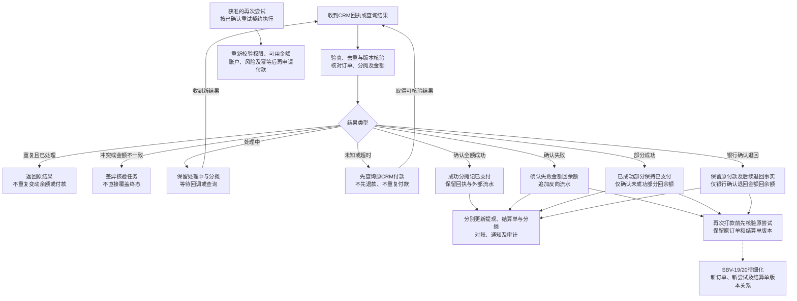

# 07 提现流程图 Mermaid 预览

版本：v0.1。状态：业务设计预览，待财务、CRM及技术评审；不代表真实打款已完成。  
对应[文字绘制说明](07-提现流程图.md)。审批以[角色权限与审批契约](../契约/14-角色权限与审批契约-v1.0.md)为准。

## 1. 提交、审核与CRM受理

结算前已核验实名；未实名不得自动或人工结算。提现仍复查当前CRM确认、账户和合规状态。申请时防并发重复纳入，审批后锁定与执行前复查的具体事务边界按SBV-19统一，不据本图填实现锁字段。

提现按申请金额在服务端FIFO分摊，可引用一张或多张月单的可用明细；提现提交不生成月单。结算已扣税费不在提现重复扣除。

## 2. 回执、失败、退回与再次尝试

P14没有连接P15，表示重试对象关系尚未细化，不能用一条“重新付款”箭头越过。未知结果也不连接退回余额或再次付款。部分成功为应覆盖的设计分支，渠道实际支持能力仍待CRM确认。

## 3. 关键节点与来源

| 节点/连接 | 精确来源 |
| --- | --- |
| W01至W08：提交、归集、防重复、月度结算单分摊引用 | [接口v0.14§8A.3、8A.4](../../接口文档/Affiliate接口文档-v0.14-设计稿.md)；[状态字典§14.5](../../评审资料包/基础资料/05-状态与原因码字典-v0.4.md) |
| W09至W14：逐笔核验、审批、支付前复查与任务 | [主PRD第6节](../Affiliate-MVP-PRD-v0.1-首轮完善稿.md)；[权限契约第5.2节](../契约/14-角色权限与审批契约-v1.0.md) |
| W15、W19至W21：CRM实际打款 | 接口§8A.5、8A.6；资金专题§2A及3A |
| W16至W18：允许状态取消、外部付款不可凭UI撤回 | 接口§8A.3取消接口；[文字说明§4](07-提现流程图.md) |
| P01至P12：未知先查、失败退回、部分成功与反向流水 | 资金专题§4.10、4.12、4.14及§5；状态字典§14.3 |
| P13至P16：再次尝试关系不预设 | 资金专题§3A及§5；[核验台账SBV-19/20](核验/服务蓝图核验台账.md) |
| 实名和税费门槛 | [待决事项§1A.15“合作者实名门槛”](../待决事项.md)；状态字典§14.1 |

## 4. 待确认与核验

| 原编号 | 为什么影响流程 | 类型与关闭要求 |
| --- | --- | --- |
| SBV-19 | 当前按申请金额FIFO分摊，仍需验证CRM受理与余额预占 | 技术/财务核验，保留同版分摊及并发占用证据 |
| SBV-20 | 部分成功、银行退回、手续费及新尝试关系影响资金守恒和防重付 | CRM/财务/后端核验，需实际回执样例、逐分摊守恒及重试契约 |
| SBV-22、OPEN-REQ-017 | 授权自动审核与逐笔核验均须落实；目标IAM动作配置待验 | 测试越权拒绝、自审双审计及两条路径的支付前复查 |

自审若在获准配置内使用，提交与审批必须同事务记录SUBMIT、APPROVE双审计；不得把配置自动审核误作未经授权的自动打款。
