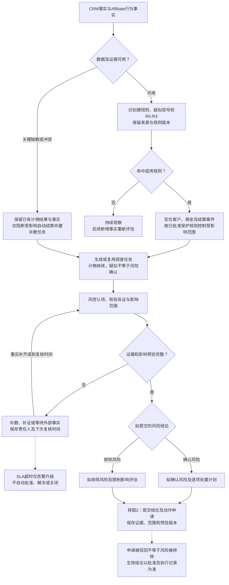
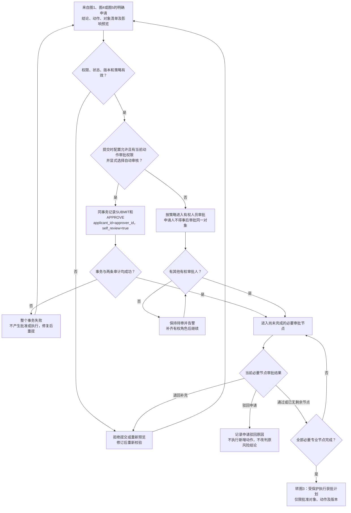
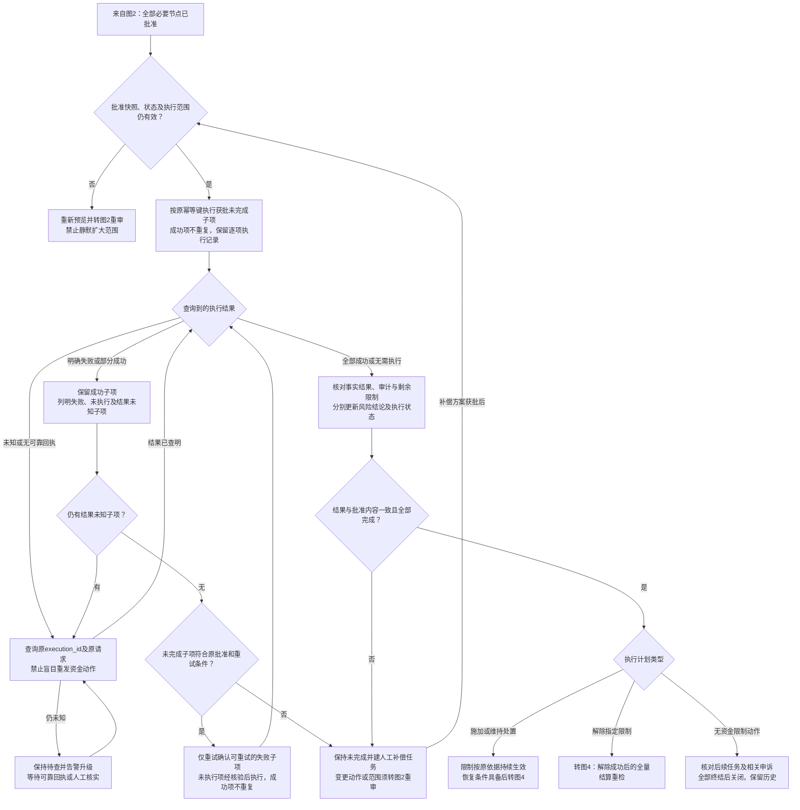
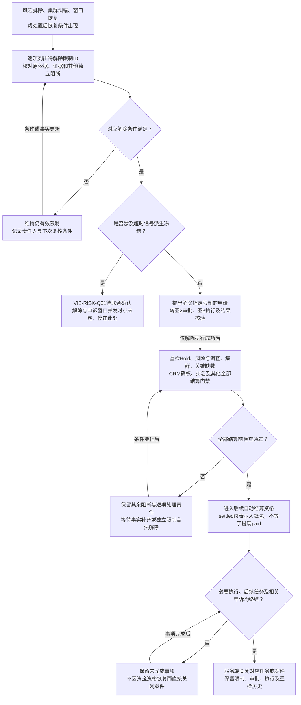
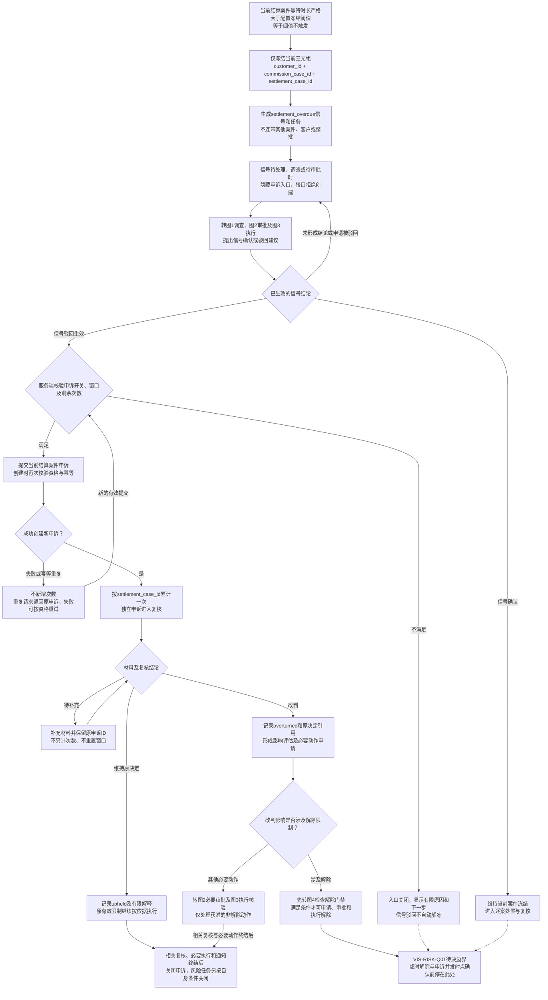

# 08 风险处置流程图 Mermaid预览

版本：v0.2；更新日期：2026-11-12。

状态：目标设计图稿，待跨岗评审；不代表生产处置授权或功能已实现。

[文字说明](08-风险处置流程图.md) · [Drawio XML](08-风险处置流程图-Drawio.xml) · [HTML预览](静态页面/08.html)。五张子图与XML五页一一对应，审批、执行和解除以同一案件、申请和限制ID衔接。旧稿见[版本留档](../../归档/风控流程图-2026-11-12/README.md)。

## 1. 识别、调查与风险结论

CRM原始事实不可被Affiliate风险结论覆盖；R0-R3风险档与C0-C4信用等级独立。无足够计算事实时保留已有计佣结果、等待补数，不虚构佣金。

## 2. 审批与自审门禁

自审按[权限审批契约§5.2](../契约/14-角色权限与审批契约-v1.0.md)执行。自审不替代其他风控、合规、财务等必要专业节点；具体动作权限与配置仍须按正式策略核验。驳回的是本次申请，已有独立限制继续按原依据生效。

## 3. 执行、未知结果与补偿

“结果未知”是核实分支，不新增生产状态枚举。部分成功不得按整单失败重放；冲正或追索通过关联财务案件处理，不修改历史流水。任务关闭须有服务端执行证据。

## 4. 解除限制与结算重检

解除的是指定限制，不豁免其他门禁。图3的“解除成功”返回本图全量重检节点；本图不是解除即支付的快捷链。超时派生冻结不沿普通解除分支绕过待决时点。

## 5. 超时冻结与申诉复核

补证超时只告警或升级，不凭SLA自动判维持、改判、解冻或关闭。窗口到期及次数用尽不自动解除冻结。申诉改判只产生影响评估和获准动作，历史决定、资金及审计记录保留。

## 6. 依据与核对范围

| 内容 | 当前依据 | 保留边界 |
| --- | --- | --- |
| 信号、案件、任务、审批、执行、申诉各自状态 | [风险状态机§4至9](../状态机/03-风险风控防薅羊毛状态机-V1.0.md) | 申请驳回与风险排除不同；未知结果是查证分支 |
| 事件、影响范围、幂等与补偿 | [风险统一事件契约](../01-风险风控防薅羊毛统一事件契约与数据指标-V1.0.md) | 事实、结论、动作分离，生产能力待核验 |
| 提交时自审与专业节点 | [权限审批契约§5.2](../契约/14-角色权限与审批契约-v1.0.md) | 双审计同事务；未选自审不得事后自审 |
| 动态Hold与严格超时 | [动态Hold方案](../业务规则/Affiliate动态Hold方案-v0.4.md) | 取对应生效配置，不能用延期规避超时冻结 |
| 页面、预览与受保护执行 | [风险对象页面](../页面设计/管理端-061-risk-workbench-objects-风险对象.md)、[数据契约](../接口文档/Affiliate风险工作台页面数据契约-v1.0.md) | 页面不是最终执行或资金事实源 |
| 超时解除时点 | [VIS-RISK-Q01](../待决事项.md)、[服务蓝图核验台账](核验/服务蓝图核验台账.md) | 未确认前停止对应解除分支 |

阈值、SLA、真实接口和执行能力沿原专业评审核验；本次只补齐已有规则的流程表达。
