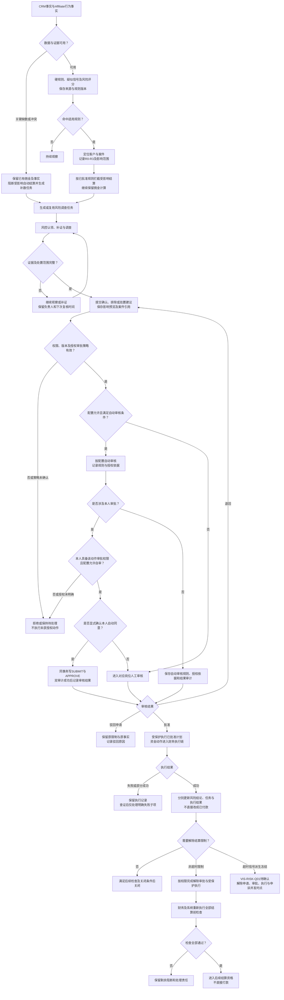
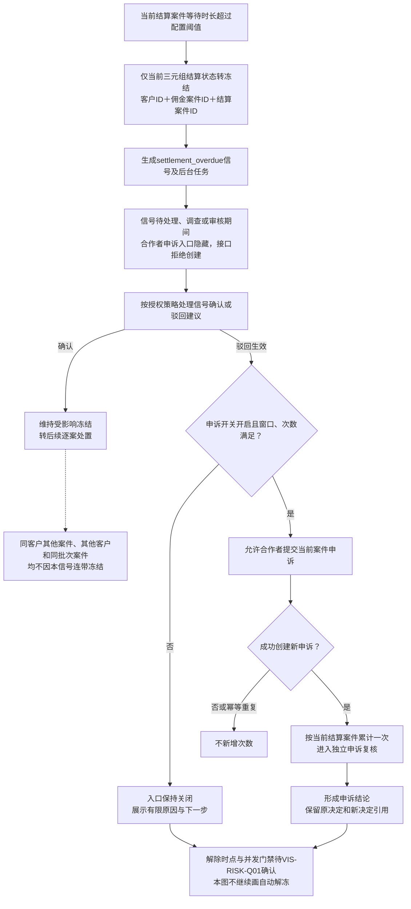

# 08 风险处置流程图 Mermaid预览

版本：v0.1预览稿。

状态：目标设计预览，待评审；不是已实现、完整冻结状态机或生产处置授权。

本图按[最新需求03第4、5、9节](../../需求文档/03-业务规则与状态-v0.1.md)、[需求决策DEC-013、014、021、032](../../需求文档/09-决策与待确认事项-v0.1.md)及当前风险专题整理。自动审核以对应权限和已授权配置为前提，具体动作边界仍待OPEN-REQ-017统一；不沿用旧资料“全部敏感动作禁止自审”的概括。

## 1. 识别、调查及处置

SLA超时只提醒和升级，不自动审批、解冻或关闭。自动规则引发的结算拦截与人工提交的处置申请分开审计。CRM确权、实名和其他独立门禁不能因单一风险排除而被跳过。

## 2. 超时冻结与申诉

## 3. 节点依据与待确认

|节点或连线|来源|边界|
|---|---|---|
|识别→逐案拦截→任务→调查|[需求03第4节](../../需求文档/03-业务规则与状态-v0.1.md)、[风险页面第7、10节](../../历史版本/2026-11-05文档归档/2026-11-10页面规范迁移/原型/页面规范/风险工作台-页面契约-v1.0.md)|有足够输入时计佣继续，不删除既有佣金|
|权限→配置自动/人工审核→受保护执行|[需求07第1、2节](../../需求文档/07-权限、非功能与验收-v0.1.md)、DEC-032|动作范围待OPEN-REQ-017；旧自审限制不能冒充最新确认|
|三元组冻结→信号→申诉资格|[待决事项第1A.12、1A.14节](../待决事项.md)、[接口第6B.4A节](../../接口文档/Affiliate接口文档-v0.14-设计稿.md)|驳回信号及申诉均不自动放行|
|解除时点待定节点|[待决事项VIS-RISK-Q01](../待决事项.md)、[核验SBV-17/22](核验/服务蓝图核验台账.md)|待确认分支停在节点，不能据图执行|
|入余额与付款分离|[状态字典第14.3节](../../评审资料包/基础资料/05-状态与原因码字典-v0.4.md)|settled是入钱包，paid只属于提现|

图中不确定点为解除时点及审批动作授权范围；阈值、SLA数值和真实执行能力沿专业评审核验。

[返回文字绘图说明](08-风险处置流程图.md)。
