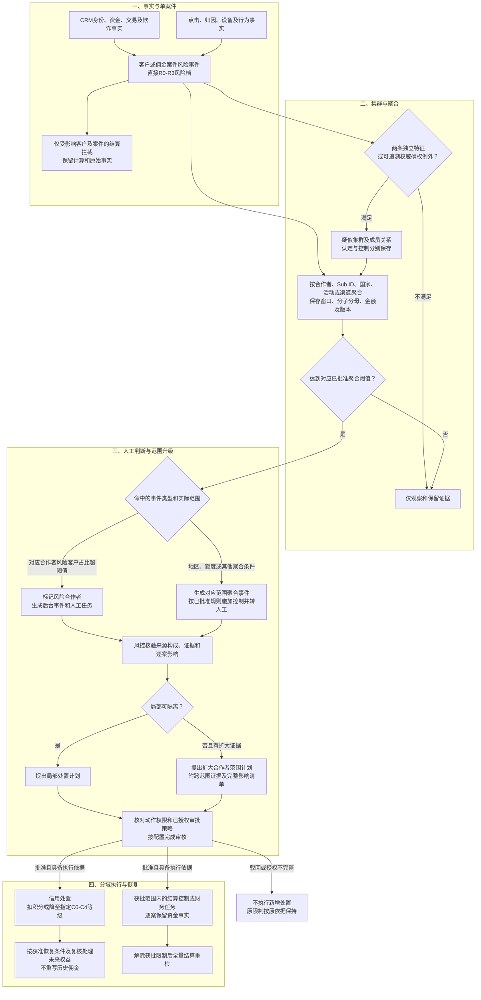
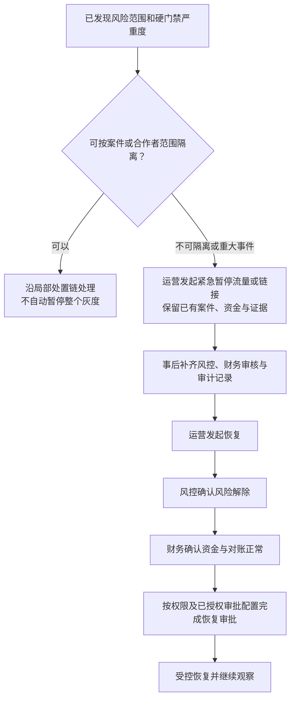

# 09 风险传播图 Mermaid预览

版本：v0.1预览稿。

状态：目标设计预览，待评审；展示传播条件与责任，不表示生产阈值或执行权限已配置。

按[需求03第4节](../../需求文档/03-业务规则与状态-v0.1.md)及DEC-013/014/021区分案件级、合作者级和全局级。单个客户风险不直接升级为全合作者限制；风险客户占比超阈值先生成风险标记、事件和人工任务。

## 1. 事实、聚合与处置范围

聚合事件和限制必须区分：对应合作者风险客户占比超阈值时才走风险合作者标记路径；国家、地区、额度等其他聚合按其实际范围处理，不自动将所有关联合作者标记为风险合作者。风险占比触发本身不等于自动冻结全合作者资金。适用规则明确允许的合作者级流量/额度/结算控制，也需记录对应范围和规则；不能借单案超时信号扩大冻结。

## 2. 全局暂停与恢复

## 3. 信用及关联限制

- R0-R3是即时风险档，C0-C4是合作者信用等级；合作者或集群的关联最高R档不能当作信用等级。
- 普通风险信用处置二选一；硬风险可按配置组合扣积分与目标等级，仍受最低等级、单次/周期上限和重复事件保护。
- 目标等级只向下生效；当前已更严格时记录目标已满足，不能反向升级。
- 集群认定、成员纠错、风险排除、信用恢复和资金解除分别留痕，不互相直接覆盖。
- 超时冻结绑定客户、佣金、结算案件三元组；其解除时点沿VIS-RISK-Q01待确认，不通过此传播图决定。

## 4. 节点依据

|节点或连线|来源|需要保留的证据|
|---|---|---|
|单案→聚合条件→人工事件|[需求03第4.1～4.3节](../../需求文档/03-业务规则与状态-v0.1.md)、[待决OPEN-30、40、43、47](../待决事项.md)|触发快照、分子分母、窗口、规则版本、受影响案件|
|两特征与权威例外|[风险页面第7节](../../历史版本/2026-11-05文档归档/2026-11-10页面规范迁移/原型/页面规范/风险工作台-页面契约-v1.0.md)、[待决OPEN-23/28](../待决事项.md)|独立性、来源、确权及复核依据|
|信用与资金分域执行|[配置项与参数字典契约](../契约/13-配置项与参数字典-v1.0.md)、[待决OPEN-38～46](../待决事项.md)|生效时间、等级/权益快照、审批及执行记录|
|全局暂停和恢复|[需求03第4.4、9节](../../需求文档/03-业务规则与状态-v0.1.md)、DEC-030/033|暂停原因、范围、运营发起及风控财务恢复确认|
|自动审核边界|[需求07第1节](../../需求文档/07-权限、非功能与验收-v0.1.md)、[核验SBV-22](核验/服务蓝图核验台账.md)|按DEC-032方向，具体动作授权待OPEN-REQ-017|

[返回文字绘图说明](09-风险传播图.md)。
