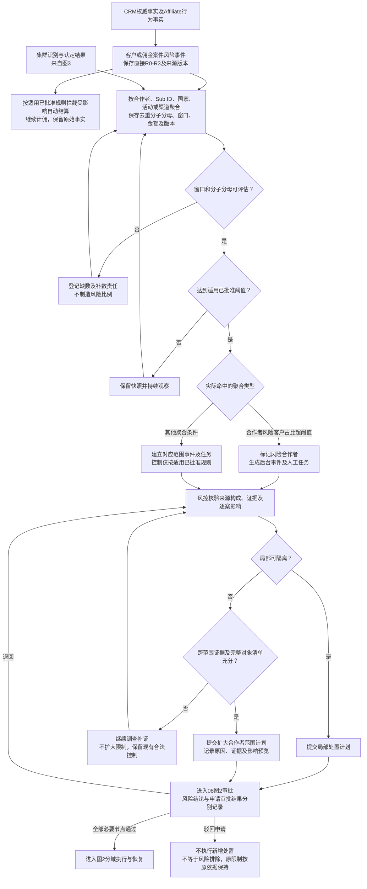
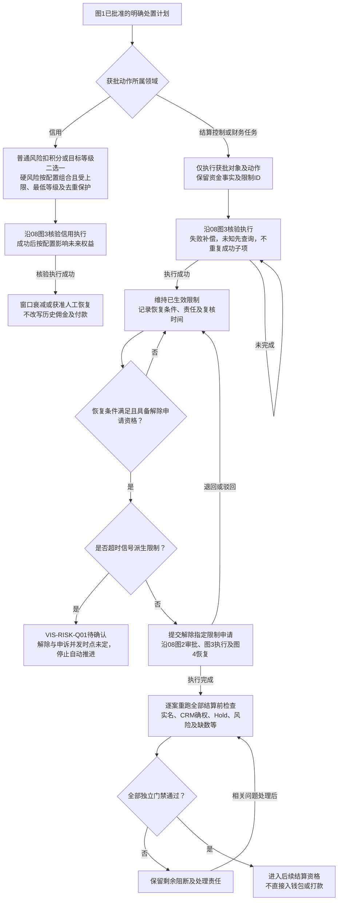
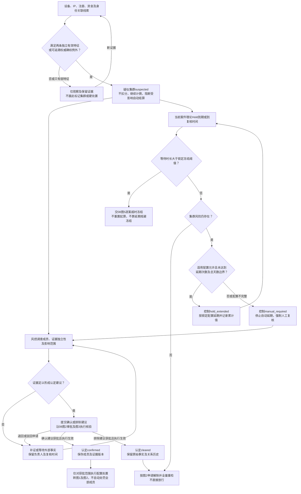
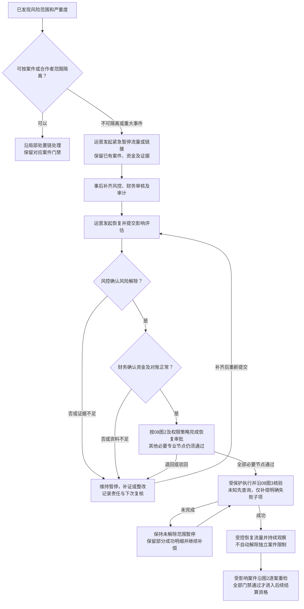

# 09 风险传播图 Mermaid预览

版本：v0.2。日期：2026-11-12。

状态：目标设计预览，待跨岗及专业评审；不表示生产阈值、执行权限或外部能力已配置。与[文字说明](09-风险传播图.md)、[Drawio XML](09-风险传播图-Drawio.xml)及[HTML预览](静态页面/09.html)配套使用。

## 1. 事实、聚合与处置范围

聚合超阈值先形成对应对象的标记、事件和任务，不自动冻结全合作者资金。单案`settlement_overdue`始终只绑定当前客户、佣金和结算案件三元组，不因聚合扩大冻结。

## 2. 分域执行、维持限制与恢复

风险关闭、信用恢复、限制解除和结算资格分别记录。R0-R3与C0-C4独立，C0本身不阻断结算；申诉改判、风险排除或窗口到期不直接改账。`settled`为入钱包，`paid`属于提现支付。

## 3. 集群调查与Hold到期闭环

集群认定与控制状态分别保存。同源IP与IP网段不能伪作两条独立特征。延期与调查并行，不重置原Hold起算；超过冻结阈值优先进入超时流程，等于阈值时不触发超时冻结。生产特征、延期上限及各时限仍待责任方签核；SLA超时只告警升级。

## 4. 全局暂停与恢复

自动审核遵循[权限审批契约第5.2节](../契约/14-角色权限与审批契约-v1.0.md)：提交时有权、配置允许、门禁通过且显式选择，才可同事务记录`SUBMIT`、`APPROVE`和`self_review=true`；未选择不得后续自审。其他必要专业节点不能由自审替代；无有权审批人则保持待审并告警。

## 5. 节点依据与待评审边界

|图块|来源|核对重点|
|---|---|---|
|图1范围及聚合|[风险统一事件契约](../01-风险风控防薅羊毛统一事件契约与数据指标-V1.0.md)、[风险工作台页面设计](../页面设计/管理端-061-risk-workbench-objects-风险对象.md)、[待决事项](../待决事项.md)|触发快照与当前值分开；扩围需要证据和明确对象清单|
|图2执行与恢复|[风险状态机第七至九节](../状态机/03-风险风控防薅羊毛状态机-V1.0.md)、[配置字典](../契约/13-配置项与参数字典-v1.0.md)、[08风险处置图](08-风险处置流程图-Mermaid预览.md)|审批不等于执行；维持限制、解除和重检分开；VIS-RISK-Q01保持待决|
|图3集群与延期|[风险状态机第六节](../状态机/03-风险风控防薅羊毛状态机-V1.0.md)、[动态Hold第4、5节](../业务规则/Affiliate动态Hold方案-v0.4.md)|疑似不扣分；认定和控制独立；达到上限转人工，超过冻结阈值不再自动延期|
|图4暂停恢复与审批|[权限审批契约第5.2、6节](../契约/14-角色权限与审批契约-v1.0.md)、[风险状态机第九节](../状态机/03-风险风控防薅羊毛状态机-V1.0.md)|运营发起，风控及财务确认，审批执行后逐案重检|

图中不填写生产阈值、特征权重、SLA或延期数值，也不以图稿核销业务待决、真实能力或专业签核。
