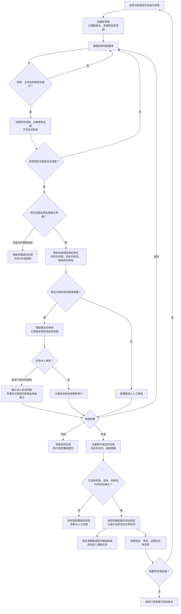

# 10 配置审批流程图 Mermaid预览

版本：v0.1预览稿。

状态：目标设计预览，待评审；配置版本模型与准确动作授权尚未冻结。

审批方向采用最新DEC-032：具备对应权限时可按配置自动审核，自审同事务双审计。旧IREV-02及原说明中“敏感动作一律禁自审”的表述待回填，不作为本预览当前规则。

## 1. 草稿、审批及生效

审批通过不等于已生效，发布协作模式不替代业务授权；要求的风控/财务等必要审批未完成时不能发布。

## 2. 校验和历史保护

|校验点|必须表达的规则|依据|
|---|---|---|
|CPA与奖励|基础FTD段+有效FTD段合计100%；质量服务在基础外；比例以基础CPA价为准|[文字说明第4节](10-配置审批流程图.md)、[业务规则第3节](../../需求文档/03-业务规则与状态-v0.1.md)|
|风险与信用|R0-R3和C0-C4独立；目标等级不得反向提升|[配置项与参数字典契约](../契约/13-配置项与参数字典-v1.0.md)|
|试算|保存输入、版本、差异和资金影响，不修改真实账务|配置方案第6.4节|
|自动审核与双审计|具备权限+配置；涉及自审同事务两条记录|[需求07第1、2节](../../需求文档/07-权限、非功能与验收-v0.1.md)、[DEC-032](../../需求文档/09-决策与待确认事项-v0.1.md)|
|影响域审批|风险由风控、资金由财务、跨域共同审批|需求07第1.6项、DEC-022|
|生效与回退|生效版锁定；修改或回退均创建新草稿并重新经过全链|配置方案第2、6、8节|
|失败与通知|生效失败保留原有效配置；通知失败不伪装送达|配置方案第6、7节|

配置变更不静默回写已生成佣金、结算、提现、税费或保证金历史；重算或调整须有独立依据与记录。

## 3. 图中保留的待确认边界

1. 配置版本粒度尚未统一：全量快照、独立配置项或配置项版本+发布包均有资料。图中仅写“配置版本”，不画“全局只能一个生效版本”，也不自行定义唯一性范围。
2. OPEN-REQ-017需明确自动审核、自审适用的动作、权限及配置表；图展示已确认方向，策略未确定时停在待处理节点。
3. 通知确认是否阻止特定版本生效、定时取消和改期细节沿配置专业评审；不由图确定生产默认。

差异与核验见[待决事项第1A.19节](../待决事项.md)、[SBV-22](核验/服务蓝图核验台账.md)。[返回文字绘图说明](10-配置审批流程图.md)。
