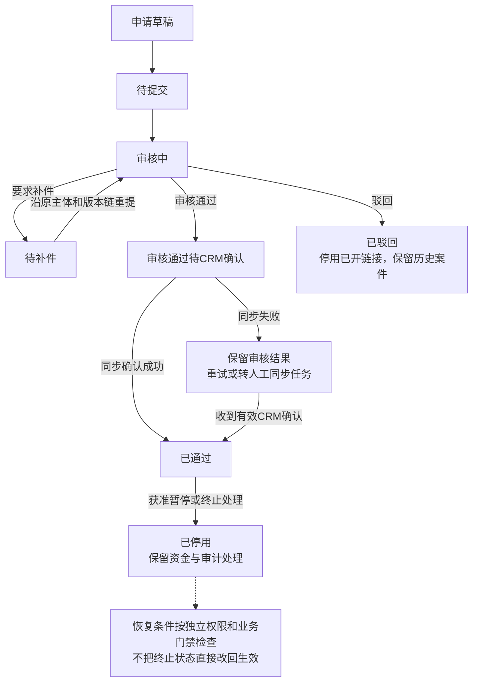
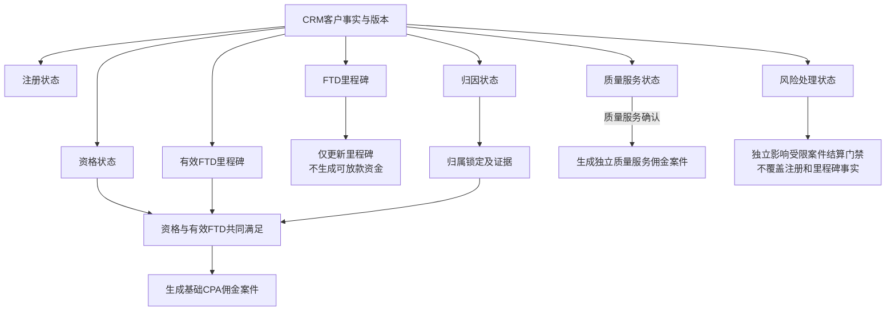
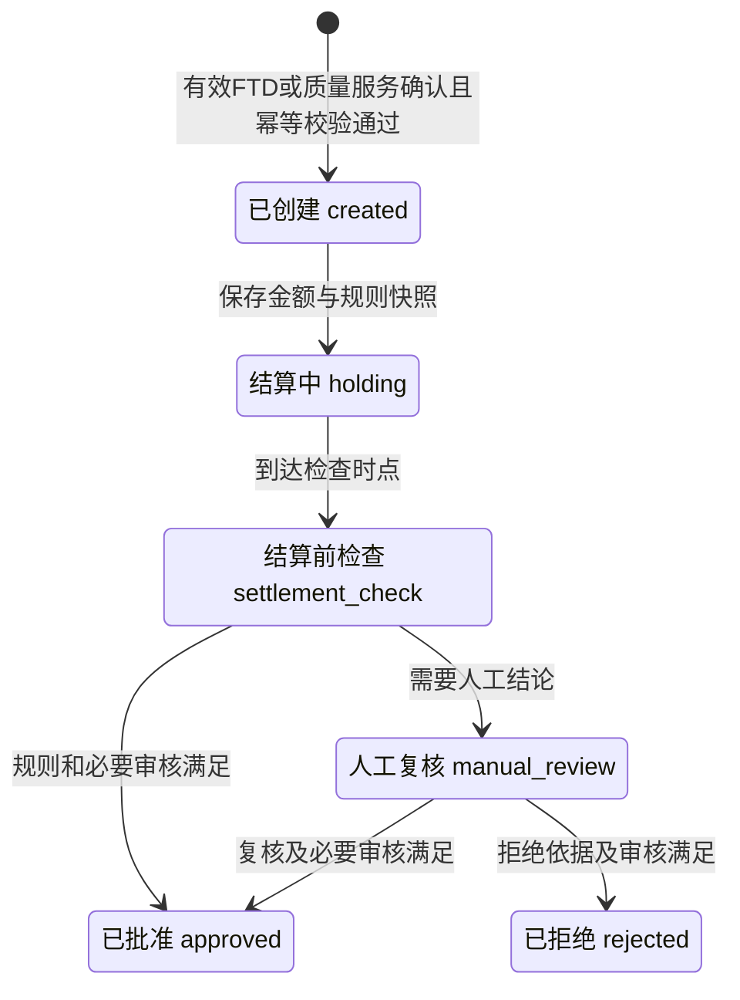
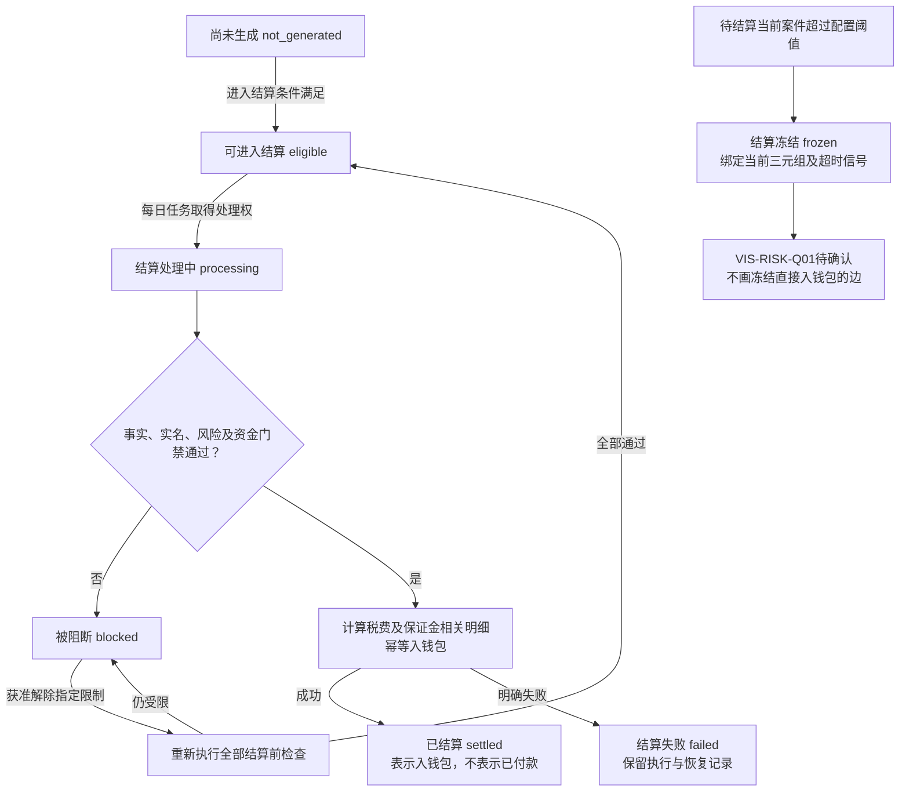
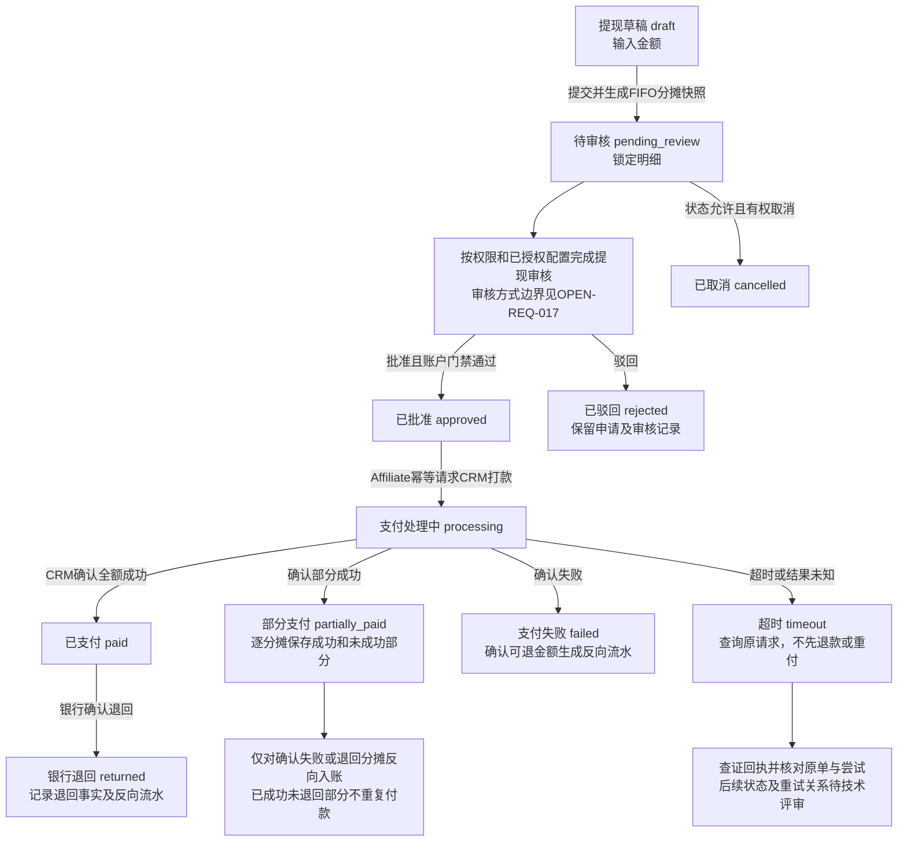
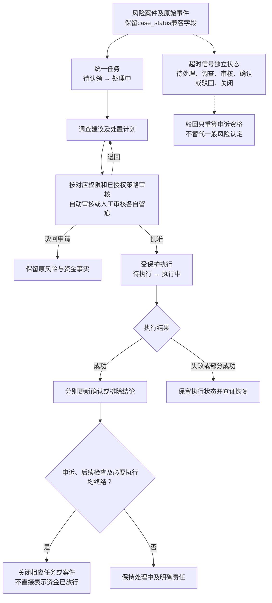
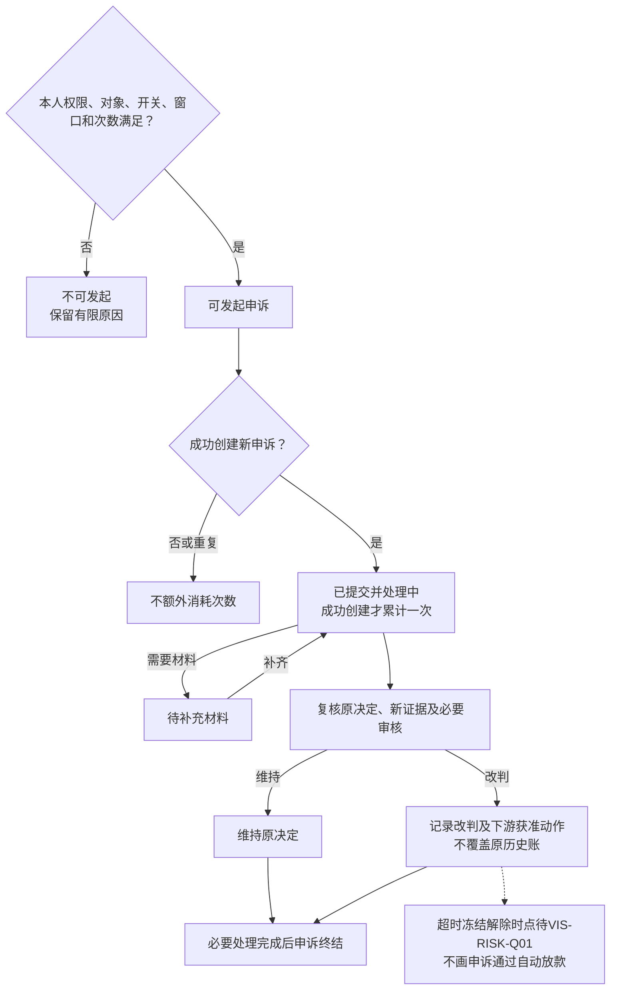

# 11 核心对象状态机 Mermaid预览

版本：v0.1预览稿。

状态：目标设计子集，待评审。七类对象分别绘制；不代表完整转换白名单、Schema已冻结或实现已完成。

字段以[状态字典v0.4第14节](../../评审资料包/基础资料/05-状态与原因码字典-v0.4.md)为现行资金依据。客户与申诉尚未定完整枚举时使用中文业务态；图中省略的边不代表允许任意跳转。

## 1. 合作者申请与合作状态

最新DEC-034要求申请、CRM确认、链接及资金资格分离，因此本图使用中文业务态，不把旧合作状态枚举冒充完整申请状态。

依据：[DEC-024、026、028、034](../../需求文档/09-决策与待确认事项-v0.1.md)。链接可用不等于身份、结算或提现资格通过；阶段开链另见注册/入驻流程。

## 2. 客户多维状态

依据：状态字典第14.2节、[需求03第2～5节](../../需求文档/03-业务规则与状态-v0.1.md)。质量服务失败不追回已成立基础CPA。

## 3. 佣金案件 CommissionCase

`reversed`、`clawed_back`也是现行枚举，但部分冲正、追索金额及允许来源状态尚需财务/技术细化，本图不虚构全部转换边。它们必须关联反向流水和原案件；`paid`不属于佣金状态。

依据：状态字典第14.3节、[接口第8A.1节](../../接口文档/Affiliate接口文档-v0.14-设计稿.md)。

## 4. 结算案件 SettlementCase

依据：状态字典第14.3/14.6节、[资金专题第2A节](../../评审资料包/基础资料/13-Affiliate佣金结算与资金时序图-v0.2.md)、[VIS-RISK-Q01](../待决事项.md)。重检不是重付；失败恢复的准确枚举映射待技术确认。

## 5. 提现 WithdrawalOrder

依据：状态字典第14.3/14.5节、接口第8A.3～8A.5节、FUND-04及DEC-032。终态不通过普通更新接口复活；未知与失败、银行退回分别处理。新订单/新尝试/原结算单的关系未在图中代定。

## 6. 风险案件 RiskCase及并行状态

依据：[风险页面第8～10节](../../历史版本/2026-11-05文档归档/2026-11-10页面规范迁移/原型/页面规范/风险工作台-页面契约-v1.0.md)、[风险数据契约第旧兼容映射](../../接口文档/Affiliate风险工作台页面数据契约-v1.0.md)、状态字典第14.7节。审批模式按最新DEC-032；旧专项不同人限定需回填，当前图不代造动作授权。

## 7. 申诉 Appeal

中文为业务阶段，不是新增`appeal_status`技术枚举。超时信号驳回前不可申诉；成功创建次数按当前结算案件累计，重复幂等请求不重置窗口。

## 8. 跨图核对

审批、执行、任务、风险、申诉、佣金、结算、提现均保存独立状态和引用。每次变化记录前后状态、原因、来源、规则版本、时间、幂等键与`trace_id`。

完整客户/申诉枚举、终态后尝试映射及IAM策略由技术和专业评审核验；真正业务待决见[VIS-RISK-Q01与第1A.19节](../待决事项.md)、[核验SBV-17/22](核验/服务蓝图核验台账.md)。

[返回文字绘图说明](11-状态机图.md)。
