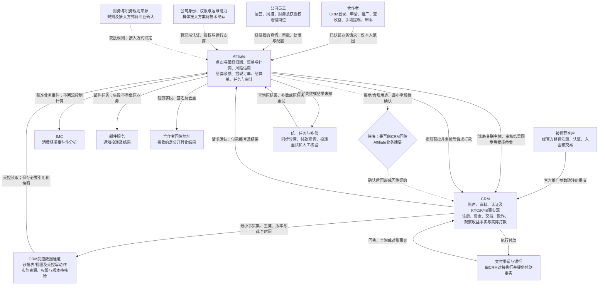

# 12 系统上下文图

版本：v0.1预览稿  
状态：基于现有业务资料的目标边界图，待技术评审；不代表外部系统已经联调通过。  
配套：[文字说明](12-系统上下文图.md)。

## 1. 系统与参与者

实线表示资料已明确的业务职责和目标数据方向，不表示已经实现。虚线连接待确认边界；CRM受控通道的实际表、视图、写入方式与协议仍须核验。

## 2. 本图不应误读的关系

- CRM是账户和认证事实源；Affiliate不新增本地密码体系，不本地执行KYC/KYB。
- CRM提供观察窗口及最终净贡献，Affiliate不重算最终净贡献；其他资格事实与结论的具体分工仍按SBV-12核验。
- 每日自动结算只形成可提现余额。图中指向CRM的付款线由手动提现及审批触发。
- CRM付款请求被接收，不等于实际付款成功；通知、IMC和回传成功也不能证明资金成功。
- 浏览器不直连CRM数据库，也不持有服务间密钥。可数据库直连不等于任意改写CRM原始事实。

## 3. 节点与来源

| 图中关系 | 依据 |
| --- | --- |
| P/C/E与A、CRM的职责 | [需求决策DEC-010/015至028](../../需求文档/09-决策与待确认事项-v0.1.md)；[CRM事实源清单§1至3](../CRM事件与数据/06-CRM事实源与注册归因能力完善清单-v0.1.md) |
| A→CRM→PAY及返回结果 | [接口v0.14§8A.3至8A.6](../../接口文档/Affiliate接口文档-v0.14-设计稿.md) |
| A→IMC/MAIL/PB | [事件文档§1、§6、§7](../../接口文档/事件流转综合文档-v0.10.md)；[文字说明§3至5](12-系统上下文图.md) |
| DB/IAM的数据及权限边界 | [安全治理§2至5](../../技术设计/Affiliate安全与数据治理设计-v0.1.md)；[CRM评审§11.1](../CRM事件与数据/05-CRM系统评审文档-v0.1.md#111-对接资料逐项补齐要求) |
| RET待决连接 | [活跃待决§1“CRM业务数据回传”](../待决事项.md)；同号实名议题不是本项 |

## 4. 待确认与核验

| 事项 | 为什么不能直接画成确定连接 | 处理位置及角色 |
| --- | --- | --- |
| CRM业务摘要是否回传、用于什么展示和合规用途 | 决定是否建设反向数据通道及共享哪些结果 | 原CRM业务回传议题；产品、CRM、合规 |
| 实际数据通道、登录协议、付款受理方式 | 已有职责方向不证明已有表、接口或生产权限 | [核验SBV-02/10/19](核验/服务蓝图核验台账.md)；CRM、后端、安全、财务 |
| 税费规则与接入方式 | 生产规则和外部依赖尚需专业签核 | SBV-18/24及财务评审，不代填服务商 |

