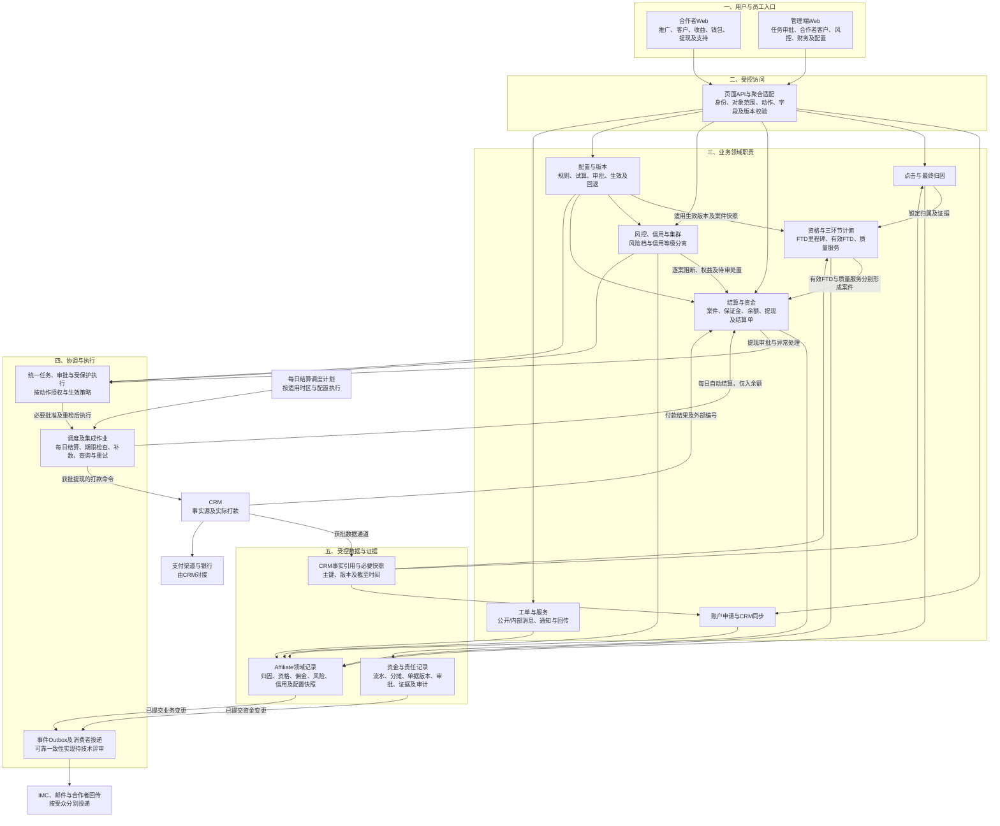
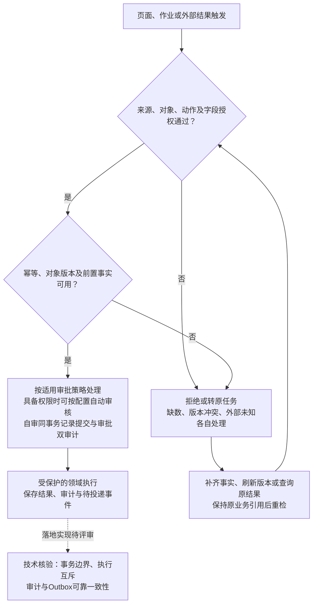

# 13 逻辑架构图

版本：v0.1预览稿  
状态：职责分层预览，待技术评审；框代表逻辑能力，不代表独立微服务、数据库选型或已部署组件。  
配套：[文字说明](13-逻辑架构图.md)。

## 1. 页面到领域及外部系统

## 2. 贯穿控制与失败恢复

审批策略依据最新DEC-032展示。与旧材料敏感双角色限制的差异，以及具体动作授权，按OPEN-REQ-017/SBV-22回填；本图不自行决定哪些人取得权限。缺少计佣输入时等待补数；集群、调查或结算关键缺数不能取消已有充分输入的佣金计算。

## 3. 来源对应

| 节点/关系 | 依据 |
| --- | --- |
| 入口、领域、执行、数据分层 | [文字说明§2至3](13-逻辑架构图.md)；[逻辑数据模型§1至3](../../技术设计/Affiliate数据模型与数据库设计说明-v0.1.md) |
| COMM→FUND及每日作业与CRM付款分离 | [接口§8A.1至8A.6](../../接口文档/Affiliate接口文档-v0.14-设计稿.md) |
| CFG、TASK与审批控制 | [最新DEC-022/023/027/032](../../需求文档/09-决策与待确认事项-v0.1.md) |
| AUTH/VER/WRITE/RETRY | [安全治理§3](../../技术设计/Affiliate安全与数据治理设计-v0.1.md)；[幂等规范§3至8](../../接口文档/Affiliate-API幂等重试超时与生命周期规范-v0.2.md)；[审计规范§5至6](../../技术设计/Affiliate日志traceId与审计字段规范-v0.1.md) |
| OUT与消费者独立性 | [事件§1、§7、§7A](../../接口文档/事件流转综合文档-v0.10.md) |

## 4. 技术评审保留项

- 组件如何合并部署、存储与队列选型、任务互斥及跨组件事务实现由研发确认，不在此新增技术选型。
- 配置项版本与发布包组织仍待确认，不据图认定“全系统只能一个生效版本”。
- CRM实际字段、资格结果分工及外部通道按SBV-10/12/19核验；IMC不是资格或计佣上游。
- 自动审核动作权限按OPEN-REQ-017细化；本图不是生产权限授权书。

