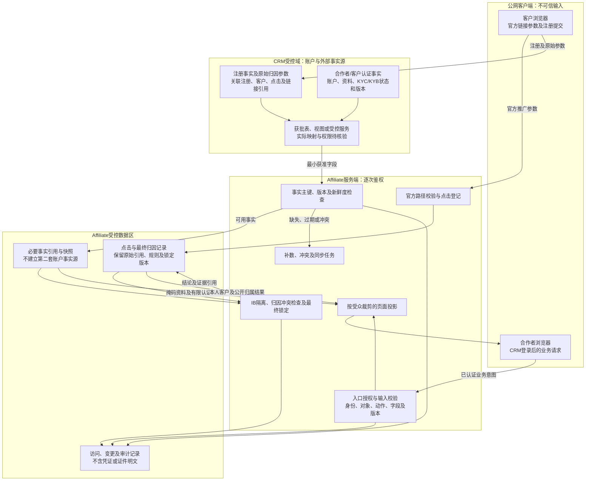
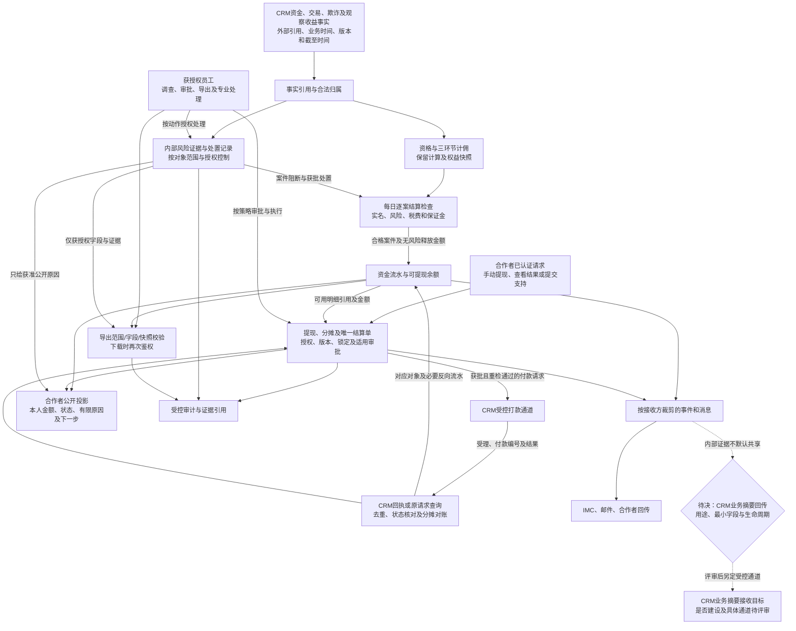

# 14 数据流图

版本：v0.1预览稿  
状态：数据用途与信任边界预览，待安全、CRM、财务和合规评审；不代表已获生产数据访问授权。  
配套：[文字说明](14-数据流图.md)。

## 1. 注册、认证与归因数据流

边框表示信任区域；跨区箭头标数据用途。原始事实与Affiliate结论分开保存，敏感原文不沿普通业务投影传播。

浏览器不连接数据库，不持有服务间凭证。客户认证在CRM执行；Affiliate保存认证引用、状态与审计，不将证件全文发送至合作者端。

## 2. 资金、风险及输出的数据流

图中最后一条CRM业务摘要线仅表示待决共享方向；若采用回传，必须另定目标通道与字段，不能复用打款请求负载或把内部风险证据装入付款命令。付款结果未知时先查询，不先退款或盲目重付。

## 3. 数据保护与来源

| 图中处理 | 来源与约束 |
| --- | --- |
| VIEW、READ、SNAP、LOCK | [CRM事实源清单§1至4、§7](../CRM事件与数据/06-CRM事实源与注册归因能力完善清单-v0.1.md)；实际物理字段待CRM确认 |
| 入口、受众裁剪、导出与审计 | [安全治理§2至8](../../技术设计/Affiliate安全与数据治理设计-v0.1.md)；[日志审计§5至7](../../技术设计/Affiliate日志traceId与审计字段规范-v0.1.md) |
| CALC、SET、WD、RES | [接口v0.14§8A](../../接口文档/Affiliate接口文档-v0.14-设计稿.md)；[本主题文字说明§3至6](14-数据流图.md) |
| 公开/内部消息与输出 | [事件文档§6至7A](../../接口文档/事件流转综合文档-v0.10.md)；[客户服务契约§3](../../接口文档/Affiliate管理端客户服务开发契约-v0.1.md) |

## 4. 待确认与核验

- CRM业务回传：沿用[活跃待决§1的CRM业务回传议题](../待决事项.md)，产品、CRM和合规确认是否需要及最小范围。
- 数据保留、导出有效期、跨境和共享依据：安全/合规专业签核，不把参考期限当生产值。
- 实际表/视图、资料和回执字段：SBV-02/08/10/19；未核验不据本图开放数据库权限。
- 资格事实与结果的生产方：SBV-12；CRM最终净贡献直接读取，不在本地重算。

