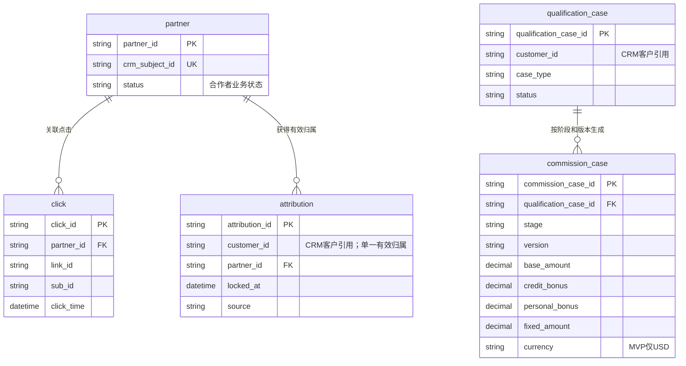
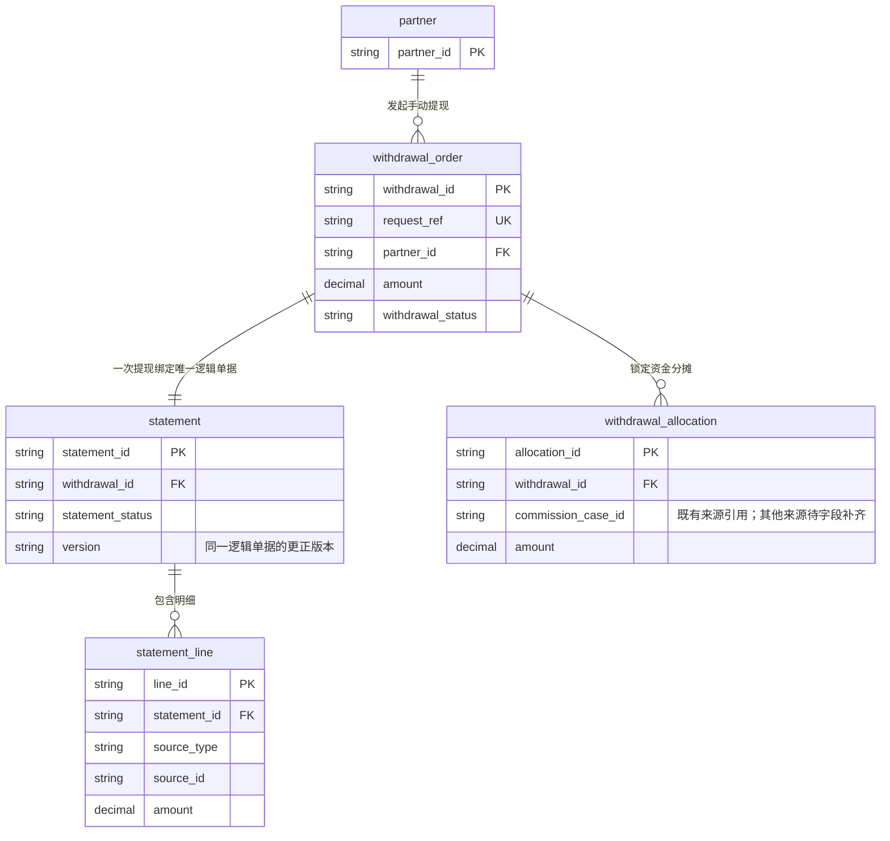
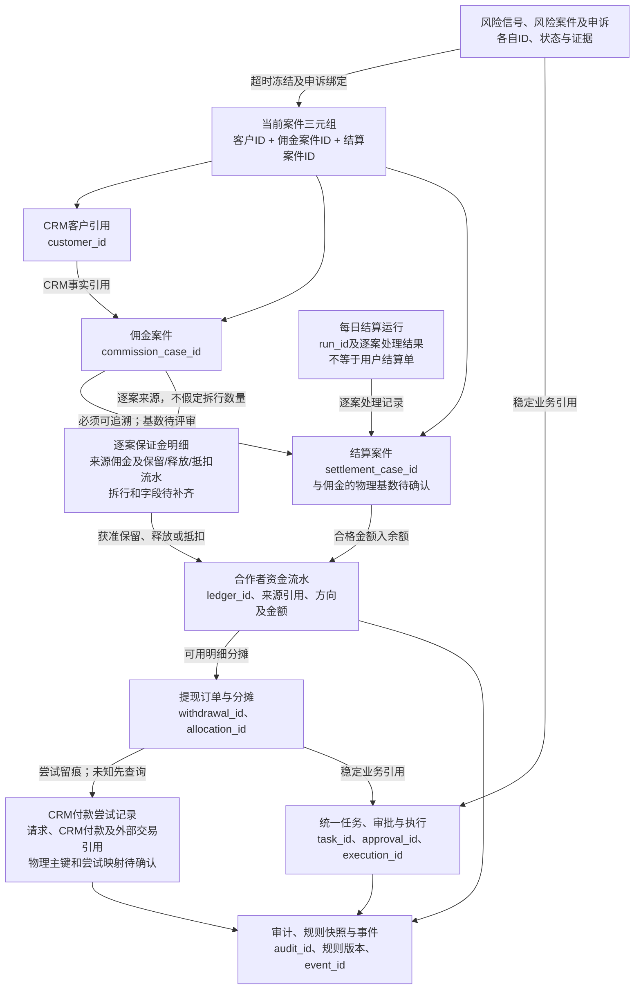
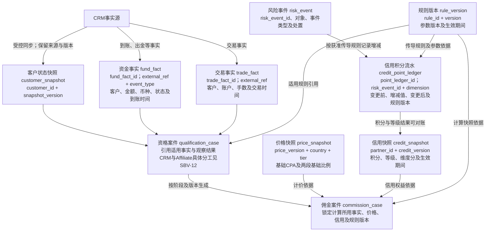

# 15 核心业务对象关系图

版本：v0.1预览稿  
状态：概念与逻辑关系预览，待数据库及领域评审；不是DDL、完整Schema或生产建表依据。  
配套：[文字说明](15-ER图.md)。

## 1. 合作者、归因与计佣的已有逻辑关系

实体名沿现有逻辑数据模型；中文关系是业务含义。`crm_subject_id`和`customer_id`引用CRM，不代表Affiliate拥有另一套客户账户事实。

图只表达有依据的关联和部分关键字段，未将点击与归因强制画成一对一。一个客户最多一个当前有效Affiliate归属，历史更正与锁定证据仍须保留；该约束不能解释为删除历史记录。

FTD仅里程碑；有效FTD承接基础CPA及FTD/有效FTD附加，质量服务另建奖励案件。资格输入和CRM提供结果的具体分工按SBV-12核验，不据实体名确定计算责任。

## 2. 提现与结算单的一对一逻辑关系

以下采用接口v0.14的新资金规则，覆盖旧数据模型“合作者+周期+版本生成结算单”的定义。资金精度、实际字段类型及完整物理键仍待技术评审。

这里的一对一是逻辑提现与逻辑结算单，版本链不新增另一张无关联单据。`withdrawal_id`唯一性及版本表的物理组织由后端回填，图中不代造复合主键。

## 3. 新资金对象与风控治理关联

对尚未冻结的基数使用关系图，不用确定的乌鸦脚表示。框中名称是当前业务逻辑对象，不是新增生产表名。

风险案件组、集群及合作者聚合维度不构成向其他佣金的级联冻结关系。付款尝试不能因原状态未知而新增实际支付。

## 4. CRM事实、价格与信用快照关系

下图补充已有模型中的计算依据和对账引用。箭头表达数据使用关系，不代替物理外键，也不把所有风险命中直接画成扣分。

CRM客户快照不成为另一套客户事实源；各实体的实际字段类型、增量版本及物理关联由技术评审确定。质量服务结果对合作者只展示获准结果，内部理由不因模型存在而自动开放。

## 5. 关系依据与未定边界

| 关系或约束 | 来源 |
| --- | --- |
| 合作者、点击、归因、资格与佣金 | [逻辑数据模型§3.1至3.3及§5](../../技术设计/Affiliate数据模型与数据库设计说明-v0.1.md) |
| CRM事实、价格与信用快照及积分流水 | [逻辑数据模型§3.2、3.3、3.5及§5](../../技术设计/Affiliate数据模型与数据库设计说明-v0.1.md)；字段只表达已有设计，执行与权限仍待评审 |
| 提现、结算单、分摊及更正 | [接口§8A.3至8A.5](../../接口文档/Affiliate接口文档-v0.14-设计稿.md)；[文字说明§2至5](15-ER图.md) |
| 分离资金对象及状态 | [状态字典v0.4§14](../../评审资料包/基础资料/05-状态与原因码字典-v0.4.md) |
| 风险、任务、积分及审计关系 | [逻辑数据模型§3.5至3.6](../../技术设计/Affiliate数据模型与数据库设计说明-v0.1.md)；[冻结粒度决策§1A.14](../待决事项.md) |

后端/数据库评审需补SettlementCase基数、逐案保证金外键、保证金来源分摊、付款尝试与终态重试、更正版本和资金并发约束；对应SBV-18至20。上下级分润制度仍为讨论稿，本图不新增生产分润实体或金额分配关系。

