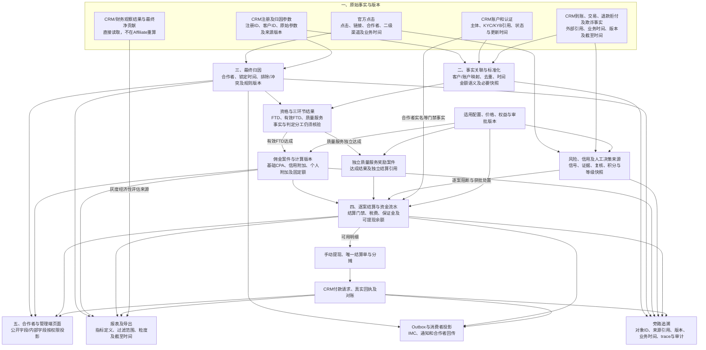
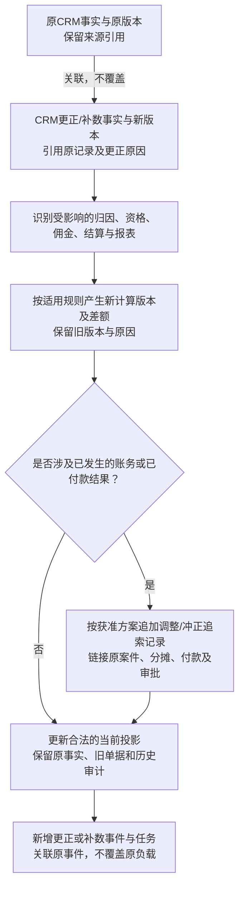

# 16 数据血缘图

版本：v0.1预览稿  
状态：业务结果来源预览，待数据、财务和风控评审；不声称存在生产血缘平台。  
配套：[文字说明](16-数据血缘图.md)。

## 1. 从原始事实到页面、报表与事件

箭头表示“结果依赖哪些来源”，不是任意数据访问授权，也不是服务调用时序。

FTD只留下里程碑，不生成可放款资金。有效FTD承接基础CPA和FTD/有效FTD两环节附加；质量服务额外另案，不阻塞基础CPA。三环节附加比例都以基础CPA价格为基准。

IMC是下游分析消费者，不是资格、计佣或放款的上游依据。CRM业务结果回传仍待决，不画成已生效的双向同步。

## 2. 更正、重算与资金调整的追溯

风险冻结、信号驳回或申诉结论变化，只能改变对应案件的风险/资金可用性结论，不能倒推CRM原始交易发生变化。结算超时案件按客户、佣金案件、结算案件三元组追溯。

## 3. 血缘锚点与来源

| 结果及图中节点 | 最少可反查来源与依据 |
| --- | --- |
| ATTR客户归属 | 点击、注册原参数、锁定规则；[CRM事实源清单§2至4](../CRM事件与数据/06-CRM事实源与注册归因能力完善清单-v0.1.md) |
| COMM/QCOMM佣金 | 资格事实、价格/权益/规则版本；[逻辑数据模型§3.3、§5](../../技术设计/Affiliate数据模型与数据库设计说明-v0.1.md) |
| SET/WD/PAY资金结果 | 原佣金、保证金流水、提现分摊、单据版本、CRM请求回执；[接口§8A](../../接口文档/Affiliate接口文档-v0.14-设计稿.md) |
| REPORT汇总与明细 | 指标定义、时间、去重键、范围、数据截至时间；[报表口径§1、§6、§9](../../技术设计/Affiliate报表指标口径与SQL映射-v0.1.md) |
| EVENT/AUD责任追溯 | 事件ID、来源对象、规则、trace及审计；[事件§7至7A](../../接口文档/事件流转综合文档-v0.10.md)、[审计规范§2及§5至8](../../技术设计/Affiliate日志traceId与审计字段规范-v0.1.md) |
| ECO观察经济性 | [DEC-012](../../需求文档/09-决策与待确认事项-v0.1.md)，CRM/财务提供窗口、最终净贡献及版本 |

## 4. 待核验

CRM实际字段及版本、资格事实/结论分工、质量服务结果来源和报表逐字段SQL血缘仍待责任团队确认，对应SBV-10至14。旧报表中的周期结算单税费等口径需要按接口§8A回填，不能因本图已有血缘线就宣称SQL与页面完全同源。保证金、终态后更正及付款尝试映射按SBV-18至20细化。

