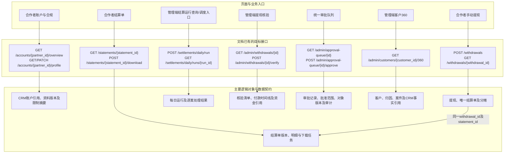
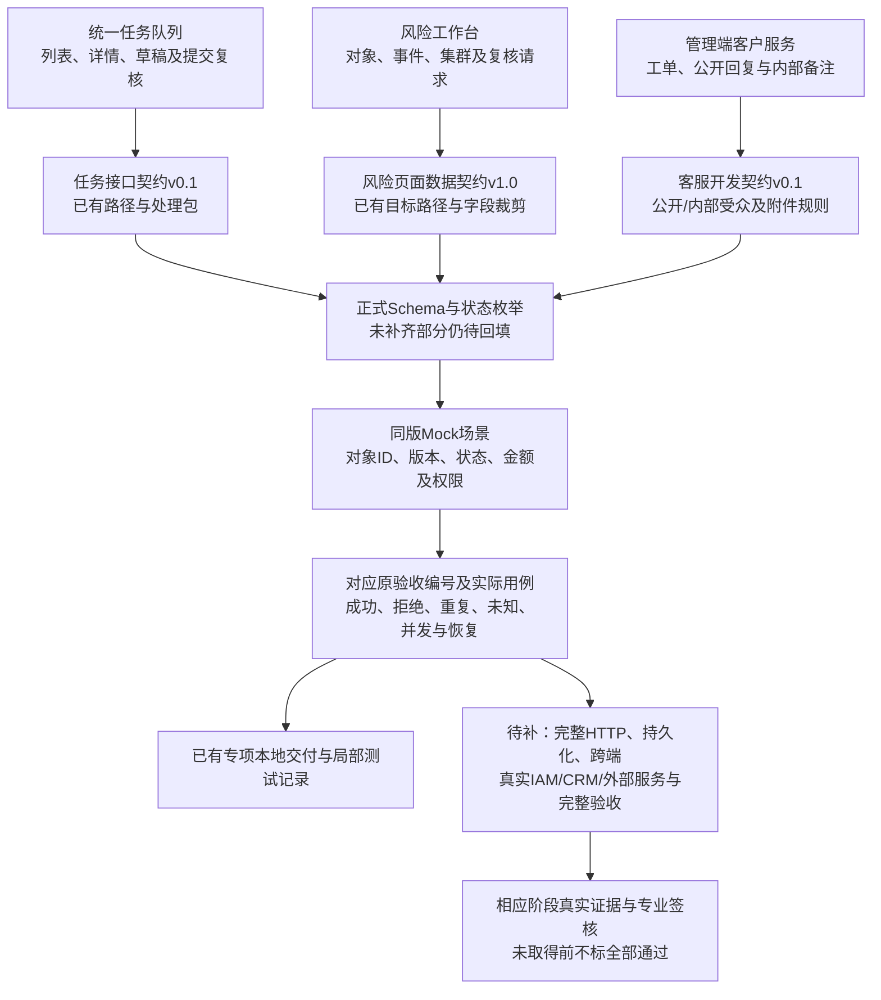
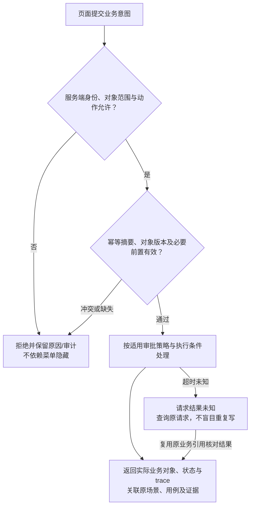

# 17 API与页面映射图

版本：v0.1预览稿  
状态：现有设计契约与证据追溯预览，待正式OpenAPI及同版实现核验；路径存在于文档不代表HTTP服务已经实现。  
配套：[文字说明](17-API与页面映射图.md)。

## 1. 页面到接口与逻辑对象

以下选取现有主契约中的关键路径，不声称覆盖全部页面/API。路径未额外补统一前缀；准确前缀及operationId待正式OpenAPI确认。

每日结算接口是调度/获授权管理能力，不表示合作者可以主动调用。月度结算单由自然月任务生成；提现只创建订单和分摊快照。审批动作授权与自动审核条件按最新DEC-032及OPEN-REQ-017处理，不沿用旧映射中的敏感自审拒绝作为本轮已定政策。

## 2. 专项页面与场景、测试和证据

第二图的连线表示应建立的追溯关系，不表示每条映射已逐项闭合。风险工作台、任务队列、客服已有局部Mock交付证据；完整AC、目标HTTP、持久化和真实外部验收仍按原专项记录追踪，不根据图中连线推定完成。

## 3. 每个写动作的验证关系

## 4. 来源及回填要求

| 图中接口/关系 | 来源 |
| --- | --- |
| A1账户资料 | [接口§6A.2](../../接口文档/Affiliate接口文档-v0.14-设计稿.md) |
| A2/A3/A4资金主链 | [接口§6A.3及§8A.2至8A.4](../../接口文档/Affiliate接口文档-v0.14-设计稿.md)，§8A优先 |
| A5/A6/A7管理端 | [接口§6B.1、§6B.2、§6B.5A](../../接口文档/Affiliate接口文档-v0.14-设计稿.md) |
| TC/RC/CC专项契约 | [任务接口](../../接口文档/Affiliate任务队列页面接口契约-v0.1.md)、[风险接口](../../接口文档/Affiliate风险工作台页面数据契约-v1.0.md)、[客服契约](../../接口文档/Affiliate管理端客户服务开发契约-v0.1.md) |
| SC/MOCK/TEST/LOCAL/GAP | [现有映射的状态声明](../研发准备/Mock与接口/Affiliate管理端OpenAPI与Mock映射-v0.6.md)、[全量测试矩阵](../测试验收/Affiliate全量测试用例矩阵-v0.1.md)、[证据总表§4至5](../核验/Affiliate原型与Mock评审证据总表-v0.1.md) |
| 写操作的权限、幂等与版本 | [生命周期规范§2至4A、§8](../../接口文档/Affiliate-API幂等重试超时与生命周期规范-v0.2.md)；[DEC-032](../../需求文档/09-决策与待确认事项-v0.1.md) |

最终逐项映射仍需关联当前路由、原需求/AC编号、准确operationId、Schema版本、Mock场景、实际用例和执行结果。旧tag到当前页面重映射、幂等Header命名差异及资金新增场景由前后端和测试确认；本图不新增虚构编号或统一Header结论。

