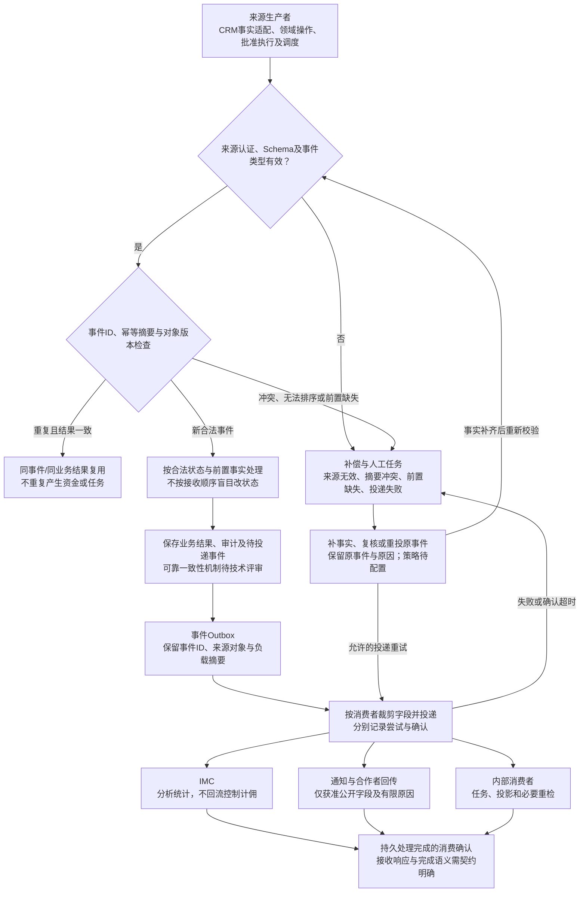
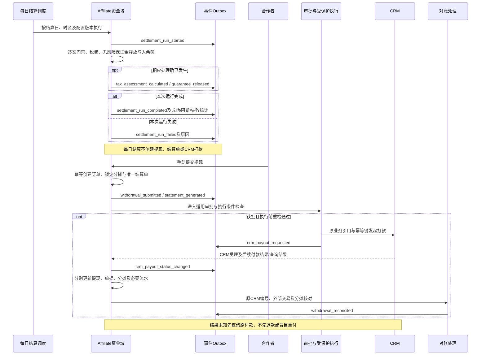
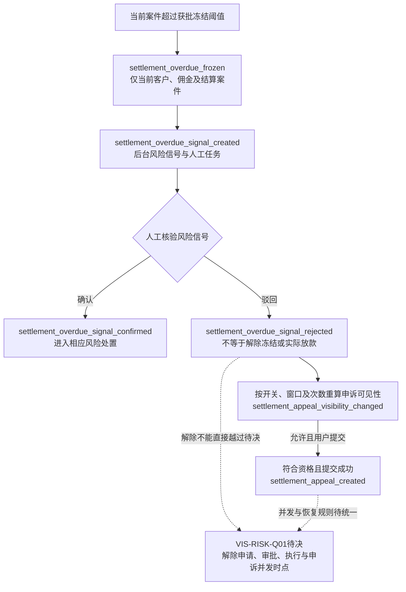

# 18 事件流转图

版本：v0.1预览稿  
状态：基于事件设计稿的处理与补偿预览，待Schema和消费者评审；不声明全部事件已实现。  
配套：[文字说明](18-事件流转图.md)。

## 1. 事件接收、业务处理与消费者投递

无效来源和业务拒绝不能因进入补偿节点就自动重试成功；需按原因处理。迟到更正、退回和拒付仍可作为合法新事实处理，不能简单因为“旧业务时间”就丢弃。

## 2. 自动结算、提现、CRM打款的事件时点

下图保留已有`event_type`，中文说明业务含义。事件名称来自设计稿，不证明对应JSON Schema或消费者已部署。

`withdrawal_submitted`与`statement_generated`是独立事件：前者为提现申请，后者为月度结算单生成或重算。CRM受理与实际付款结果是不同事实；`withdrawal_reconciled`是否有差异取决于对账结果，不能从事件发出推定金额已一致。

## 3. 风险与申诉事件的作用范围

所有上述超时事件保留案件三元组。合作者、二级渠道、国家和批次可作上下文或聚合维度，不能据此自动冻结其他案件。

## 4. 来源、锚点及待核验

| 图中处理或事件 | 来源 |
| --- | --- |
| 事件ID、幂等、Schema、字段受众及补数 | [事件§6至7](../../接口文档/事件流转综合文档-v0.10.md)；[幂等规范§3至8](../../接口文档/Affiliate-API幂等重试超时与生命周期规范-v0.2.md) |
| Outbox、任务与消费者投递 | [逻辑数据模型§3.5](../../技术设计/Affiliate数据模型与数据库设计说明-v0.1.md)；[本主题文字说明§2至5](18-事件流转图.md) |
| 自动结算、提现、单据与CRM付款事件 | [事件§7A](../../接口文档/事件流转综合文档-v0.10.md)，覆盖旧周期结算单触发；[接口§8A](../../接口文档/Affiliate接口文档-v0.14-设计稿.md) |
| 超时冻结及申诉事件 | [事件§4A](../../接口文档/事件流转综合文档-v0.10.md)；[待决事项§1A.12、§1A.14及VIS-RISK-Q01](../待决事项.md) |

每条事件需关联事件ID、类型、Schema版本、来源对象及版本、业务时间、数据截至时间、幂等键和trace；准确字段名按正式Schema统一，不另造Envelope。审批和执行关联原task/approval/execution及审计。

正式事件枚举与Schema覆盖范围、消费者确认语义、版本兼容、乱序处理、保留与重试策略由后端、CRM、IMC和测试确认。待回收成功、重复、乱序、未知类型、重投和资金重放金额不变证据；不把旧资料固定事件数量写成当前全量实现状态。

