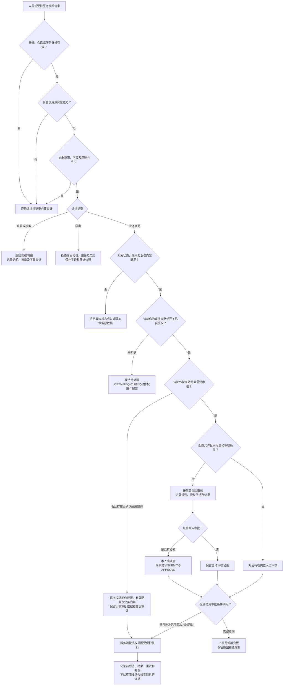
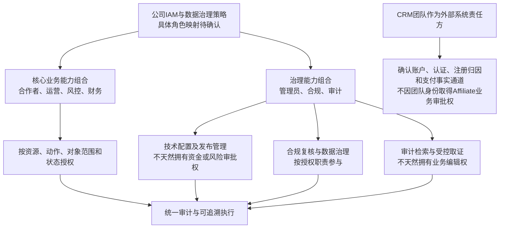

# 19 权限矩阵与授权流程 Mermaid预览

版本：v0.1预览稿。

状态：目标设计预览，待IAM及业务角色评审；不是已部署权限表或生产自动审核授权。

首期核心操作角色按DEC-010为合作者、运营、风控、财务。管理员、合规、审计等治理职责沿已有规范通过权限组合映射，准确IAM角色、能力码和数据范围待OPEN-REQ-005/016确认。

本预览按DEC-031/032更新管理端明细可见和自动审核方向；原文字说明中的旧自审限制不再概括为当前规则。

## 1. 角色、资源和动作

|资源或动作|合作者|运营|风控|财务|
|---|---|---|---|---|
|账户与CRM认证|本人查看及去CRM办理|协助与同步状态查看|按业务查看认证事实|核验资金所需认证事实|
|申请、补件和审核|本人申请、补件及看结果|处理申请、审核及CRM确认跟踪|风险协作|资金资格协作|
|客户收益及风险明细|本人获准脱敏范围|具备管理权限时完整查看并审计|具备管理权限时完整查看并审计|具备管理权限时完整查看并审计|
|链接与推广|本人按资格使用|审核、停链及紧急暂停发起|硬风险及限制判断|资金门禁不因开链而豁免|
|风险案件|按资格申诉和补证|协作、一般工单转办|调查、聚合、拦截及解除建议|资金影响复核与后续检查|
|佣金和结算|本人查看|查看及协作|风险拦截与解除建议|结算、放行、冲正与对账|
|提现|本人提交与跟踪|协助及任务转办|必要风险判断|对应权限审核、CRM打款协调及对账|
|灰度配置|无管理动作|提交配置|风险影响域审核|资金/结算影响域审核|
|跨域配置|无管理动作|有权提交|风险部分共同审核|资金部分共同审核|
|全量暂停恢复|看有限服务状态|暂停及恢复发起|确认风险解除|确认资金与对账正常|
|导出和下载|本人允许范围|具备对应权限并记录用途和范围|具备对应权限并记录用途和范围|具备对应权限并记录用途和范围|
|自动审核与自审|不自动获得管理审批能力|有对应审批权限且配置允许时适用|有对应审批权限且配置允许时适用|有对应审批权限且配置允许时适用|

“完整查看”遵循最新管理端方向，不代表任意导出、改资金或覆盖CRM事实；操作、字段/用途治理和访问审计仍需服务端控制。更详细字段边界沿OPEN-REQ-016细化，不把旧“仅部分查看”当作最新确认。

## 2. 服务端授权流程

身份通过不代表动作获准；服务账号、直连数据库和后台定时任务也只能执行其被授权范围，不能借技术身份跳过业务门禁。

“无需审批”仅适用于有明确规则依据的动作，例如已确认可由后台开关控制的收款账户/税务资料变更；不默认对所有业务变更提供关闭审批开关。依据为[当前主PRD](../Affiliate-MVP-PRD-v0.1-首轮完善稿.md)及[管理端重建底账财务资料审批决定](../页面设计/专项方案/Affiliate管理端重建功能底账-v1.3.md)。开关关闭也不豁免身份、范围、版本、资金及CRM事实源门禁。

## 3. 治理职责映射

## 4. 核心依据及拒绝场景

|图中规则|来源|必须检验的反例|
|---|---|---|
|核心角色及治理组合|[DEC-010](../../需求文档/09-决策与待确认事项-v0.1.md)、[原角色矩阵第1、9节](../../评审资料包/基础资料/06-角色权限矩阵-v0.2.md)|技术管理员无业务权限却审批、CRM团队身份越权|
|管理明细完整查看与审计|DEC-031、[需求07第1、2节](../../需求文档/07-权限、非功能与验收-v0.1.md)|有查看权却未记访问、把查看权当任意导出或修改权|
|配置自动审核及双审计|DEC-032、需求07第1.7项|无审批权限自审、配置未授权却自动同意、自审漏一条审计|
|风险/资金按影响域审核|需求07第1.3～1.6项、DEC-022|跨域只完成一个责任域即执行|
|恢复三方条件|DEC-033、需求07第1.8项|仅取消暂停标记即恢复，无风险及财务确认|
|服务端二次鉴权|需求07第3.2节|直接调用接口、伪造角色/allowed_actions、访问其他合作者数据|

最新需求允许具备权限时按配置自动审核，不等于默认给所有角色全部审批权。动作白名单、授权配置和旧材料回填见[OPEN-REQ-017](../../需求文档/09-决策与待确认事项-v0.1.md)、[待决事项第1A.19节](../待决事项.md)及[核验SBV-22](核验/服务蓝图核验台账.md)。

审计至少保留操作者、角色、动作、资源、原因、前后状态、配置版本、时间和`trace_id`；涉及提交、审批、执行及导出时保存各自关联编号。图示不能替代真实权限测试或岗位签核。

[返回文字绘图说明](19-权限矩阵图.md)。
