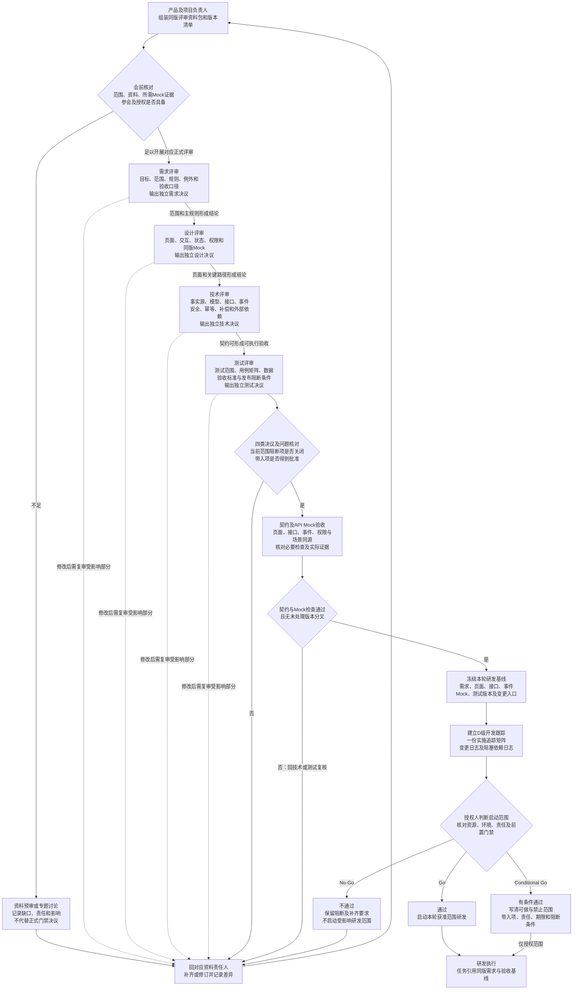
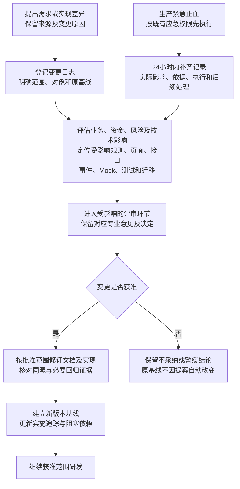

# 20 评审到研发门禁图

版本：v0.1预览稿  
状态：基于现有规范的流程表达，待项目负责人及各评审角色审阅；不代表本项目已通过任何门禁。  
对应：[绘制说明](20-评审到研发门禁图.md)。本图没有代填会议日期、真实签核人或启动结论。

## 1. 从资料准备到研发启动

按从上到下顺序阅读。技术方案、Mock和测试资料可以提前编制；下图表达门禁依赖，不要求所有准备工作串行开展。四类评审可合开会议，决议和签核分别保留。

图中的“是”是需要评审形成的条件，均不是当前已完成状态。未签核生产参数可先评审配置结构；不允许把Mock值作为生产值，或越过依赖该参数的生产门禁。

## 2. 冻结后变更与重新评审

紧急止血是既有生产变更例外，不是跳过常规研发启动审查的通道。所有生产变更按D级管理。

## 3. 节点与依据

| 图中范围 | 直接依据 | 解释边界 |
| --- | --- | --- |
| G01、G02、PRE | [四类评审手册§1、2、5](../../归档/根目录精简-2026-11-10/Affiliate四类评审执行手册-v0.3.md)、[当前证据总表§2、6](../核验/Affiliate原型与Mock评审证据总表-v0.1.md) | 资料可讨论与正式门禁通过分开；Mock局部证据不自动满足完整评审范围 |
| G03至G06 | [研发规范§4及评审相关细则](../协作规范/Affiliate研发流程与文档规范-v1.13.md)、[手册§2至4](../../归档/根目录精简-2026-11-10/Affiliate四类评审执行手册-v0.3.md) | 四类结论分别记录；不要求开发前写完所有自动化代码 |
| G07至G10 | [里程碑§2至3](../../归档/精简资料-2026-11-10/项目评审/项目与立项资料/08-项目里程碑与阶段门禁-v1.0.md)、[绘制说明§3至6](20-评审到研发门禁图.md) | 关键阻断关闭；带入项需获准，不能因写了责任人就默认可带入 |
| G11、GO、CG、NG | [里程碑§4](../../归档/精简资料-2026-11-10/项目评审/项目与立项资料/08-项目里程碑与阶段门禁-v1.0.md) | 由授权人形成真实启动结论，图不代签 |
| C01至C09、E01/E02 | [绘制说明§7](20-评审到研发门禁图.md)、[研发规范](../协作规范/Affiliate研发流程与文档规范-v1.13.md)的变更与生产管理规则 | 仅复审受影响部分，保留原始记录和版本关系 |

## 4. 尚需落实的事项

| 事项 | 为什么需要确认 | 责任与记录入口 |
| --- | --- | --- |
| 真实评审人、授权代表、启动批准人和会议时间 | 缺少真实授权无法形成有效签核；不能填模拟角色代替 | 项目负责人；[当前工作台NOW-07](../当前工作台.md)、[签核记录](../../归档/根目录精简-2026-11-10/Affiliate评审签核记录-v0.2.md) |
| 本轮正式评审范围及其完整证据 | 只看局部Mock不能推定整个系统通过；必要时先做专题讨论 | 产品、各评审角色；[正式评审包](../评审/Affiliate正式内部评审资料包-v1.0.md)及证据总表 |
| CRM、权限、资金未决项影响哪些契约 | 未解决的主链冲突不能借图冻结；按范围区分可继续工作与阻断项 | [服务蓝图核验SBV-12/17/18/19/20/22](核验/服务蓝图核验台账.md)、[活跃待决](../待决事项.md) |
| 生产参数及真实环境 | 配置结构、测试值与生产值适用门禁不同 | 业务、风控、财务、合规、CRM及运维，按原计划和专业签核关闭 |

Cellexpert公开报告及PRD影响处理结论继续是冻结输入；后台实测是后续补充，不新增为冻结阻断项。本图不以固定路由、页签或事件数量判定系统范围。
